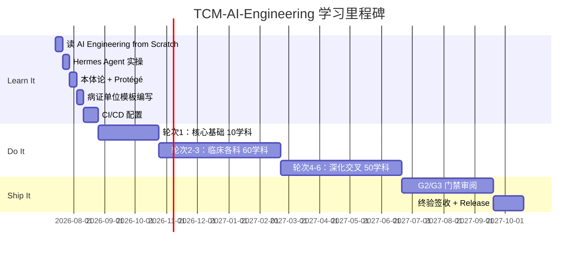

# TCM-AI-Engineering-from-Scratch
## 中医药系列教材 · AI 工程化编写实战计划

> **核心理念**：Learn it, Do it, Ship it  
> **目标**：以 AI Engineering 方法论完成 120 门中医药学科教材编写  
> **灵感**：[AI Engineering from Scratch](https://github.com/chiphuyen/ai-engineering-from-scratch) — Chip Huyen  
> **适配**：中医药知识工程 · 四层多智能体体系 · CI/CD 人机互动

---

## 一、项目总览

### 1.1 核心理念映射

```
"AI Engineering from Scratch"  →  "TCM-AI-Engineering"
         ↓                              ↓
  传统软件工程 + AI              中医药知识工程 + Multi-Agent
         ↓                              ↓
  Learn AI concepts             学习中医 AI 工程化方法
  Do hands-on projects          上手编写病证单位教材
  Ship production systems       交付 120 门可教学教材
```

### 1.2 项目定位

| 维度 | 传统教材编写 | TCM-AI Engineering |
|:----|:-----------|:------------------|
| **编写方式** | 人类逐字撰写 | Hermes Agent 主力 + 人类审校 |
| **版本管理** | Word 文档 + 邮件 | Git + GitHub + CI/CD |
| **质量控制** | 领域专家抽审 | G1/G2/G3 三级自动门禁 |
| **迭代速度** | 3-5 年/套 | 18 个月/120 门 |
| **可复现性** | 依赖个人经验 | 依赖本体论 + SOUL.md |
| **知识原子** | 章节 → 段落 | 病证单位（60,000+ 节点）|

### 1.3 团队架构（四层 × AI Engineering 角色）

```
┌─────────────────────────────────────────────────────┐
│             TCM-AI Engineering 团队                   │
├──────────┬──────────┬──────────┬──────────────────────┤
│    L1     │    L2    │    L3    │         L4          │
│ 行业主编  │ 领域主编  │ 学科主编  │     章节作者        │
│          │          │          │                      │
│ AI 架构师 │ AI 工程师 │ AI 开发者 │   AI 内容生产者     │
│  1人     │  8人     │ 120人    │  1,200人            │
└──────────┴──────────┴──────────┴──────────────────────┘
```

---

## 二、Learn It — 学习阶段（第 1-2 月）

### 2.1 团队学习路径

```
第1周：AI Engineering 基础
  ├── 课程：AI System Design (Chip Huyen)
  ├── 实操：Hermes Agent 安装与配置
  └── 产出：每位成员 Hermes --version

第2周：Hermes Agent 深度实操
  ├── 课程：Multi-Agent Orchestration
  ├── 实操：创建 Profile + SOUL.md + Kanban
  └── 产出：L1-L4 各创建一个 Agent Profile

第3周：本体论与知识工程
  ├── 课程：Ontology Theory + Protégé 实操
  ├── 实操：设计 D01 领域的 OWL 本体
  └── 产出：tcm-knowledge-universe.owl

第4周：病证单位范式
  ├── 课程：Disease-Syndrome Unit 编写规范
  ├── 实操：用双栏格式编写 3 个病证单位
  └── 产出：10 个标准病证单位 + 模板

第5-6周：CI/CD 人机互动
  ├── 课程：GitHub Actions + 质量门禁
  ├── 实操：配置 tcm-ci-cd.yml + 触发一次流水线
  └── 产出：绿色 CI 流水线运行

第7-8周：地域适应与季节调整
  ├── 课程：区域病证分布 + 季节教学法
  ├── 实操：编写南方 vs 北方的 L4 SOUL.md
  └── 产出：6 大地理分区 × 4 季的 L4 模板
```

### 2.2 学习成果验收

```yaml
learning_checklist:
  L1:
    - 能运行 hermes gateway + API Server
    - 能设计 OWL 本体文件
    - 能仲裁 L2 跨领域冲突
  L2:
    - 能配置领域看板 tcm-domain-DXX
    - 能编写领域 SOUL.md（含个人学术思想）
    - 能创建 Story 卡片
  L3:
    - 能使用 kanban create/task/complete
    - 能编写学科大纲 + 样章
    - 能运行 G2 质量门禁
  L4:
    - 能使用双栏病证单位模板
    - 能提交 PR 到 GitHub
    - 能根据地域调整内容比重
```

### 2.3 学习环境准备

```bash
# 每位团队成员初始化
hermes --version                          # 确认 Hermes 已安装
hermes profile create my-profile          # 创建个人 Profile
hermes doctor                             # 健康检查

# 项目目录
mkdir -p ~/tcm-learning/{notes,exercises,projects}
cd ~/tcm-learning
git init
git remote add origin git@github.com:beijingcdy/tcm-textbook-series.git

# 学习资源
# - AI Engineering from Scratch: https://github.com/chiphuyen/ai-engineering-from-scratch
# - Hermes Agent 文档: https://hermes-agent.nousresearch.com/docs
# - Protégé Ontology: https://protege.stanford.edu
# - OWL 2 入门: https://www.w3.org/TR/owl2-primer/
```

---

## 三、Do It — 实践阶段（第 3-12 月）

### 3.1 六轮次编写节奏

```
轮次 1-2（第3-4月）：核心基础（10 学科）
  ├── D01-S01 中医基础理论
  ├── D02-S01 临床中药学
  └── D03-S01 经络腧穴学
  → 每个学科 15 章，每章 3-5 个病证单位

轮次 3-4（第5-8月）：临床各科（60 学科）
  ├── D01-S13~S17 内科·外科·妇科·儿科
  ├── D05-S01~S12 骨伤学科群
  └── 高峰期：6 领域同时编写

轮次 5-6（第9-12月）：深化与交叉（50 学科）
  ├── D07-S01~S14 中医智能学院
  ├── D08-S01~S14 管理学院
  └── 终验前修订
```

### 3.2 每个 Sprint（2 周）的日常

```yaml
sprint_rhythm:
  day_1_mon:
    - L1: 签批本周编写的轮次计划
    - L2: 从看板领取 Story 分发给 L3
    - L3: 将 Story 拆解为 Task（每章 1 个）
    - L4: 从看板领取 Task
  
  day_2_4:
    - L4: Hermes Agent 自动编写（~30 分钟/章）
    - L4: 人类调整完善（~2 小时/章）
    - L4: 提交 PR 到 GitHub
  
  day_5:
    - L3: 审查 L4 提交的 PR
    - G2 门禁检查（≥85/100）
    - 驳回则 L4 修改，再提交
  
  day_6_9:
    - L2: 领域一致性审查
    - 跨域接口对齐
  
  day_10:
    - L1: 轮次进度评审
    - 签发下周编写令
    - 记录全局判例
```

### 3.3 "Do It" 实战命令

```bash
# L4 作者：从看板领取章节任务
hermes kanban boards switch tcm-domain-D01
hermes kanban take t_xxxxx

# Hermes Agent 编写草稿
hermes chat -q "请编写《中医基础理论》第2章阴阳学说，
包含以下病证单位：
1. 阴虚证（病侧：TGF-β信号通路 / 证侧：阴液不足）
2. 阳虚证（病侧：线粒体功能障碍 / 证侧：温煦失职）
3. 阴阳两虚证（病侧：能量代谢紊乱 / 证侧：阴阳互损）
使用双栏格式，每病证单位800-1000字。"

# 将输出保存为草稿
cat > drafts/D01-S01/chapter-02-yinyang-v1.md
# [粘贴 Hermes 输出]

# 提交 PR
git checkout -b feat/D01-S01-ch02-yinyang
git add drafts/D01-S01/chapter-02-yinyang-v1.md
git commit -m "feat(D01-S01): 第2章阴阳学说 v1
- 病证单位：阴虚/阳虚/阴阳两虚
- 双栏格式：病侧分子通路 + 证侧场论
- 字数：3,200 字"
git push origin feat/D01-S01-ch02-yinyang

# 在 GitHub 创建 PR → 触发 tcm-human-review.yml 工作流
```

### 3.4 质量门禁执行

```yaml
# .github/workflows/tcm-gate-G1.yml
name: "G1 作者自检门禁"
on: [pull_request]
jobs:
  quality:
    runs-on: ubuntu-latest
    steps:
      - uses: actions/checkout@v4
      - name: "G1 检查"
        run: |
          # 1. 病证单位完整性
          grep -c "病侧：" ${{ github.head_ref }} || exit 1
          grep -c "证侧：" ${{ github.head_ref }} || exit 1
          
          # 2. 字数检查
          wc -m ${{ github.head_ref }} | awk '$1 < 800 {exit 1}'
          
          # 3. 自检清单
          grep -c "\[x\] 自检完成" ${{ github.head_ref }} || exit 1
```

---

## 四、Ship It — 交付阶段（第 13-18 月）

### 4.1 交付物清单

```
├── 📚 教材（134 种）
│   ├── CM-01~CM-32  中医学院（28 学科）
│   ├── MM-01~MM-24  中药学院（20 学科）
│   ├── AT-01~AT-14  针灸学院（12 学科）
│   ├── TU-01~TU-10  推拿学院（10 学科）
│   ├── OR-01~OR-14  骨伤学院（12 学科）
│   ├── ENT-01~ENT-10 五官口腔（10 学科）
│   ├── AI-01~AI-16  中医智能（14 学科）
│   └── MG-01~MG-14  管理学院（14 学科）
│
├── 🔧 基础设施
│   ├── .github/workflows/    CI/CD 流水线
│   ├── profiles/             四层 Agent Profile
│   └── souls/                L1-L4 SOUL.md
│
├── 📊 看板
│   ├── tcm-epic              总控看板（8 Epic）
│   └── tcm-domain-D0*        8 个领域看板
│
└── 🏗️ 部署
    ├── 前端服务器（114.115.211.254:8000）
    ├── Hermes API（114.115.211.254:8642）
    └── Git 仓库（GitHub）
```

### 4.2 三阶段签收

```yaml
phase_1_review:
  who: "L3 学科主编"
  what: "每章逐字审阅 + G2 门禁"
  score: "≥85/100"
  duration: "2 日/章"
  
phase_2_audit:
  who: "L2 领域主编"
  what: "领域一致性 + 跨域接口"
  score: "≥92/100"
  duration: "3 日/学科"
  
phase_3_acceptance:
  who: "L1 行业主编"
  what: "宇宙归一化 + 战略符合度"
  score: "≥95/100"
  duration: "5 日/轮次"
  action: "签发《终验合格证》"
```

### 4.3 Ship 仪式

```bash
# 每轮次完成，L1 签发终验
echo "轮次 N 终验合格" > approved/round-N-certificate.md
git add approved/
git commit -m "ship: 轮次 N 终验通过 - $(date +%Y-%m-%d)"

# GitHub Release
gh release create v0.$(date +%Y%m%d) \
  --title "轮次 N 教材交付" \
  --notes "共交付 $(ls drafts/ | wc -l) 章"
```

---

## 五、CI/CD 完整流水线

### 5.1 流水线总图

```yaml
# .github/workflows/tcm-full-pipeline.yml
name: "TCM-AI-Engineering Pipeline"

on:
  push:
    branches: [master, feat/*]
  pull_request:
    branches: [master]
  schedule:
    - cron: "0 8 * * *"  # 每日报告

jobs:
  # ── Stage 1: Code → Agent 编写 ──
  agent_write:
    runs-on: ubuntu-latest
    steps:
      - name: "Hermes Agent 自动编写"
        run: |
          hermes chat -q "${{ github.event.head_commit.message }}"
          # → 输出到 drafts/

  # ── Stage 2: Integration → 自动检查 ──
  g1_quality:
    needs: [agent_write]
    runs-on: ubuntu-latest
    steps:
      - name: "G1 门禁：病证单位完整性"
        run: ./scripts/g1-check.sh
      - name: "G1 门禁：格式规范"
        run: markdownlint drafts/

  # ── Stage 3: Deploy → 部署看板 ──
  deploy_dashboard:
    needs: [g1_quality]
    runs-on: ubuntu-latest
    steps:
      - name: "同步到云服务器"
        run: |
          rsync -avz drafts/ root@114.115.211.254:/var/www/tcm-dashboard/

  # ── Stage 4: Monitor → 日进度报告 ──
  daily_report:
    if: github.event_name == 'schedule'
    runs-on: ubuntu-latest
    steps:
      - name: "生成进度报告"
        run: |
          echo "# 编写进度日报" > daily-report.md
          echo "已完成：$(find drafts/ -name '*.md' | wc -l) 章" >> daily-report.md
          echo "待审核：$(hermes kanban list --json | jq length) 卡" >> daily-report.md
```

### 5.2 人工介入点

| 流程节点 | 自动/人工 | 人做什么 |
|:---------|:--------:|:---------|
| G1 检查 | 🤖 自动 | — |
| G2 学科审核 | 👤 **人工** | L3 逐字审阅教材内容 |
| 跨域接口 | 🤖 自动 + 👤 确认 | L2 确认跨域依赖一致性 |
| G3 终验 | 👤 **人工** | L1 签发合格证 |
| 地域适配 | 🤖 自动 | 根据环境变量调整病证比例 |
| 季节调整 | 🤖 自动 | 根据系统日期选择教学重点 |

---

## 六、项目启动命令

### 6.1 首次初始化

```bash
# 1. 克隆项目
git clone git@github.com:beijingcdy/tcm-textbook-series.git
cd tcm-textbook-series

# 2. 创建学习分支
git checkout -b learn/ai-engineering-from-scratch

# 3. 安装 Hermes（每位成员）
curl -fsSL https://hermes-agent.nousresearch.com/install.sh | bash

# 4. 创建个人 Profile
hermes profile create team-member-$(whoami) --clone-from default

# 5. 创建 L1 主编 Profile
hermes profile create tcm-chief-editor --clone-from default
```

### 6.2 启动首次 Pilot（轮次 1：10 学科）

```bash
# 创建 D01-S01 中医基础理论的 15 章编写任务
hermes kanban boards switch tcm-domain-d01
for ch in \
  "编写第1章：中医药学导论" \
  "编写第2章：阴阳学说" \
  "编写第3章：五行学说" \
  "编写第4章：藏象学说" \
  "编写第5章：精气血津液神"; do
  hermes kanban create "$ch" --assignee tcm-author
done

# 启动 Gateway Dispatcher
hermes gateway start

# 60s 后验证
sleep 90
hermes kanban list
# 应看到 running 状态 → Agent 正在自动编写
```

---

## 七、度量指标

### 7.1 关键结果（KRs）

| 指标 | 当前 | 目标 | 测量方式 |
|:----|:---:|:----:|:---------|
| 编写速度 | ~1 章/天 | 5 章/天 | Kanban done/天 |
| 病证单位 × 教材 | 0 | 60,000+ | `grep -r "病侧" drafts/*.md | wc -l` |
| G1 通过率 | — | ≥ 95% | GitHub Actions |
| 人类审校时间 | — | ≤ 2h/章 | 看板 in_review → done |
| CI/CD 绿跑率 | — | ≥ 90% | Actions 统计 |
| 地区适配覆盖率 | — | 6/6 分区 | SOUL.md 检查 |

### 7.2 学习曲线验收



---

## 八、快速启动指南

### 第一步：团队注册 GitHub

```bash
# 每位成员
git config --global user.name "你的名字"
git config --global user.email "你的邮箱"
```

### 第二步：克隆 + 学习

```bash
git clone git@github.com:beijingcdy/tcm-textbook-series.git
cd tcm-textbook-series
git checkout -b learn/ai-engineering
# 开始读 README.md → 按 Learn It 路径学习
```

### 第三步：第一个 "Do It"

```bash
# 写你的第一个病证单位
cat > exercises/my-first-dsu.md << 'EOF'
# 病证单位：阴虚证

## 病侧（西医）
- **分子靶点**：TGF-β/Smad 信号通路
- **基因**：TGFB1, SMAD2, SMAD3
- **病理机制**：细胞外基质过度沉积 → 组织纤维化
- **诊断标准**：血清 TGF-β1 ↑, 影像学显示组织萎缩

## 证侧（中医）
- **证候**：形体消瘦、口燥咽干、潮热盗汗
- **病机**：阴液不足 → 虚热内生
- **经典依据**：《素问·阴阳应象大论》"阴胜则阳病"
- **方药**：六味地黄丸（熟地、山茱萸、山药、泽泻、丹皮、茯苓）

## 双栏对应
| 病侧 | 证侧对应 |
|:----|:---------|
| TGF-β ↑ | 虚火内生 |
| 组织纤维化 | 阴虚不荣 |
| 能量代谢 ↓ | 形体消瘦 |
EOF

echo "✅ 你的第一个病证单位已创建！"
```

---

> **项目名称**：TCM-AI-Engineering-from-Scratch  
> **核心理念**：Learn it, Do it, Ship it  
> **总周期**：18 个月（2026.07 - 2028.01）  
> **总产出**：120 门学科 × ~15 章 = **~1,600 章教材**  
> **执行引擎**：Hermes Agent Multi-Agent System  
> **版本管理**：GitHub + CI/CD  
> **公开访问**：http://114.115.211.254:8000
