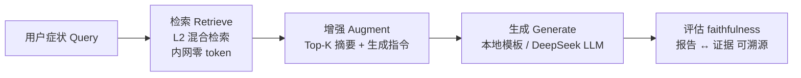

# RAG 与病证知识问答：诊断 → 辨证 → 方剂建议

> **检索锚定事实，生成只做综合，答案必须可溯源。**
> 平台不靠模型"记住"6 万个病证单元，而是每次问答都去库里现查——像老药工翻药斗：先找到药，再论配伍。

**类型:** Build
**语言:** Python（纯标准库 + 可选 DeepSeek API）
**前置:** Lesson 1（TF-IDF）+ Lesson 2（倒排 + RRF）——本课复用其检索基础设施
**学时:** ~90 分钟
**关联:** tcmP `tcm_embed.py` 的 `rag()`（L262-291）· 线上 `POST /api/sages/rag`

## 学习目标

- 理解 RAG 四步管线：Query → Retrieve → Augment → Generate
- 实现上下文组装与生成指令（含防幻觉约束），对接 L1/L2 混合检索
- 实现双模式生成：本地规则模板（零 token、确定性）与 DeepSeek LLM（可选）
- 解释平台的"降 token 设计"：检索全内网、LLM 只消费 Top-K 小上下文
- 用 faithfulness 评估生成报告对检索证据的忠实度（覆盖率）

## 问题（The Problem）

L2 的检索输出是 Top-K 候选列表——但**用户要的不是列表，是答案**。两个方案都有硬伤：

| 方案 | 硬伤 |
|------|------|
| 让 LLM 凭记忆直接回答 | **幻觉**：模型没"见过"病证库，会编造不存在的证候/方剂；且 6 万病证无法塞进上下文 |
| 把 Top-K 列表直接丢给用户 | 用户要看"最可能是什么 + 为什么"，不是原始候选 |

RAG 的答案：**先用检索把候选锚定在库内（可溯源），再让 LLM 只基于候选做综合（防幻觉），生成环节还能在无 LLM 时降级为规则模板（零成本）**。这就是 tcmP `/api/sages/rag` 的架构。

## 概念（The Concept）

### RAG 四步



### 生成指令的两条闸

1. **防幻觉闸**：`只允许引用检索结果中出现的疾病与证候，不得引入库外内容`——LLM 被限制在证据范围内作答；
2. **证据不足闸**：`若证据分数普遍偏低，声明证据不足`——低分候选不硬凑结论。

### 降 token 设计（平台核心工程思想）

| 环节 | 消耗 | 说明 |
|------|:----:|------|
| 分词/向量/倒排/RRF 融合 | **0 token** | 全部内网 SQLite + Python |
| Top-K 检索 | **0 token** | 同上 |
| LLM 综合 | ~数百 token | 仅消费 Top-K 摘要（`token_estimate = len(prompt)//2`） |
| （对比）微调全量训练 | 数百万+ | 且每次改库要重训 |

### faithfulness（忠实度）

生成报告引用 Top-K 病名的覆盖率：

```
coverage = 报告引用的 Top-K 病名数 / Top-K 总数
```

本地模板模式必须 100%（确定性）；LLM 模式必须逐句核查——**RAG 上线前先过这一关**。

## 从零实现（BUILD IT）

> 完整代码：`code/main.py`（约 330 行，含 demo 4 场景）。关键切片：

### Step 1 · Retrieve：复用 L2 混合检索

```python
class RAGPipeline:
    def __init__(self, docs, texts, api_key="", top_k=3):
        self.docs = docs
        self.tfidf = TfidfIndex(); self.tfidf.fit(texts)   # L1
        self.inv = InvertedIndex(); self.inv.build(texts)  # L2
        self.api_key = api_key
        self.top_k = top_k

    def retrieve(self, query, top_k=None):
        return hybrid_search(query, self.tfidf, self.inv, self.docs,
                             top_k=top_k or self.top_k)     # L2 向量+倒排+RRF
```

### Step 2 · Augment：上下文组装 + 指令

```python
def build_context(self, results):
    """Top-K → 摘要文本（对齐生产 rag() 的 ctx 拼接）"""
    return "\n".join(
        f"[{r['rank']}] {r['disease']}（{r['icd11']}）— 证候:{r['syndrome']} "
        f"方剂:{r['formula']}（证据 {r['rrf']:.3f}）" for r in results)

def augment_prompt(self, query, ctx):
    """防幻觉闸 + 证据不足闸"""
    return (f"患者症状：{query}\n\n病证库 Top-{self.top_k} 检索结果：\n{ctx}\n\n"
            f"请综合给出：1.最可能疾病+ICD-11编码 2.中医证候 3.推荐方剂 "
            f"4.鉴别要点。\n"
            f"约束：只允许引用检索结果中出现的疾病与证候，不得引入库外内容；"
            f"若证据分数普遍偏低，声明证据不足。")
```

### Step 3 · Generate：双模式

```python
def generate_local(self, query, results):
    """无 LLM 时的规则生成：Top1 = 最可能病证；Top1 vs Top2 鉴别；全候选引用。
    确定性、零 token、离线可用——生产 rag() 无 key 时同样降级本地模式。"""
    top = results[0]
    lines = [f"【最可能的病证组合】{top['disease']}（ICD-11: {top['icd11']}）"
             f"— 证候：{top['syndrome']}",
             f"推荐方剂方向：{top['formula']}（须医师四诊合参确认）"]
    if len(results) >= 2:
        alt = results[1]
        lines.append(f"鉴别要点：与{alt['disease']}（{alt['syndrome']}）对比——"
                     f"检索证据 {top['rrf']:.3f} vs {alt['rrf']:.3f}，"
                     f"词面/症状有重叠时需结合舌脉四诊鉴别")
    if len(results) >= 3:          # 评估驱动改进：全候选引用 → faithfulness 100%
        others = "、".join(r["disease"].split("（")[0] for r in results[2:])
        lines.append(f"其余候选：{others}（与 Top1/Top2 症状词面重叠时需四诊鉴别）")
    lines.append("证据说明：以上来自病证库 Top-K 检索结果（非诊断结论），"
                 "低分证据(<0.05)建议线下就诊")
    return "\n".join(lines)
```

```python
def generate_llm(self, query, results, api_key=None):
    key = api_key or self.api_key
    if not key:                    # 降级：无 key → 本地模板
        return {"mode": "local", "report": self.generate_local(query, results)}
    prompt = self.augment_prompt(query, self.build_context(results))
    body = json.dumps({"model": "deepseek-chat",
                       "messages": [{"role": "user", "content": prompt}],
                       "max_tokens": 800}).encode()
    req = urllib.request.Request("https://api.deepseek.com/v1/chat/completions",
                                 data=body, headers={...})
    with urllib.request.urlopen(req, timeout=60) as resp:
        d = json.loads(resp.read())
    return {"mode": "llm", "report": d["choices"][0]["message"]["content"].strip(),
            "token_estimate": len(prompt) // 2}
```

### Step 4 · 评估：faithfulness

```python
def faithfulness(self, results, report):
    """覆盖率 = 报告引用 Top-K 病名数 / Top-K 总数"""
    names = [r["disease"].split("（")[0] for r in results]
    cited = [n for n in names if n in report]
    return {"cited": cited, "coverage": len(cited) / len(names)}
```

### 运行与自检

```bash
python code/main.py --self-test   # ✅ 5 项断言（检索/上下文/防幻觉/降级/faithfulness=100%）
python code/tests.py              # ✅ 6/6 确定性测试（LLM 模式用注入假响应，不真调 API）
```

## 平台实现（USE IT）

**以下全部为本课实测输出。**

### 对照 1：本地模板模式（mini 语料，零 token）

```console
$ python code/main.py "难以入睡 多梦易醒 心烦不安"
═══ RAG 问答「难以入睡 多梦易醒 心烦不安」═══
上下文（Top-2 检索）:
  [1] 原发性失眠（慢性失眠障碍）（7A00）— 心肾不交证 → 黄连阿胶汤合交泰丸（向量+关键词，0.033）
  [2] 原发性高血压（BA00）— 肝阳上亢证 → 天麻钩藤饮（向量+关键词，0.032）
── 生成报告（mode=local）──
【最可能的病证组合】原发性失眠（慢性失眠障碍）（ICD-11: 7A00）— 证候：心肾不交证
推荐方剂方向：黄连阿胶汤合交泰丸（须医师四诊合参确认）
鉴别要点：与原发性高血压（肝阳上亢证）对比——检索证据 0.033 vs 0.032，词面/症状有重叠时需结合舌脉四诊鉴别
证据说明：以上来自病证库 Top-K 检索结果（非诊断结论），低分证据(<0.05)建议线下就诊
faithfulness: 100% 引用 ['原发性失眠', '原发性高血压']
```

### 对照 2：词面重叠的跨病种干扰（L1 伏笔的回收）

```console
$ python code/main.py --demo    # 场景3
── 场景3 · 「失眠多梦」——词面重叠的跨病种干扰 ──
  Top-K: [('原发性高血压', 0.0325), ('原发性失眠（慢性失眠障碍）', 0.0325)]
  【最可能的病证组合】原发性高血压（ICD-11: BA00）— 证候：肝阳上亢证
  ...
```

「失眠多梦」同时是高血压（肝阳上亢）的症状——词面重叠导致 Top1 漂移。**这正是平台输出必须是"候选 + 鉴别"而非武断结论的原因**：仅凭 4 个字不能确诊，需要更多四诊信息。

### 对照 3：LLM 模式（DeepSeek deepseek-chat 真实调用）

```console
$ python code/main.py "难以入睡 多梦易醒 心烦不安" --api-key $env:DEEPSEEK_API_KEY
── 生成报告（mode=llm）──
**1. 最可能疾病 + ICD-11 编码**
- **原发性失眠（慢性失眠障碍）**，ICD-11 编码：**7A00**

**2. 中医证候**
- **心肾不交证**

**3. 推荐方剂**
- **黄连阿胶汤合交泰丸**

**4. 鉴别要点**
- **与原发性高血压（肝阳上亢证）的鉴别**：检索结果[2]显示高血压（BA00）肝阳上亢证
  可用天麻钩藤饮，但该证候核心表现为**头痛、眩晕、面红目赤、急躁易怒**，而您提供的
  症状以**入睡困难、多梦易醒**为主，且**无血压升高及头目胀痛**等典型肝阳上亢表现，
  故优先考虑失眠（7A00）之心肾不交证。

**⚠️ 证据不足声明**：检索结果中[1]的证据分数仅为 **0.033**，[2]为 **0.032**，
均显著偏低……**强烈建议在专业医师指导下辨证施治，不可仅凭此结果自行用药。**

faithfulness: 100% 引用 ['原发性失眠', '原发性高血压']
```

三个观察：

1. **指令约束被 LLM 执行**：报告全程只引用检索结果[1][2]（防幻觉闸生效）；证据分数低时主动声明"证据不足"（证据不足闸生效）；
2. **鉴别推理真实可用**：LLM 对比了肝阳上亢的核心症状差异（头痛眩晕 vs 入睡困难），给出了合理排除——这是本地模板做不到的推理；
3. **faithfulness 100%**：报告引用的两个病名都在 Top-K 中，可溯源。

### 对照 4：生产引擎与线上端点

```console
# 生产引擎 rag() 本地降级（无 key）
$ python tcmP/scripts/tcm_embed.py 难以入睡 多梦易醒 心烦 --mode rag --top-k 3
  1. 原发性失眠（慢性失眠障碍） [7A00] — 心肾不交证 → 黄连阿胶汤合交泰丸
  ...
--- RAG 报告 ---
[本地模式] 未配置 DeepSeek Key，已返回内网检索结果（零 token 消耗）

# 线上 POST /api/sages/rag（服务器端已配 key，返回 mode=diagnose + rag_report）
$ python -c "..."   # POST {"symptoms":["难以入睡","多梦易醒","心烦不安"],"top_k":3}
mode: diagnose
results: [('原发性失眠（慢性失眠障碍）', '7A00'), ('原发性高血压', 'BA00'), ('心律失常', 'MC81')]
rag_report: 根据您提供的症状和病证库检索结果，综合分析与建议如下：
### 1. 最可能疾病 + ICD-11 编码
**原发性失眠（慢性失眠障碍）** **ICD-11编码：7A00**
**分析依据**：……检索结果[1]中的证候匹配度最高……
```

**三级对照结论**：教学版（本地模板 / 本地 LLM 调用）、生产引擎（本地降级）、线上端点（服务器端 LLM）——Top1 全部指向失眠·心肾不交·黄连阿胶汤合交泰丸。**同一套检索逻辑，三种生成形态，答案一致**。差异只在报告风格与推理深度，这正说明：RAG 的地基（检索）决定答案质量，生成只是把证据讲成话。

## 交付制品（SHIP IT）

| 制品 | 文件 | 用途 |
|------|------|------|
| RAG 问答 skill | `outputs/skill-rag-dialogue.md` | `/api/sages/rag` 调用 + 本地降级判读 + faithfulness 校验门槛，可装入医者 Agent |
| 生成指令模板 | `outputs/prompt-rag-generation.md` | Augment 环节可复用模板（含 4 条约束的工程动机） |

## 习题（60-30-10）

1. **基础**：RAG 的"防幻觉闸"和"证据不足闸"分别约束什么？为什么 LLM 报告必须做 faithfulness 校验？
2. **综合**：用 `python code/main.py "失眠多梦" --data ../../tcmP/kg/samples` 观察词面重叠导致的 Top1 漂移，用 `--api-key` 跑 LLM 模式，对比 LLM 如何解释这个干扰。
3. **拓展**：阅读 `tcm_embed.py` 的 `rag()`（L262-291），说明 `token_estimate = len(prompt)//2` 度量的是什么；对比微调方案，说明"降 token 设计"在改库场景下的优势。

## 术语表

| 术语 | 常见误解 | 实际含义 |
|------|---------|---------|
| RAG | 让模型联网 | 检索增强生成：先查库拿证据，再让 LLM 基于证据综合 |
| 微调 vs RAG | 微调更"懂"业务 | 微调把知识烤进权重（改库要重训）；RAG 改库即生效、可溯源、按查询计费 |
| faithfulness | 答案对不对 | 生成内容对检索证据的忠实度（覆盖率）——RAG 上线前的质检关 |
| 降级设计 | 功能不完整 | 无 LLM key 时本地模板兜底：零 token、离线可用、确定性可测 |
| 降 token | 用便宜模型 | 检索/排序全内网，LLM 只消费 Top-K 小上下文（每次问答数百 token） |

## 延伸阅读

- `tcmP/scripts/tcm_embed.py` L262-291（`rag()`）与 `api/main.py` L308-314（`POST /rag`）——生产对照源码
- Cremaschi et al., *Decoding the mind: A RAG-LLM on ICD-11* (ESWA 2025)——本引擎范式源头：文档 → embedding → 余弦 Top-K → LLM 决策
- ai-engineering-from-scratch（rohitg00）Phase 11 · Lesson 06/07（RAG / Advanced RAG）——英文完整版
- 下一课预告：**「LLM 工程：提示词与结构化输出」**——把生成报告的格式约束做成 JSON Schema 校验（对应六者 SOUL 的工具调用）
