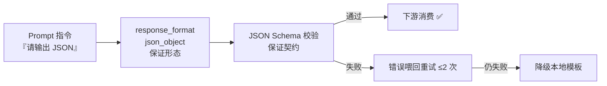

# LLM 工程：结构化输出（JSON Schema 校验生成报告）

> **先定义契约，再相信输出；机器要消费，校验不可省。**
> 自由文本只给人看，JSON 契约才给机器用——六者平台的数据交换，每一层都该有一张"验货单"。

**类型:** Build
**语言:** Python（纯标准库 + 可选 DeepSeek API）
**前置:** Lesson 3（RAG 问答链）——本课复用其检索基础设施
**学时:** ~90 分钟
**关联:** tcmP `kg/schema/schema.json`（DSU 数据 Schema）· `api/main.py`（Pydantic BaseModel）· DeepSeek `response_format=json_object`

## 学习目标

- 说清"JSON 可解析"与"JSON 符合契约"的区别
- 用纯标准库实现 JSON Schema 迷你校验器（type/required/enum/pattern/minLength/minItems/minimum/maximum）
- 实现结构化生成三件套：LLM JSON 输出 → Schema 校验 → 错误喂回重试 → 本地模板降级
- 用平台真实 DSU 数据 + 生产 schema 语义做校验对照
- 理解结构化输出对六者 Agent 工具调用与图谱注入的意义

## 问题（The Problem）

L3 的 RAG 报告是自由文本——**人读没问题，机器没法用**：

| 下游流程 | 自由文本报告带来的麻烦 |
|---------|----------------------|
| 药者处方审核 | 正则解析"方剂是X还是Y"？脆弱不堪 |
| 图谱注入 | 病名/证候/方剂要手工清洗成结构化字段 |
| 医圣成长记录 | 无法按字段统计掌握病证数 |
| 六者工具调用 | 参数无法校验，错就错进 |

解法不是"教模型更听话"，而是**工程三件套**：① 让生成器输出 JSON；② JSON Schema 校验（不合契约就不放行）；③ 校验失败重试 + 降级（系统永远有输出）。

## 概念（The Concept）

### 结构化输出的三层保证



| 层 | 保证 | 局限 |
|:--:|------|------|
| Prompt 指令 | 引导模型输出 JSON | 模型可能不听话 |
| `response_format=json_object` | 输出是合法 JSON 形态 | "是 JSON"≠"符合契约" |
| **JSON Schema 校验** | 字段/类型/枚举/正则全合规 | 只拦不合规，不改内容 |
| 重试 + 降级 | 失败有出路 | 重试耗 token、降级质量低 |

### JSON Schema：数据契约（draft-07）

平台生产参考 `tcmP/kg/schema/schema.json`（60,000+ 病证节点的结构定义）：

| 关键字 | 作用 | 平台实例 |
|--------|------|---------|
| `type` | 类型约束 | object/string/number/... |
| `required` | 必填字段 | `["id","disease_side","syndrome_side","bridge","clinical"]` |
| `pattern` | 正则约束 | id → `^DSU-\d{5}$` |
| `enum` | 枚举白名单 | category 18 类疾病分类 |
| `$ref` | 子结构引用 | 四段式组合 |

### 校验失败的处理：重试-降级两级策略

**错误喂回重试**：校验器说"缺必填字段 disease"，把这个错误原文喂回 prompt——模型看到具体错误，修正成功率远高于盲重试。**降级**：重试用尽后回到确定性本地模板（L3 的 `generate_local` 思路），保证系统永远有输出，但调用方感知 `degraded` 标记。

## 从零实现（BUILD IT）

> 完整代码：`code/main.py`（约 330 行逻辑 + 检索基础设施复用）。关键切片：

### 步骤 1：定义 Schema（先定契约）

```python
RAG_REPORT_SCHEMA = {
    "type": "object",
    "required": ["disease", "icd11_code", "syndrome", "formula",
                 "confidence", "differential", "evidence_gap"],
    "properties": {
        "disease": {"type": "string", "minLength": 2},
        "icd11_code": {"type": "string", "pattern": r"^[0-9A-Z][0-9A-Z.]*$"},
        "confidence": {"type": "number", "minimum": 0, "maximum": 1},
        "differential": {"type": "array", "minItems": 1,
                         "items": {"type": "string", "minLength": 4}},
        "evidence_gap": {"type": "boolean"},
    },
}
```

> ⚠️ **本课真实踩坑**：初版 pattern 写成 `^[A-Z]...`（字母开头），测试用真实数据 `7A00`（原发性失眠，精神障碍类 ICD-11 以数字开头）立刻被抓——ICD-11 编码两种形态都存在。**用真实数据喂测试，schema 才不会脱离现实。**

### 步骤 2：迷你校验器（约 60 行核心）

```python
class MiniValidator:
    """支持 type/required/properties/items/enum/pattern/minLength/
    minItems/minimum/maximum；返回错误列表，空 = 通过。"""

    def validate(self, data, schema):
        errors = []
        self._check(data, schema, "$", errors)
        return errors

    def _check(self, data, schema, path, errors):
        t = schema.get("type")
        if t == "object":
            if not isinstance(data, dict):
                errors.append(f"{path}: 应为 object，实为 {type(data).__name__}")
                return
            for req in schema.get("required", []):
                if req not in data:
                    errors.append(f"{path}: 缺少必填字段 {req}")
            for key, sub in schema.get("properties", {}).items():
                if key in data:
                    self._check(data[key], sub, f"{path}.{key}", errors)
        elif t == "string":
            if not isinstance(data, str):
                errors.append(f"{path}: 应为 string，实为 {type(data).__name__}")
                return
            if "minLength" in schema and len(data) < schema["minLength"]:
                errors.append(f"{path}: 长度 {len(data)} < minLength "
                              f"{schema['minLength']}")
            if "pattern" in schema and not re.search(schema["pattern"], data):
                errors.append(f"{path}: 不匹配 pattern {schema['pattern']}")
            if "enum" in schema and data not in schema["enum"]:
                errors.append(f"{path}: 不在枚举内 {schema['enum']}")
        # ... array / number / integer / boolean 同理
```

### 步骤 3：结构化生成 + 重试降级

```python
class StructuredRAG:
    MAX_RETRY = 2

    def ask(self, query, top_k=None, api_key=None):
        key = api_key or self.api_key
        results = self.retrieve(query, top_k)
        ctx = self.build_context(results)
        if not key:                                   # 无 key → 本地 JSON
            data = local_json(results)
            return {"mode": "local", "data": data, ...}
        prompt = self.build_prompt(query, ctx)
        for i in range(self.MAX_RETRY + 1):
            raw = self._call_llm(prompt, key)         # response_format=json_object
            data = json.loads(raw)                    # 解析失败 → 重试
            errors = self.validator.validate(data, self.schema)
            if not errors:
                return {"mode": "llm", "data": data, "valid": True, ...}
            prompt = self.build_prompt(query, ctx, "\n".join(errors))  # 错误喂回
        return {"mode": "local", "data": local_json(results),
                "degraded": True, ...}                # 重试用尽 → 降级
```

### 运行与自检

```bash
python code/main.py --self-test   # ✅ 5 项断言（合法通过/四类违规/确定性/重试成功/全坏降级）
python code/tests.py              # ✅ 6/6 确定性测试（含平台真实 DSU 数据校验）
```

## 平台实现（USE IT）

**以下全部为本课实测输出。**

### 对照 1：本地结构化生成（确定性 JSON）

```console
$ python code/main.py "难以入睡 多梦易醒 心烦不安"
═══ 结构化问答「难以入睡 多梦易醒 心烦不安」═══
mode=local | attempts=0 | valid=True
{
  "disease": "原发性失眠",
  "icd11_code": "7A00",
  "syndrome": "心肾不交证",
  "formula": "黄连阿胶汤合交泰丸",
  "confidence": 0.33,
  "differential": ["与原发性高血压（肝阳上亢证）对比：证据 0.033 vs 0.032，词面重叠时需四诊鉴别"],
  "evidence_gap": true
}
```

注意 `evidence_gap: true`：mini 语料 RRF 分数是 1/60 量级（k=60），Top1≈0.033 < 0.05——**低分证据被如实声明**，与 L3 的 LLM 判断完全一致。

### 对照 2：平台真实数据过骨架 schema

```console
── 场景2 · 平台真实数据校验（DSU 骨架 schema）──
  样本: dsu-samples-001.json → DSU-00001 (普通感冒（上呼吸道感染）)
  校验: ✅ 通过骨架 schema
```

从生产 `kg/schema/schema.json` 裁剪的教学子集（id pattern `^DSU-\d{5}$` + 五段必填 + 证据等级枚举），对平台**真实 DSU 数据**校验通过——教学版校验器与生产 schema 语义同源。

### 对照 3：校验器负面演示（坏数据被拦截）

```console
── 场景3 · 校验器负面演示（坏数据被拦截）──
  ❌ $.disease: 长度 1 < minLength 2
  ❌ $.icd11_code: 不匹配 pattern ^[0-9A-Z][0-9A-Z.]*$
  ❌ $.formula: 长度 0 < minLength 1
  ❌ $.confidence: 1.5 > maximum 1
  ❌ $.differential[0]: 长度 1 < minLength 4
  ❌ $.evidence_gap: 应为 boolean，实为 str
  共 6 项违规——机器可消费的保证
```

6 类违规全部被定位到具体路径（`$.xxx`）——重试时这就是喂回 LLM 的修正信号。

### 对照 4：LLM 真实调用（DeepSeek json_object）

```console
$ python code/main.py "难以入睡 多梦易醒 心烦不安" --api-key $env:DEEPSEEK_API_KEY
mode=llm | attempts=1 | valid=True
{
  "disease": "原发性失眠（慢性失眠障碍）",
  "icd11_code": "7A00",
  "syndrome": "心肾不交证",
  "formula": "黄连阿胶汤合交泰丸",
  "confidence": 0.033,
  "differential": [
    "患者以入睡困难、多梦易醒为主，符合失眠特征，而非高血压常见头晕头痛",
    "心烦不安可见于两病，但失眠更直接对应心肾不交"
  ],
  "evidence_gap": true
}
```

**attempts=1**：`response_format=json_object` + 字段说明清晰的 prompt，让 LLM 一次输出合规 JSON。ICD 编码 `7A00` 通过修正后的 pattern——schema 是"契约"，而契约必须基于真实数据。

### 生产对照全景

| 层 | 教学版 | 生产版 |
|----|--------|--------|
| Schema | `RAG_REPORT_SCHEMA`（本课） | `kg/schema/schema.json`（DSU 六段，$ref 组合） |
| 校验器 | `MiniValidator`（60 行手写） | FastAPI Pydantic BaseModel（请求校验）+ 图谱入库校验 |
| LLM 结构化 | `response_format=json_object` + 重试 | 同上（生产 rag 未启用，可升级） |
| 降级 | 本地模板 `local_json` | `rag()` 无 key 本地模式 |

## 交付制品（SHIP IT）

| 制品 | 文件 | 用途 |
|------|------|------|
| 结构化输出守卫 skill | `outputs/skill-structured-output.md` | 六者 Agent 数据交换契约层：Schema → 校验 → 重试 → 降级全流程 |
| JSON 输出提示词模板 | `outputs/prompt-json-output.md` | 首次调用 + 错误喂回重试两套 prompt 模板 |

## 习题（60-30-10）

1. **基础**：`response_format=json_object` 保证什么？不保证什么？为什么 Schema 校验不可省？
2. **综合**：用 `python code/main.py --validate` 校验一个你自己构造的 JSON；故意把 `differential` 留空，观察 `minItems` 报错。
3. **拓展**：阅读 `tcmP/kg/schema/schema.json` 的 `$ref` 组织方式（DiseaseSyndromeUnit → DiseaseSide → ...），说明为什么生产 schema 用 `$ref` 组合而不是单层平铺；教学版 MiniValidator 不支持 `$ref` 的代价是什么？

## 术语表

| 术语 | 常见误解 | 实际含义 |
|------|---------|---------|
| 结构化输出 | 让模型输出更整齐 | 工程三件套：JSON 输出 + Schema 校验 + 重试降级 |
| JSON Schema | 一种数据格式 | 数据契约（draft-07）：type/required/enum/pattern/... 描述"合法数据长什么样" |
| response_format | 保证输出正确 | `json_object` 只保证形态是 JSON，不保证字段契约 |
| 错误喂回 | 浪费 token | 校验错误是最强修正信号，喂回后重试成功率显著提升 |
| degraded | 系统故障 | 重试用尽后的本地模板降级，调用方应降权处理该输出 |

## 延伸阅读

- `tcmP/kg/schema/schema.json`（267 行）——平台 DSU 生产 Schema（$ref/required/enum/pattern 全用上）
- `tcmP/api/main.py` L30-75——Pydantic BaseModel 即 FastAPI 的结构化输入校验
- ai-engineering-from-scratch（rohitg00）Phase 11 · Lesson 03（Structured Outputs）
- 下一课预告：**「Agent 工程：医圣人格与师带徒回路」**——把 SOUL 人格 + 工具调用契约组装成可对话的 Agent（对应 `sages/` 与 `/api/sages/consult`）
