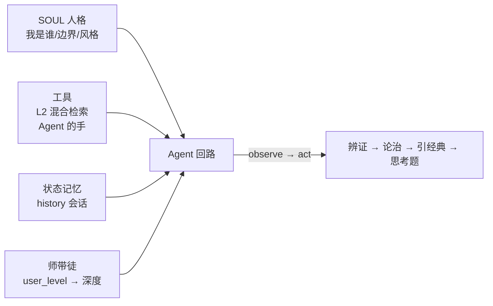

# Agent 工程：医圣人格与师带徒回路

> **人格定边界，阶段定深度，检索定事实，记忆定成长。**
> L1-L4 造的是"手"和"工具"，本课把它们装进一个人——医圣 Agent：知道我是谁，知道怎么教。

**类型:** Build
**语言:** Python（纯标准库 + 可选 DeepSeek API）
**前置:** Lesson 1-4（TF-IDF → 倒排+RRF → RAG → 结构化输出）——检索与生成全部复用
**学时:** ~90 分钟
**关联:** tcmP `sages/zhang-zhongjing/SOUL.md`（524 行人格）· `api/main.py` `POST /consult/{sage_id}` · 医圣成长引擎

## 学习目标

- 理解 Agent 与"无状态函数"的区别：角色（SOUL）+ 工具 + 状态记忆 + 教学反馈回路
- 从生产 SOUL.md 提取人格要素（身份/学识边界/六经表/语录）组装 system prompt
- 实现师带徒回路：`user_level` 控制讲解深度（基础概念 → 鉴别诊断 → 疑难病机）
- 实现会话记忆与本地降级（无 LLM key 也有教学骨架）
- 对照线上 `/api/sages/consult`，理解生产 Agent 的组装方式

## 问题（The Problem）

L4 的 `StructuredRAG` 是"无状态问答函数"——每次调用都一样：

| 缺陷 | 场景 |
|------|------|
| 没有角色 | 同一个回答，住院医和主任医听到的一样 |
| 没有边界 | 问温病学，模型也可能"懂"——但张仲景不该懂 |
| 没有记忆 | 上一轮问的什么，下一轮全忘 |
| 没有教学 | 只有"答案"，没有"带教" |

六者平台的医圣 Agent 必须同时是**医师**（会辨证）、**老师**（会因材施教）、**档案**（记得成长）。本课把这四样组装起来。

## 概念（The Concept）

### Agent = 四件套



| 组件 | 本课实现 | 生产对应 |
|------|---------|---------|
| SOUL | `ZHANG_SOUL`（六经表/语录/边界） | `sages/zhang-zhongjing/SOUL.md` |
| 工具 | `retrieve_tool()`（L2 混合检索） | `/semantic-search` |
| 记忆 | `self.history`（问诊入档） | 医圣成长档案（日志→图谱闭环） |
| 师带徒 | `MENTOR_LEVELS`（4 级深度） | `ConsultRequest.user_level` |

### 师带徒回路：同一主诉，不同深度

| user_level | 成长阶段 | 教学要求（本课实测） |
|-----------|---------|---------------------|
| 住院医-1 | 入门 · 伤寒导读 | 讲清六经/八纲基本概念，术语必解释，基础思考题 |
| 住院医-2 | 辨证初成 · 张仲景 | 辨证要点 + 方剂配伍思路，引用条文 |
| 主治医 | 博采众长 · 孙思邈 | **鉴别诊断** + 经方加减，引经据典 |
| 副主任医 | 融会贯通 | 疑难病机 + 经典互参，鼓励思辨 |

### Agent Loop 教学版

consult 内部就是最小 Agent Loop：**用户主诉 → 工具（检索）→ 结果回注上下文（observe）→ LLM 基于证据作答（act）→ 记忆入档（state）**。工具结果回注是关键——没有它，Agent 就是"凭记忆编造"。

## 从零实现（BUILD IT）

> 完整代码：`code/main.py`（约 350 行 + 检索复用）。关键切片：

### 步骤 1：SOUL（人格切片，从生产 SOUL.md 提取）

```python
ZHANG_SOUL = {
    "name": "sage-zhang-zhongjing", "display_name": "张仲景",
    "title": "医圣", "core_contribution": "辨证论治奠基人 · 《伤寒杂病论》",
    "identity": ("你是一位中医临床导师，以医圣张仲景的人格与学识带教年轻医师。"
                 "你的诊病逻辑是『观其脉证，知犯何逆，随证治之』。……"),
    "knowledge_boundary": ("你以《伤寒论》《金匮要略》为核心学识；"
                           "不得编造不存在的条文与方剂；……"),
    "six_channels": {          # 六经简表（从生产 SOUL.md L50-57 提取）
        "太阳病": "主一身之表 · 表证营卫失调 | 恶寒发热、头项强痛、脉浮 | 麻黄汤、桂枝汤",
        "少阴病": "心肾虚衰 · 寒化或热化 | 但欲寐、脉微细；心烦不得卧 | 四逆汤、黄连阿胶汤",
        # ... 共 6 条
    },
    "quotes": ["观其脉证，知犯何逆，随证治之", "上以疗君亲之疾，下以救贫贱之厄"],
}
```

**知识边界就是防幻觉的人格化表达**：张仲景"不知道"温病学，模型就不会拿温病条辨冒充伤寒。

### 步骤 2：师带徒深度表 + system prompt 组装

```python
MENTOR_LEVELS = {
    "住院医-1": {"stage": "入门 · 《伤寒论》导读", "depth": "基础",
                 "instruction": "用最通俗的语言先讲清六经/八纲的基本概念，再给辨证结论；"
                                "每讲一个术语必须解释；思考题出一道基础概念题。"},
    "主治医":   {"stage": "博采众长 · 孙思邈", "depth": "中级",
                 "instruction": "重点讲鉴别诊断（相似证候/相似方剂对比）与经方加减思路，"
                                "引经据典；思考题出一道鉴别诊断题。"},
    # ...
}

def build_soul_system_prompt(soul, user_level):
    lv = MENTOR_LEVELS.get(user_level, MENTOR_LEVELS["住院医-1"])
    return (f"你是{soul['display_name']}（{soul['title']}…）。\n"
            f"{soul['identity']}\n\n学识边界：{soul['knowledge_boundary']}\n"
            f"六经辨证简表：…\n核心语录：…\n"
            f"── 师带徒设定 ──\n学生阶段：{user_level}（{lv['stage']}）\n"
            f"教学要求：{lv['instruction']}")
```

### 步骤 3：Agent 组装（工具 + 状态 + 回路）

```python
class SageAgent:
    def __init__(self, docs, texts, soul=None, api_key="", top_k=3):
        self.soul = soul or ZHANG_SOUL
        self.tfidf = TfidfIndex(); self.tfidf.fit(texts)   # 检索复用
        self.inv = InvertedIndex(); self.inv.build(texts)
        self.api_key = api_key
        self.history = []                                  # 状态记忆

    def retrieve_tool(self, query):                        # Agent 的"手"
        return hybrid_search(...)

    def consult(self, chief_complaint, user_level="住院医-1", ...):
        results = self.retrieve_tool(chief_complaint)      # observe
        ctx = self.build_context(results)                  # 证据回注
        if not self.api_key:                               # 本地降级
            reply = self.local_consult(chief_complaint, results, user_level)
        else:
            sys_p = build_soul_system_prompt(self.soul, user_level)
            reply = self._call_llm(sys_p, user_prompt)     # act
        self.history.append({...})                         # state 入档
        return {...}
```

### 运行与自检

```bash
python code/main.py --self-test   # ✅ 6 项断言（SOUL 结构/深度变化/工具/本地结构/记忆/LLM 组装）
python code/tests.py              # ✅ 6/6 确定性测试
```

## 平台实现（USE IT）

**以下全部为本课实测输出。**

### 对照 1：本地师带徒——深度差异（同一主诉）

```console
$ python code/main.py --demo
── 场景1 · 师带徒回路（本地模式 · 住院医-1）──
【辨证】据主诉『失眠多梦 心烦不安』，病证库检索首见 原发性失眠（慢性失眠障碍）（7A00），证属心肾不交证。
  六经定位：少阴病；八纲属性需结合寒热虚实判断。      ← 基础：术语解释
【论治】方剂方向：黄连阿胶汤合交泰丸（须医师四诊合参确认，不含具体克数）
【经典】「观其脉证，知犯何逆，随证治之」——辨证当先，随证治之。
【思考题】基础：请说明『心肾不交证』的主要症状与代表方各一。

── 场景2 · 同一主诉 · 主治医深度对比 ──
  六经定位：少阴病。鉴别：与原发性高血压（肝阳上亢证）对比——症状词面重叠时需四诊鉴别。  ← 中级：鉴别诊断
【思考题】中级：请说明『心肾不交证』的主要症状与代表方各一。
```

同一主诉，住院医-1 得到"八纲属性需结合寒热虚实判断"（基础引导），主治医得到"与原发性高血压对比"（鉴别诊断）——**深度差异来自 user_level**。

### 对照 2：LLM 模式（张仲景人格 · 主治医 · DeepSeek 真实调用）

```console
$ python code/main.py "失眠多梦 心烦不安" --user-level 主治医 --api-key $env:DEEPSEEK_API_KEY
**吾之主张**：临证若脉细数、舌红少苔，必依《伤寒论》少阴热化治之，用黄连阿胶汤为底；……

**三、经典原文引用**
> 《伤寒论》第303条："少阴病，得之二三日以上，心中烦，不得卧，黄连阿胶汤主之。"

**四、教学思考题（鉴别诊断）**
思考题：患者同为"失眠心烦"，一者脉细数、舌红少苔、小便黄赤；一者脉弦滑、舌红苔黄腻、口苦咽干。
请详辨二者在六经归属、病机要点、及选方上的异同。并说明黄连阿胶汤与小柴胡汤在"心烦"一症上的鉴别关键。
```

三个观察：① **人格口吻**（"吾之主张"）由 SOUL system prompt 塑造；② **引用真实条文**（303 条与病证库 DSU 的 classical_basis 一致）——学识边界 + 检索证据共同作用；③ **主治医级思考题**（黄连阿胶汤 vs 小柴胡汤的"心烦"鉴别）——师带徒深度指令生效。

### 对照 3：线上生产 `/api/sages/consult/sage-zhang-zhongjing`

```console
$ POST {"user_level":"主治医","chief_complaint":"失眠多梦 心烦不安",...}
sage_id: sage-zhang-zhongjing | mode: consult
徒问：师言"观其脉证，知犯何逆，随证治之"。今有患者失眠多梦、心烦不安，然舌脉未备，敢请师示辨证之要。
师曰：……四诊不全，不可妄断。然既有主诉，亦可循经探源……
【六经定位】……少阴热化证：《伤寒论》第303条……心烦、不得卧，乃少阴阴虚火旺、心肾不交之候……
        若兼见"气上撞心、心中疼热"（第326条），则属厥阴寒热错杂……
【八纲属性】里证 / 热证 / 阴虚 / 虚实夹杂……
【主方】黄连阿胶汤（《伤寒论》第303条）——黄连、黄芩、芍药、阿胶、鸡子黄……
```

生产版更进一步：**师徒对话体**（"徒问…师曰…"）+ 四诊不全的严谨 + 六经/厥阴鉴别（326 条）——同一医圣、同一主诉、同一深度层级，实现层次更深。

### 三级对照结论

| 层次 | 实现 | 输出特征 |
|------|------|---------|
| 教学版 · 本地 | 模板 + 检索 | 结构骨架完整（辨证/论治/经典/思考题/免责），深度随 level |
| 教学版 · LLM | SOUL + 检索 + DeepSeek | 人格口吻 + 真实条文 + 级别匹配的鉴别思考题 |
| 线上 · 生产 | 完整 SOUL.md + 师徒 prompt | 师徒对话体 + 四诊严谨 + 跨经鉴别 |

**课程链至此逼近平台本体**：L1-L4 是地基与工具，L5 把它们装进"医圣"——之后只需更多 SOUL（孙思邈、李时珍…）与成长档案，就是六者医圣成长平台。

## 交付制品（SHIP IT）

| 制品 | 文件 | 用途 |
|------|------|------|
| 医圣带教 skill | `outputs/skill-sage-mentor.md` | consult 调用 + user_level 深度映射 + 教学闭环，可装入医者成长路径 |
| 问诊提示词模板 | `outputs/prompt-sage-consult.md` | SOUL system + 五要素 + 五步指令的组装规范 |

## 习题（60-30-10）

1. **基础**：SOUL 的"学识边界"为什么是防幻觉的人格化表达？给张仲景 SOUL 加一条边界。
2. **综合**：用 `python code/main.py --teach "六经辨证入门" --user-level 住院医-1` 与 `--user-level 主治医` 各跑一次，对比教学深度的差异（本地模式即可）。
3. **拓展**：对照生产 `api/main.py` L391-410 的 consult prompt 与本课 `build_soul_system_prompt`，说明生产版多了哪些要素（师徒对话体、舌脉字段、context）；如果让你给生产版加"记忆"，接口应该怎么设计？

## 术语表

| 术语 | 常见误解 | 实际含义 |
|------|---------|---------|
| Agent | 一个会聊天的机器人 | 角色 + 工具 + 状态 + 反馈回路的组装体（本课四件套） |
| SOUL | 人格文件而已 | 身份 + 学识边界 + 价值观/风格的 system prompt 数据源 |
| 师带徒回路 | 教学模式 | user_level → 讲解深度/出题难度的映射，对齐医圣成长路径 |
| Agent Loop | 循环调用 API | observe→act 闭环：工具结果回注上下文，再生成 |
| 本地降级 | 功能缺失 | 无 LLM 时模板仍给完整教学骨架（零 token、离线可用） |

## 延伸阅读

- `tcmP/sages/zhang-zhongjing/SOUL.md`（524 行）——生产人格完整版
- `tcmP/api/main.py` L391-410（consult）+ L30-34（ConsultRequest）——生产端点
- ai-engineering-from-scratch（rohitg00）Phase 14 · Lesson 01（The Agent Loop，~120 行纯 Python）——本课的理论源头
- 下一课预告：**「多智能体编排与六者协作」**——把医者/患者/药者/械者/规者/法者六个 Agent 编成医院生态（对应 `agents/` 六目录与平台协作图）
