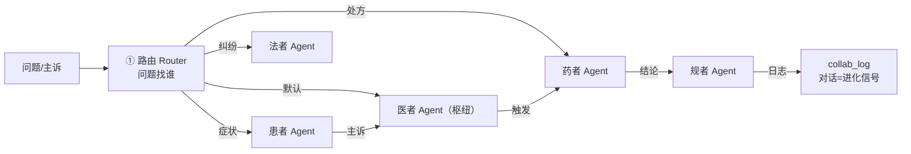

# 多智能体编排与六者协作

> **路由定分工，流水定次序，枢纽定协调，日志定进化。**
> L5 造了一个医圣；本课把他放进医院——医/患/药/械/规/法六个 Agent，各守一摊，又连成一条就诊链。

**类型:** Build
**语言:** Python（纯标准库 + 可选 DeepSeek API）
**前置:** Lesson 5（Agent 工程）——角色 Agent 的泛化与编排
**学时:** ~90 分钟
**关联:** tcmP `agents/{healer,patient,pharmacist,device,regulator,legal}/SOUL.md` · `api/main.py` `/agents/{role}/chat` + 六者业务端点

## 学习目标

- 理解多智能体编排三件套：路由（问题找谁）/ 流水线（就诊次序）/ 枢纽（医者协调）
- 定义六者 SOUL（角色使命/工具/边界），实现各角色本地确定性处理
- 实现关键词路由与「患者→医者→药者→规者」就诊流水线
- 用协作日志（collab_log）记录跨角色流转——平台「对话=进化信号」闭环的最小实现
- 对照生产 `agents/` 六目录与线上端点，理解平台终极形态

## 问题（The Problem）

L5 只有一个医圣。但医院是生态：

| 场景 | 单 Agent 的困境 |
|------|----------------|
| 处方里附子 15g + 半夏 | 医者开方，但**药者**该拦——职责混在一个人身上就会漏 |
| 医保纠纷 | 医者不懂法条，**法者**才懂 |
| CT 设备故障 | 与辨证无关，**械者**管 |
| 质控检查 | 需要**规者**的院级标准 |

**分工的意义**：每个角色有专业边界（药者守住十八反、法者守住纠纷防线、规者守住质控），可独立考核、可审计。这正是平台六者（医·患·药·械·规·法）的架构来源——医者为核心枢纽，其余五方围绕。

## 概念（The Concept）

### 编排三件套



| 模式 | 作用 | 教学版实现 |
|------|------|-----------|
| 路由 Router | 问题分派到正确角色 | 关键词规则（无命中→医者） |
| 流水线 Pipeline | 就诊数据流 | visit_pipeline 四步 |
| 枢纽 Supervisor | 医者协调药者/规者 | healer 辨证后自动触发审方+质控 |
| 协作日志 | 进化信号沉淀 | collab_log（from/to/task/mode） |

### 六者分工（对齐 agents/ 六 SOUL）

| 角色 | 使命 | 边界（防越权） |
|------|------|---------------|
| 医者 healer | 病证推理 + 方剂推荐 + 师带徒 | 不直接开剂量；需四诊合参 |
| 患者 patient | 症状自查 + 导诊 + 康复 | 自查非诊断；重症建议急诊 |
| 药者 pharmacist | 处方审核 + 用药安全 + 溯源 | 十八反十九畏绝不越过 |
| 械者 device | 设备维护 + 影像 + 采购 | 故障按预案分级 |
| 规者 regulator | 质控 + 排班 + 应急 | 以院级标准为准 |
| 法者 legal | 纠纷防控 + 法规 + 文书 | 风险提示非正式法律意见 |

## 从零实现（BUILD IT）

> 完整代码：`code/main.py`（约 380 行 + 检索复用）。关键切片：

### 步骤 1：六者 SOUL（对齐 agents/ 六目录）

```python
SIX_ROLES = {
    "healer": {"display": "医者", "hospital_mapping": "临床医师/带教老师",
               "mission": "病证推理 + 方剂推荐 + 师带徒教学",
               "tools": ["病证检索", "辨证论治", "师带徒"],
               "boundary": "不直接开具处方剂量；需四诊合参",
               "route_keywords": ["失眠", "头痛", "咳嗽", "辨证", "证候"]},
    "pharmacist": {"display": "药者", "hospital_mapping": "药剂师/药企/配送",
                   "mission": "处方审核 + 用药安全 + 饮片溯源",
                   "boundary": "十八反十九畏绝不越过；剂量超限必警示",
                   "route_keywords": ["处方", "药", "剂量", "附子", "半夏"]},
    # ... 共 6 角色
}
```

### 步骤 2：路由（问题找谁）

```python
class HospitalRouter:
    def route(self, text):
        scores = {role: sum(1 for kw in kws if kw in text)
                  for role, kws in self.keywords.items()}
        scores = {r: n for r, n in scores.items() if n}
        return max(scores, key=scores.get) if scores else "healer"
```

### 步骤 3：就诊流水线（四步闭环 + 协作日志）

```python
def visit_pipeline(self, chief_complaint):
    steps = []
    p = self.agents["patient"].handle(chief_complaint)     # 1 自查导诊
    steps.append({"role": "patient", ...})
    top = self.agents["healer"].retrieve(chief_complaint)[0]
    h = self.agents["healer"].handle(chief_complaint)      # 2 辨证论治
    h["reply"] += f"\n【处方】{top['formula']}（方向）"
    steps.append({"role": "healer", ...})
    ph = self.agents["pharmacist"].handle(f"审方：{top['formula']}")  # 3 审方
    steps.append({"role": "pharmacist", ...})
    rg = self.agents["regulator"].handle("就诊闭环质控：...")          # 4 质控
    steps.append({"role": "regulator", ...})
    for s in steps:
        self.collab_log.append({"from": "prev", "to": s["role"], ...})  # 日志
    return {"steps": steps, "top": top}
```

### 运行与自检

```bash
python code/main.py --self-test   # ✅ 6 项断言（六者SOUL/路由/各角色/流水线/日志/LLM组装）
python code/tests.py              # ✅ 6/6 确定性测试
```

## 平台实现（USE IT）

**以下全部为本课实测输出。**

### 对照 1：路由（问题找谁）

```console
$ python code/main.py --demo
── 场景1 · 路由演示（问题找谁）──
  「我失眠多梦怎么办」→ 医者（healer）
  「这张处方有附子15g」→ 药者（pharmacist）
  「CT设备报错」→ 械者（device）
  「医保报销纠纷咨询」→ 法者（legal）
  「内科质控检查」→ 规者（regulator）
  「不知道挂什么科」→ 患者（patient）
```

六类问题各归其位，无命中回落医者（枢纽）。

### 对照 2：就诊流水线（患者→医者→药者→规者）

```console
── 场景2 · 就诊流水线（患者→医者→药者→规者）──
  ▶ 患者（patient · local）
    【自查】症状『失眠多梦 心烦不安』与 原发性失眠（慢性失眠障碍） 相似病证吻合。
    【导诊】建议挂号：7A00 对应科室方向（中医内科/相应专科）。
  ▶ 医者（healer · local）
    【辨证】……证属心肾不交证。
    【论治】方剂方向：黄连阿胶汤合交泰丸（须四诊合参确认）。
    【处方】黄连阿胶汤合交泰丸（方向）
  ▶ 药者（pharmacist · local）
    【审方】药味：黄连、阿胶；含方剂：黄连阿胶汤合交泰丸、黄连阿胶汤、交泰丸
    【警示】未检出十八反十九畏冲突；建议核对剂量与妊娠禁忌
    【结论】可调配，附用药说明
  ▶ 规者（regulator · local）
    【质控】就诊闭环质控：失眠多梦 心烦不安 → 原发性失眠（慢性失眠障碍） → 黄连阿胶汤合交泰丸……
  ▶ 辨证结论: 原发性失眠（慢性失眠障碍） → 黄连阿胶汤合交泰丸
```

四步闭环：主诉从患者流到医者，处方从医者流到药者，审方结论流到规者——**每步输出是下一步输入**。

### 对照 3：药者审方——规则版 vs LLM 版（同一处方）

```console
# 规则版（本地，零 token）
【审方】药味：附子、半夏、甘草
【警示】附子: 有毒之品，须先煎/久煎，剂量超 15g 警示
【警示】半夏: 与乌头类相反（十八反），配伍须核查
【警示】甘草: 与海藻/甘遂/大戟/芫花相反，且久服伤脾
【结论】需医者复核后再调配

# LLM 版（DeepSeek，药者 SOUL system）
建议处理：
1. 请医师确认处方是否笔误，若确需合用，须提供书面风险确认并调整炮制/煎法。
2. 替代思路：若需温化痰饮，可选用陈皮、茯苓、干姜等（需辨证）。
3. 附子单用剂量15g已属高位（常规3-9g），须先煎60分钟以上，并注明"久煎去麻"。
请立即与开方医师沟通修订方案后再调剂。
```

规则版守住底线（拦截），LLM 版给出临床处理路径（书面确认/替代/煎法）——**药者边界（"绝不越过"）两种模式都守住**。

### 对照 4：生产六者

| 教学版 | 生产版 |
|--------|--------|
| `SIX_ROLES`（6 角色精简 SOUL） | `agents/{role}/SOUL.md`（六份完整人格，如药者 241 行） |
| `HospitalRouter` 关键词路由 | `/agents/{role}/chat`（角色化聊天端点） |
| `RoleAgent.handle` 本地/LLM | `/patients/symptom-check`、`/pharmacists/review` 等业务端点 |
| `collab_log` 协作日志 | 平台「对话=进化信号」CI/CD 闭环（日志→图谱→调优→上线） |

## 交付制品（SHIP IT）

| 制品 | 文件 | 用途 |
|------|------|------|
| 六者编排 skill | `outputs/skill-hospital-orchestration.md` | 路由决策表 + 流水线 + 枢纽协调 + 协作日志，多智能体场景直接套用 |
| 协作交接 prompt | `outputs/prompt-six-role-handoff.md` | 角色化 system prompt + from/to/task 交接契约 |

## 习题（60-30-10）

1. **基础**：说出六者各自的一条"专业边界"；为什么药者的边界是"十八反绝不越过"？
2. **综合**：用 `python code/main.py "发热恶寒 咳嗽" --demo` 观察流水线；再试 `"CT设备采购论证"`，对比路由结果。
3. **拓展**：设计"法者介入"的流水线扩展——患者术后纠纷：哪几步、谁触发法者、交接什么数据？对照生产 `legal-agent` 的端点（/legals/risk 等）。

## 术语表

| 术语 | 常见误解 | 实际含义 |
|------|---------|---------|
| 多智能体编排 | 多个机器人聊天 | 路由 + 流水线 + 枢纽的确定性编配，各角色分工协作 |
| Router | 负载均衡 | 问题→角色的分派层（教学版关键词，生产可语义路由） |
| Supervisor 枢纽 | 一个总控 | 医者为核心，辨证后自动触发药者审方、规者质控 |
| 协作日志 | 聊天记录 | from/to/task/mode 结构化流转记录——平台进化信号 |
| 角色边界 | 限制功能 | 防越权的人格化约束（药者不开方、法者不做医疗判断） |

## 延伸阅读

- `tcmP/agents/{六角色}/SOUL.md`——六份生产人格（frontmatter + 本体定位 + 工具能力）
- `tcmP/api/main.py`——`/agents/{role}/chat`（L380+）与六者业务端点（/patients/* /pharmacists/* /devices/* /legals/*）
- ai-engineering-from-scratch（rohitg00）Phase 16 · Lesson 05（Supervisor/Orchestrator-Worker Pattern）· Lesson 08（Role Specialization）
- **课程链完结**：L1 文本表示 → L2 检索 → L3 RAG → L4 结构化 → L5 Agent → L6 多智能体——「病证检索 → 辨证问答 → 医圣带教 → 六者医院」即平台终态的教学复刻

## 全课回顾（轮次 2 · 六课一条线）

| 课 | 主题 | 平台对应 | 关键产出 |
|:--:|------|---------|---------|
| L1 | 手写 TF-IDF | tcm_embed.py | 文本表示 + 向量检索 |
| L2 | 倒排 + RRF | FTS5 + _rrf_fuse | 混合检索 |
| L3 | RAG 问答链 | /api/sages/rag | 诊断→辨证→方剂 |
| L4 | 结构化输出 | schema.json + Pydantic | JSON 契约 + 重试降级 |
| L5 | 医圣 Agent | SOUL.md + /consult | 人格 + 师带徒 |
| L6 | 六者编排 | agents/ + /agents/{role}/chat | 路由 + 流水线 + 枢纽 |
