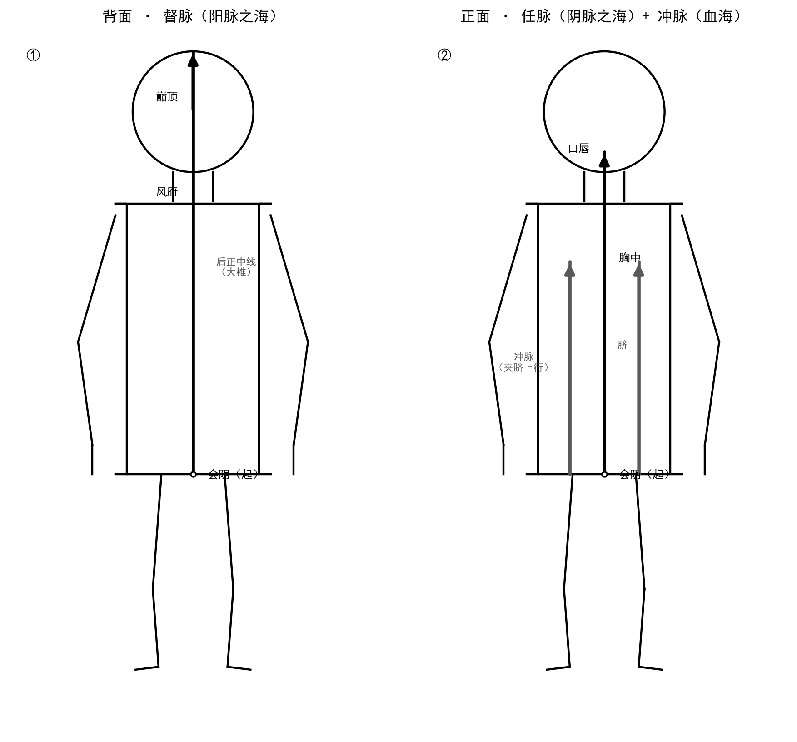
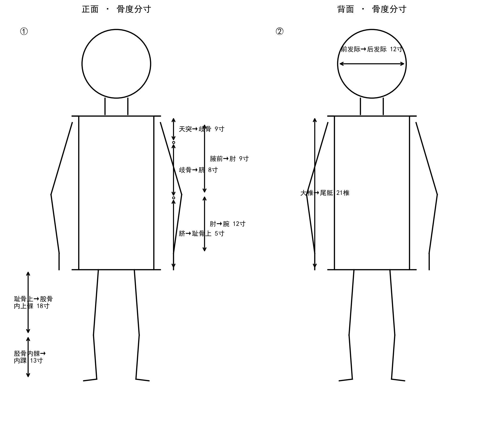
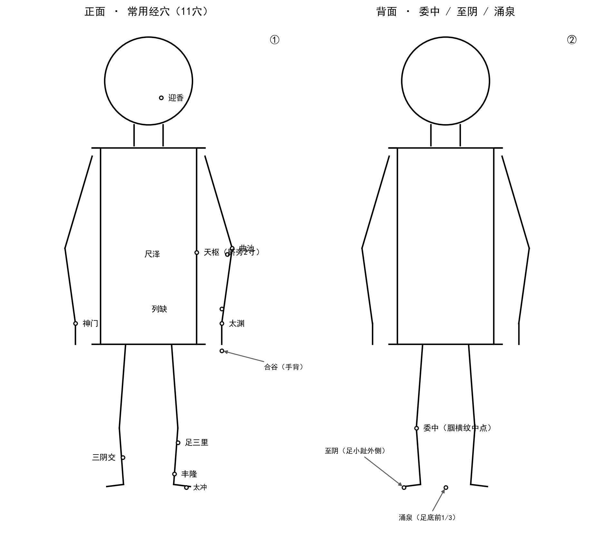

# 第8章 经络学说（下）——奇经八脉与经穴概要

> **所属篇章**：第二篇 人体结构与功能认知
> **前置章节**：第7章 经络学说（上）——十二经脉
> **建议学时**：4学时（理论3学时 + 实训1学时）

---

## 学习目标

| 层次 | 目标 |
|:----:|------|
| **知识目标** | ① 说出奇经八脉的名称、别称和主要功能；② 区分络脉、经别、经筋、皮部四者的概念和循行特点；③ 列出腧穴的三大分类（经穴、奇穴、阿是穴）及四种定位方法；④ 说出至少六类特定穴的名称和临床意义 |
| **能力目标** | ① 能在活体上指出督脉、任脉的体表循行路线；② 能运用骨度分寸法和手指同身寸法定位合谷、足三里、三阴交等常用腧穴 |
| **素养目标** | ① 体会中医经络学说"内联脏腑、外络肢节"的整体观念；② 建立"体表穴位刺激可调节内脏功能"的经络治疗思维 |

---

## 本章导图

```
经络学说（下）——奇经八脉与经穴概要
│
├── 8.1 奇经八脉
│   ├── 督脉——阳脉之海（后正中线）
│   ├── 任脉——阴脉之海（前正中线）
│   ├── 冲脉——十二经之海/血海
│   ├── 带脉——约束诸经（唯一横行）
│   ├── 阴跷脉·阳跷脉——司运动和睡眠
│   └── 阴维脉·阳维脉——维系阴阳经脉
│
├── 8.2 络脉——十五络脉（浅层沟通表里）
├── 8.3 经别——联系脏腑（深层捷径，"六合"）
├── 8.4 经筋——护卫关节（体表筋肉，以痛为腧）
├── 8.5 皮部——皮肤分区（最外层防御）
│
├── 8.6 常用腧穴分类与定位
│   ├── 分类：经穴（361）·奇穴·阿是穴
│   ├── 定位：骨度分寸·体表标志·同身寸·简便取穴
│   ├── 特定穴：五输穴·原穴·络穴·俞穴·募穴·八会穴
│   └── 常用经穴选介（15穴）+ 奇穴选介（6穴）
│
└── 8.7 经络的现代研究（拓展阅读）
    ├── 神经-体液调节
    ├── 筋膜/结缔组织网络
    └── 循经感传现象
```

---

## 情境导入

张医生在门诊遇到一位40岁的女性患者，主诉"腰部一圈像泡在水里，肚子胀，白带特别多，吃了一个月的药也不见好"。张医生在患者腰部触诊时发现带脉循行区域皮肤温度明显偏低，再结合舌脉，诊断为"带脉失约"，在带脉穴、足临泣进行针刺治疗，三次后症状明显缓解。

"带脉"是什么？它和我们上一章学的十二经脉有什么不同？除了"带脉"，还有哪些"奇经"？它们是怎样在人体内分布的？——这些问题，就是本章要回答的核心内容。

我们已学完十二经脉（第7章），那是经络系统的"主干高速公路"。而本章的奇经八脉、络脉、经别、经筋和皮部，则是经络的"辅路""支线"和"服务网络"——它们与十二经脉一起，构成了一个完整的气血运行和信息传递体系。

---

## 8.1 奇经八脉

### 8.1.1 奇经八脉总论

"奇"者，异也。奇经八脉之所以称"奇"，是因为它们在以下四个方面有别于十二正经：

| 比较维度 | 十二正经 | 奇经八脉 |
|---------|---------|---------|
| 脏腑隶属 | 各有所属脏腑（如肺经属肺） | 不直接隶属某个脏腑 |
| 表里关系 | 阴阳经配为六对表里 | 均无阴阳表里配对关系 |
| 循行方向 | 规律有序（手三阴从胸走手、手三阳从手走头、足三阳从头走足、足三阴从足走腹胸） | 循行方向不固定 |
| 循环流注 | 参与十二经脉首尾衔接 | 不参与循环流注 |

奇经八脉包括：**督脉、任脉、冲脉、带脉、阴跷脉、阳跷脉、阴维脉、阳维脉**，共八条。可以按"督任冲带、阴阳跷维"两组口诀记忆。

**核心功能——"蓄溢调节"**：如果把十二经脉比作人体气血运行的"江河"，奇经八脉就是调节水量的"水库"和"湖泊"。当十二经脉气血充盈有余时，多余的气血便蓄积于奇经；当十二经脉气血不足时，奇经释出蓄积的气血加以补充。

### 8.1.2 督脉——"阳脉之海"

**循行**：起于小腹内（胞中）→ 下出会阴 → 沿脊柱正中（后正中线）上行 → 至项后风府穴 → 入脑 → 上行巅顶 → 沿前额下行至鼻柱 → 止于上唇系带（龈交穴）。

**功能**：
1. 总督诸阳——行于背部正中线，手足三阳经均与督脉交会于大椎穴，故称"阳脉之海"
2. 贯脊络脑——"贯脊属肾、上络于脑"，与脑和神志活动密切相关（现代研究认为督脉循行与脊髓、脑的功能联系存在一定对应关系）
3. 分支络肾——与生殖功能相关

**临床表现提示**：督脉为病，可见脊柱强痛、角弓反张；亦可出现头重、眩晕等脑髓病证。治取大椎（诸阳之会）、命门、百会等穴。

### 8.1.3 任脉——"阴脉之海"

**循行**：起于小腹内（胞中）→ 下出会阴 → 沿腹部和胸部正中线上行 → 经咽喉 → 至下颌部 → 环绕口唇 → 分行至两目下。

**功能**：
1. 总任诸阴——行于前正中线，手足三阴经均与任脉交会，故称"阴脉之海"
2. 主胞胎——"任"兼有"妊养"之意，与女子月经、孕育直接相关（"任主胞胎"）
3. 联系下焦脏腑（肾、膀胱、小肠、大肠）

**临床表现提示**：任脉为病，男子可见疝气，女子可见带下、癥瘕积聚。治取关元、气海、中极等穴。

> **🔗 知识链接：督任同源异流**
>
> 督脉在后、任脉在前，二脉皆起于胞中、同出会阴——这一"同源异流"的结构设计，是中医"阴阳互根"理论在经络层面的集中体现。练习气功"小周天"时，正是通过意识导引气血沿督脉上升（背后）、沿任脉下降（身前），形成督任循环。

### 8.1.4 冲脉——"十二经之海"与"血海"

**循行**：起于胞中 → 下出会阴 → 分三支：① 一支沿腹部两侧（夹脐）上行，与足少阴肾经相并，至胸中而散；② 一支沿脊柱上行（与督脉相通）；③ 一支向下，沿下肢内侧下行至足大趾间，与足少阴肾经相并。

冲脉上至于头、下至于足，贯穿全身。"冲"字取"要冲、汇聚"之意，能调节十二经气血，故称"**十二经之海**"；又与女子月经密切相关，故又称"**血海**"。

**临床表现提示**：冲脉为病可见"逆气里急"（腹中绞痛、气上冲胸）；血海失调可见月经不调、崩漏等。

**记忆口诀**（冲任督三脉同源）：
> 一源三歧出胞中，督后任前冲四通。
> 督为阳海任阴海，冲为血海十二宗。

### 8.1.5 带脉——唯一横行的经脉

**循行**：起于季胁（侧胸部第11肋游离端下方）→ 斜向下行 → 环绕腰腹一周，状如束带。

带脉是所有经脉中唯一横向走行的经脉，其作用正如其名——像一条腰带约束纵行的各条经脉。它同时与妇女带下病密切相关。

**临床表现提示**：带脉失约则"腹满、腰溶溶如坐水中"；在妇科可见带下绵绵、子宫脱垂等。

### 8.1.6 阴阳跷脉——主司运动和睡眠

**阴跷脉**：起于内踝下照海穴 → 沿下肢内侧上行 → 经腹胸 → 至目内眦，与阳跷脉会合。

**阳跷脉**：起于外踝下申脉穴 → 沿下肢外侧上行 → 经胁肋 → 至目内眦，与阴跷脉会合。

二跷脉共同的功能是：
1. 主司下肢运动——使肢体运动灵活矫健
2. 司眼睑开阖——交会于目内眦，阳跷气盛则目开而寤（醒），阴跷气盛则目闭而寐（睡）

**临床表现提示**：跷脉失调可致下肢痿弱无力，或失眠/多寐。

### 8.1.7 阴阳维脉——维系阴阳的纽带

**阴维脉**：起于小腿内侧筑宾穴 → 沿下肢内侧上行 → 至咽喉与任脉会合。维系诸阴经。

**阳维脉**：起于足跟外侧金门穴 → 沿下肢外侧上行 → 至前额与督脉会合。维系诸阳经。

"维"即维系、连接之意，使阴阳经脉之间保持协调平衡。

**临床表现提示**：阴维为病则"苦心痛"（阴主里），阳维为病则"苦寒热"（阳主表）。

**表8-1：奇经八脉功能概要**

| 脉名 | 别称 | 循行特点 | 主要病候 |
|------|------|---------|---------|
| 督脉 | 阳脉之海 | 后正中线，入脑 | 脊强反折、头重眩晕 |
| 任脉 | 阴脉之海 | 前正中线 | 疝气、带下、癥瘕 |
| 冲脉 | 血海/十二经之海 | 夹脐上行，通贯全身 | 逆气里急、月经不调 |
| 带脉 | — | 绕腰一周，横行 | 腹满、带下、腰溶溶 |
| 阴跷脉 | — | 内踝→目内眦 | 下肢痿弱、多寐 |
| 阳跷脉 | — | 外踝→目内眦 | 下肢无力、失眠 |
| 阴维脉 | — | 下肢内侧→咽喉 | 心痛 |
| 阳维脉 | — | 下肢外侧→前额 | 寒热 |

**图8-1 督脉、任脉、冲脉体表循行示意图**



图注：图8-1 展示督、任、冲三脉的体表循行路线。a. 对应正文8.1.2—8.1.4节：督脉行于背正中（后正中线）、任脉行于前正中、冲脉夹脐上行。b. 图中粗实线为经脉主干，箭头表示循行方向，灰色双线为冲脉两侧循行。c. 圆圈标记起于会阴（胞中），三脉"一源三歧"同出会阴后分别循行。d. 左侧背面图显示督脉自会阴沿后正中线上行，经风府至巅顶；右侧正面图显示任脉沿前正中上行至口唇、冲脉夹脐上行至胸中。e. 阅读时先认三脉起点（会阴），再沿箭头方向逐一追踪督、任、冲各自走向，体会"督后、任前、冲四通"的空间格局。

---

## 8.2 络脉——遍布全身的"毛细血管网"

络脉是从经脉分出的细小分支。"络"字本义为"网络、缠绕"。经脉是主干，络脉是支流，二者构成了从大到小、从深到浅的完整网络。

### 8.2.1 十五络脉（别络）

从十二经脉和任、督二脉各分出一支较大的络脉，加上脾之大络，共**十五支**，统称"十五络脉"（或称"十五别络"）。

**核心功能**：加强互为表里的两条经脉之间的联系。例如手太阴肺经的络脉——**列缺**，从腕后分出，走向手阳明大肠经，使肺与大肠这一表里关系在经络层面得到沟通。

每条络脉皆有一个**络穴**（共15个），临床上既可诊察络脉的虚实变化，也可用以治疗表里两经的疾病。例如：
- 手太阴络脉实则手掌灼热，虚则呵欠、小便频数
- 手少阴络脉实则胸膈支满，虚则不能言语

### 8.2.2 浮络与孙络

- **浮络**：浮现于体表可以看到的细小络脉。临床上诊察小儿食指络脉（虎口三关）、观察鱼际络脉颜色等，就是利用浮络的诊法。
- **孙络**：最微细的络脉，是络脉的末级分支，深入组织间隙，是气血与组织进行物质交换的终末场所。

> **💡 临床窗口**：《灵枢·经脉》曰"诸脉之浮而常见者，皆络脉也。"针刺时刺破皮肤出现的微量出血，即为刺激了浮络与孙络。中医"刺络放血"疗法——在特定穴位用三棱针点刺放出少量血液以泻热逐瘀——正是利用了络脉与体表的密切联系。

---

## 8.3 经别——沟通表里的"深层捷径"

经别是从十二经脉分出的别行支脉，多从肘膝关节以上分出，深入体腔内部，联系脏腑后，再从颈部浅出体表。它们的作用如同地铁系统——在地下（体腔内）直接穿行，不经过地面（体表循行路线）上所有站点。

经别的循行具有"**离、入、出、合**"四个特点：

| 阶段 | 含义 | 说明 |
|:----:|------|------|
| 离 | 从正经分出 | 多在肘膝关节以上分出 |
| 入 | 深入体腔 | 与所属脏腑联系 |
| 出 | 浅出体表 | 多在头颈部 |
| 合 | 归于正经 | 阳经经别合于本经，阴经经别合于相表里的阳经 |

每一对表里经的经别合为一组，共六组——称为"**六合**"。

**经别的两大核心功能**：
1. **加强表里经脉的内在联系**——十二经脉在体表通过络脉连接，在体内通过经别沟通，形成表里双层联系
2. **扩大经穴的主治范围**——阴经在头面部本无直接分布，但阴经经别多"合"于相表里的阳经经别，借阳经之道上达头面，故阴经腧穴亦可治疗头面五官病证。例如手太阴肺经（阴经）本不上头，但其经别合于手阳明大肠经，使肺经穴位得以用于头面病证的治疗。

---

## 8.4 经筋——十二经脉的外周护卫

经筋是十二经脉之气"结、聚、散、络"于筋肉关节的体系，是十二经脉的外周连属部分。经脉藏于内而经筋行于外：经脉是"气"的通路，经筋是"力"的传导。

经筋的分布以"结"和"聚"为特点——沿途在关节和骨骼隆起处集结。例如：手阳明经筋起于食指桡侧端，结于腕，上结于肘，结于肩髃（肩峰），上述颈部——全程在关节处反复结聚。

**经筋的病候**主要是运动系统疾病：经筋所过之处出现拘急、痉挛、疼痛、弛缓不用等。治疗取"以痛为腧"的原则（即哪里痛就在哪里取穴），这与现代"阿是穴"和"激痛点"概念不谋而合。临床上对落枕、肩周炎、腰肌劳损等疾病的针刺治疗，很大程度上就是调理经筋。

> **📋 辨析：经脉、络脉、经别、经筋的区别**
>
> | 结构 | 层次 | 功能侧重 | 治疗特点 |
> |------|------|---------|---------|
> | 经脉 | 深层直行 | 运行气血 | 循经取穴 |
> | 络脉 | 浅层网状 | 沟通表里 | 刺络放血 |
> | 经别 | 深层内行 | 联系脏腑 | 扩大主治 |
> | 经筋 | 体表筋肉 | 司关节运动 | 以痛为腧 |

---

## 8.5 皮部——人体最外层的防御屏障

皮部是十二经脉功能活动在体表皮肤的反应区域，是经络系统的最外层。《素问·皮部论》曰："凡十二经络脉者，皮之部也。"意思是：十二经脉在体表皮肤上各有其分管区域，这些区域就叫做"皮部"。

皮部将人体皮肤划分为十二个区域，分属于十二经脉。其理论源于比象思维——经脉如树干、络脉如树枝、皮部如树叶，层层外展，将经脉的气血功能最终呈现在体表。

**皮部的临床意义**体现在诊断和治疗两个方面：
1. **诊断**：通过观察皮肤色泽、温度、润燥、有无皮疹等外在变化，可推断内部脏腑经络的病变。例如面部两颊潮红提示阳明经有热，胸胁部出现带状疱疹多与肝胆经有关
2. **治疗**：皮部理论是艾灸、拔罐、刮痧、梅花针叩刺等外治法的重要理论基础——这些疗法正是通过在皮部施治，激发经络之气，调整内脏功能

---

## 8.6 常用腧穴分类与定位

### 8.6.1 腧穴的分类

"腧"通"輸"，有转输、输注之意；"穴"即空隙。腧穴是人体脏腑经络之气输注于体表的特殊部位，是针灸、推拿施术的刺激点。

腧穴分为三大类：

**1. 经穴（十四经穴）**
归属于十二经脉和任、督二脉的腧穴，共361个（国家标准GB/T 12346）。它们是腧穴的主体，具有固定的名称、明确的位置和主治范围。例如合谷（手阳明大肠经）、足三里（足阳明胃经）、三阴交（足太阴脾经）等。

**2. 奇穴（经外奇穴）**
有固定名称和位置，但未归入十四经脉的腧穴。这类腧穴多在临床实践中发现，对某些病症有奇特的疗效。例如太阳穴（治疗头痛目眩）、四神聪（百会前后左右各一寸，治疗失眠健忘）、夹脊穴（华佗夹脊，治疗相应节段的脏腑疾病）等。

**3. 阿是穴**
无固定名称、无固定位置，以压痛点或其他反应点作为针灸施术部位的腧穴。"阿是"之名源于按压时病人呼"阿——是！"而得名。阿是穴是"以痛为腧"原则的直接体现，在经筋病的治疗中应用尤为广泛。

### 8.6.2 腧穴的定位方法

**1. 骨度分寸法（最精确）**
以人体各部的骨骼标志为基准，将不同部位折量等分为若干等份（寸），每一等份为1寸。

**常用骨度分寸表：**

| 部位 | 起止点 | 折量寸 | 说明 |
|------|--------|:-----:|------|
| 头部 | 前发际至后发际 | 12寸 | 前后发际之间 |
| 胸腹 | 天突（胸骨上窝）至岐骨（胸剑联合） | 9寸 | 胸部纵寸 |
| 胸腹 | 岐骨至脐中 | 8寸 | 上腹部 |
| 胸腹 | 脐中至耻骨联合上缘 | 5寸 | 下腹部 |
| 背腰 | 大椎至尾骶 | 21椎 | 按脊椎棘突计数 |
| 上肢 | 腋前纹头至肘横纹 | 9寸 | 上臂 |
| 上肢 | 肘横纹至腕横纹 | 12寸 | 前臂 |
| 下肢 | 耻骨联合上缘至股骨内上髁上缘 | 18寸 | 大腿内侧 |
| 下肢 | 胫骨内侧髁下缘至内踝尖 | 13寸 | 小腿内侧 |

**图8-2 骨度分寸法定位示意图（正面/背面）**



图注：图8-2 展示常用骨度分寸折量定位。a. 对应正文8.6.2节"骨度分寸法"及"常用骨度分寸表"。b. 图中双箭头线段表示折量寸的起止点，数字为折量寸数。c. 正面图标注胸腹纵寸（天突→歧骨9寸、歧骨→脐8寸、脐→耻骨上5寸）、上肢（腋前→肘9寸、肘→腕12寸）、下肢（耻骨上→股骨内上髁18寸、胫骨内髁→内踝13寸）；背面图标注背腰（大椎→尾骶21椎）及头部（前发际→后发际12寸）。d. 折量寸是相对比例，同一寸在不同人体上长短不同，须以本人骨度为准。e. 阅读时先看正面胸腹三段纵寸之和（9+8+5=22寸），再看四肢四段，最后看背面21椎与头部12寸，建立全身骨度坐标。

**2. 体表标志法**
- **固定标志**：五官、毛发、指甲、乳头、脐孔、骨节凸起等不随姿势变化的标志。例如：两眉之间取印堂，低头时项后最突出棘突下取大椎
- **活动标志**：随关节活动而出现的皮肤皱褶、肌肉隆起或凹陷。例如：屈肘时肘横纹外端取曲池，张口时耳屏前凹陷处取听宫

**3. 手指同身寸法**（以患者本人的手指为度量标准）
- **中指同身寸**：中指中节屈曲时，内侧两端纹头之间为1寸
- **拇指同身寸**：拇指指关节横纹两端的宽度为1寸
- **横指同身寸（一夫法）**：食、中、无名、小指并拢时，近侧指间关节处四指横度为3寸

> **💡 临床提示**：手指同身寸法简便实用，适用于四肢部和下腹部的穴位定位，但精确度不如骨度分寸法。临床上常将骨度分寸法与手指同身寸法结合使用，互相参照。

**4. 简便取穴法**
利用特定的动作姿势快速定位。例如：
- **列缺**：两手虎口交叉，一手食指按压在另一手桡骨茎突上，指尖下凹陷处
- **风市**：立正姿势，双手下垂，中指尖按在大腿外侧处
- **合谷**：以一手的拇指指间关节横纹，压在另一手虎口上，拇指尖下即是

### 8.6.3 特定穴概述

在十四经穴中，有一类具有特殊性能和特定名称的腧穴，称为"**特定穴**"。它们是针灸处方中最重要的选穴来源。本节概述以下六类常用特定穴：

| 类别 | 数量 | 位置特点 | 举例 | 临床要点 |
|------|:---:|------|------|---------|
| 五输穴 | 60 | 肘膝关节以下 | 肺经：少商(井)→尺泽(合) | "荥输治外经，合治内腑" |
| 原穴 | 12 | 腕踝关节附近 | 合谷(大肠)、太冲(肝) | 脏腑原气留止之处 |
| 络穴 | 15 | 腕踝以上 | 列缺(肺络)、丰隆(胃络) | 治表里两经病 |
| 背俞穴 | 12 | 背部膀胱经上 | 肺俞、心俞、肝俞 | 诊断相应脏腑病 |
| 募穴 | 12 | 胸腹部 | 中府(肺募)、天枢(大肠募) | 俞募配穴法 |
| 八会穴 | 8 | 躯干四肢 | 阳陵泉(筋会)、膈俞(血会) | 各治所会之疾 |

### 8.6.4 常用经穴选介

以下选取临床最常用、学习中医基础必须掌握的15个经穴：

**（一）手太阴肺经**

| 穴名 | 定位 | 主治 | 特定穴属性 |
|------|------|------|:---------:|
| **尺泽** | 肘横纹中，肱二头肌腱桡侧凹陷处 | 咳嗽、气喘、肘臂挛痛 | 合穴 |
| **列缺** | 桡骨茎突上方，腕横纹上1.5寸 | 头痛项强、咳嗽、口眼㖞斜 | 络穴 |
| **太渊** | 腕横纹桡侧，桡动脉搏动处 | 无脉症、咳嗽、手腕痛 | 原穴、脉会 |

**（二）手阳明大肠经**

| 穴名 | 定位 | 主治 | 特定穴属性 |
|------|------|------|:---------:|
| **合谷** | 手背第1、2掌骨间，第2掌骨桡侧中点 | 头痛、牙痛、面瘫、发热 | 原穴 |
| **曲池** | 屈肘，肘横纹外侧端 | 发热、高血压、荨麻疹 | 合穴 |
| **迎香** | 鼻翼外缘中点旁约0.5寸，鼻唇沟中 | 鼻塞、鼻渊、面瘫 | — |

**（三）足阳明胃经**

| 穴名 | 定位 | 主治 | 特定穴属性 |
|------|------|------|:---------:|
| **天枢** | 脐中旁开2寸 | 腹痛、泄泻、便秘 | 大肠募穴 |
| **足三里** | 犊鼻下3寸，胫骨前嵴外一横指 | 胃痛、呕吐、虚劳 | 合穴、胃下合穴 |
| **丰隆** | 外踝尖上8寸，条口外约一横指 | 咳嗽痰多、眩晕 | 络穴 |

**（四）足太阴脾经**

| 穴名 | 定位 | 主治 | 特定穴属性 |
|------|------|------|:---------:|
| **三阴交** | 内踝尖上3寸，胫骨内侧缘后方 | 月经不调、失眠 | 足三阴经交会穴 |

**（五）手少阴心经**

| 穴名 | 定位 | 主治 | 特定穴属性 |
|------|------|------|:---------:|
| **神门** | 腕横纹尺侧端，尺侧腕屈肌腱桡侧凹陷处 | 失眠、心悸、健忘 | 原穴、输穴 |

**（六）足太阳膀胱经**

| 穴名 | 定位 | 主治 | 特定穴属性 |
|------|------|------|:---------:|
| **委中** | 腘横纹中点，股二头肌腱与半腱肌腱之间 | 腰痛、下肢痿痹 | 合穴、下合穴 |
| **至阴** | 足小趾末节外侧，距趾甲角约0.1寸 | 胎位不正（灸）、头痛 | 井穴 |

**（七）足少阴肾经**

| 穴名 | 定位 | 主治 | 特定穴属性 |
|------|------|------|:---------:|
| **涌泉** | 足底前1/3凹陷处，蜷足时最凹处 | 头痛、眩晕、昏厥、失眠 | 井穴 |

**（八）足厥阴肝经**

| 穴名 | 定位 | 主治 | 特定穴属性 |
|------|------|------|:---------:|
| **太冲** | 足背第1、2跖骨结合部前方凹陷处 | 头痛、眩晕、月经不调、胁痛 | 原穴、输穴 |

**图8-3 常用经穴定位示意图（15穴）**



图注：图8-3 标注本章15个常用经穴的体表位置。a. 对应正文8.6.4节"常用经穴选介"。b. 图中圆圈为穴位所在，标注文字为穴名及简要定位；合谷、太冲、至阴、涌泉四穴因位于手足特定面，以指示线引出标注。c. 15穴按经脉归属分布：肺经（尺泽、列缺、太渊）、大肠经（合谷、曲池、迎香）、胃经（天枢、足三里、丰隆）、脾经（三阴交）、心经（神门）、膀胱经（委中、至阴）、肾经（涌泉）、肝经（太冲）。d. 定位须结合骨度分寸法与体表标志法综合运用，同一穴位的体表位置随体位与体型略有差异。e. 阅读时建议对照8.6.4节各穴定位文字，逐穴在自身或模型上指认，重点核对足三里、合谷、三阴交等易错穴的定位。

### 8.6.5 常用经外奇穴选介

| 穴名 | 定位 | 主治概要 |
|------|------|---------|
| **太阳** | 眉梢与目外眦之间，向后约一横指凹陷处 | 头痛、目赤肿痛、面瘫 |
| **印堂** | 两眉头连线中点 | 头痛、眩晕、鼻渊、失眠 |
| **四神聪** | 百会前后左右各1寸，共4穴 | 头痛、失眠、健忘、癫痫 |
| **定喘** | 第7颈椎棘突下（大椎）旁开0.5寸 | 哮喘、咳嗽、落枕 |
| **夹脊穴** | T1~L5棘突下旁开0.5寸，共34穴 | 相应节段脏腑及肢体疾病 |
| **十宣** | 手十指尖端，距指甲游离缘约0.1寸，共10穴 | 高热、昏迷、中暑（急救） |

> **📌 实训建议**：两人一组，互相在身体上定位上述15个经穴（不做针刺操作）。教师巡场检查定位准确性，重点纠正常见错误（如足三里定位偏低或偏外、合谷定位过于靠近腕关节等）。

> **🔗 知识链接：子午流注时辰简表**
>
> 子午流注是中医按时取穴的理论依据，认为十二经脉气血的盛衰随一日十二时辰（每时辰2小时）规律流注。气血流注于某经时，该经及其所属腧穴功能相对旺盛。此表承接第7章十二经脉，完整时辰对应如下：
>
> | 时辰 | 时间 | 当令经脉 | 时辰 | 时间 | 当令经脉 |
> |:---:|:---:|------|:---:|:---:|------|
> | 子 | 23—1时 | 足少阳胆经 | 午 | 11—13时 | 手少阴心经 |
> | 丑 | 1—3时 | 足厥阴肝经 | 未 | 13—15时 | 手太阳小肠经 |
> | 寅 | 3—5时 | 手太阴肺经 | 申 | 15—17时 | 足太阳膀胱经 |
> | 卯 | 5—7时 | 手阳明大肠经 | 酉 | 17—19时 | 足少阴肾经 |
> | 辰 | 7—9时 | 足阳明胃经 | 戌 | 19—21时 | 手厥阴心包经 |
> | 巳 | 9—11时 | 足太阴脾经 | 亥 | 21—23时 | 手少阳三焦经 |

---

## 8.7 经络的现代研究（拓展阅读）

经络是古代医家在长期实践中总结出的人体功能调节网络。20世纪以来，现代科学从多个角度探索其物质基础，形成了若干较有影响的假说：

1. **神经-体液调节说**：循经感传和针刺效应可通过神经传导与体液因子（内分泌、免疫活性物质）的释放来解释。针刺穴位时，局部神经末梢被激活，冲动沿传入神经传至中枢，再经传出神经和体液途径调节内脏功能。
2. **筋膜/结缔组织网络说**：穴位多分布于肌肉、肌腱、筋膜等结缔组织密集的部位。研究发现经穴区域与结缔组织富集区高度重合，针刺通过牵拉结缔组织产生机械信号并转化为生物信号，可能构成经络的物理基础。
3. **循经感传现象**：针刺某些穴位时，受试者常感到酸、麻、胀、重等感觉沿经脉路线传导（即"气至病所"），感传路线与古代描述的经脉循行大体一致，是经络客观存在的重要证据之一。

上述研究尚不能完全揭示经络的本质，但一致指向：经络并非一条"可见的管道"，而更可能是一个以神经、体液、结缔组织为基础的多层次功能调节网络。这与本章拓展题中"肌筋膜激痛点"与"阿是穴""以痛为腧"的对应关系相互印证——中医经络理论描绘的功能网络，与现代医学对体表—内脏联系的认识存在深刻相通之处。

---

## 本章小结

本章在第7章十二经脉的基础上，完成了对经络学说其余组成部分的系统学习。核心知识可概括为"**三纵四横一网络**"：

**三纵**（奇经八脉中三条重要纵脉）：督脉行于后正中线——阳脉之海；任脉行于前正中线——阴脉之海；冲脉贯穿上下——十二经之海（血海）。配合带脉（唯一横行、约束诸经）、跷脉（司运动和睡眠）、维脉（维系阴阳经脉），奇经八脉共同完成对人体气血的"蓄溢调节"功能。

**四横**（不同层次的横向联系结构）：络脉在浅层沟通表里，经别在深层联系脏腑，经筋在体表护卫关节，皮部在皮肤分区对应——四者以"层次递进"的方式，将经脉功能逐层传递至体表。

**一网络**（腧穴体系）：361个经穴 + 奇穴 + 阿是穴构成人体表面的"刺激点网络"。通过骨度分寸法、体表标志法、手指同身寸法和简便取穴法的综合运用，可将这些穴位准确定位。五输穴、原穴、络穴、俞募穴等特定穴的系统分类，为后续临床课程奠定了"循经取穴"和"辨证取穴"的基础。

此外，§8.7简要介绍了经络的现代研究进展（神经-体液调节、筋膜/结缔组织网络、循经感传），说明中医经络理论与现代医学对体表—内脏联系的认识正在相互印证、逐步融合。

### 关键术语

| 术语 | 英文参考 | 简要释义 |
|------|---------|---------|
| 奇经八脉 | Eight Extraordinary Meridians | 不隶属于脏腑、无表里配对、参与气血蓄溢调节的八条经脉 |
| 督脉 | Governor Vessel (GV) / Du Mai | 行后背正中，总督诸阳经，称"阳脉之海" |
| 任脉 | Conception Vessel (CV) / Ren Mai | 行前正中线，总任诸阴经，称"阴脉之海"，主胞胎 |
| 冲脉 | Thoroughfare Vessel / Chong Mai | 贯穿全身，调节十二经气血，称"血海" |
| 络脉 | collateral vessels / Luo Meridians | 从经脉分出的细小分支，沟通表里经脉 |
| 经别 | divergent meridians / Jing Bie | 从正经分出、深入体腔后再出的别行支脉 |
| 经筋 | sinew meridians / Jing Jin | 十二经脉之气结聚于筋肉关节的外周体系 |
| 皮部 | cutaneous regions / Pi Bu | 十二经脉功能在体表皮肤的分区反应 |
| 腧穴 | acupoint / Shu Xue | 脏腑经络之气输注于体表的特殊部位（穴位） |
| 骨度分寸 | bone proportional measurement / Cun | 以骨骼标志为基准折量等分为单位的穴位定位法 |
| 特定穴 | specific points | 具有特殊性能和名称的腧穴类别（五输/原/络/俞/募等） |

---

## 习题

### 基础题（6题）

1. 写出奇经八脉各脉的完整名称，并分别说出督脉、任脉、冲脉的别称（各一个即可）。

2. 解释"奇经八脉蓄溢调节气血"的含义：当十二经脉气血有余时，气血流向哪里？当十二经脉气血不足时，又从哪里补充？

3. 简述络脉和经别在循行深度和主要功能上的区别（各用一句话概括即可）。

4. 写出四种腧穴定位方法的名称，并说明骨度分寸法中"肘横纹至腕横纹"的折量寸数是多少。

5. 列出六类特定穴的名称，并各举一例（写出穴名和所属经脉）。

6. 简述"一源三歧"的含义：督脉、任脉、冲脉三脉在循行起点和主要走向上有何异同？

### 综合题（4题）

7. 某患者腰痛剧烈、脊柱强直、俯仰活动受限。请从经络学角度分析：
   （1）此证最可能与哪条奇经有关？为什么？
   （2）除了脊柱局部取穴外，依据"腰背委中求"的理论，你建议远端取什么穴位？该穴的定位是什么？

8. 一位失眠患者白天精神萎靡，晚上难以入睡，同时伴有下肢内侧酸痛。请分析：
   （1）此证与哪两条奇经（跷脉）的功能失调最为相关？
   （2）阐述跷脉与睡眠的生理机制。

9. 比较"经脉""络脉""经别""经筋"四者在循行层次和功能侧重上的异同，完成下表：

| 结构 | 循行层次 | 功能侧重 | 治疗特点 |
|------|---------|---------|---------|
| 经脉 | ？ | ？ | ？ |
| 络脉 | ？ | ？ | ？ |
| 经别 | ？ | ？ | ？ |
| 经筋 | ？ | ？ | ？ |

10. 《灵枢·经脉》曰："经脉者，所以能决死生，处百病，调虚实，不可不通。"这句话提示了经络在中医诊疗中的核心地位。结合第7章和第8章所学，阐述经络系统在中医"诊断"和"治疗"两个环节中分别发挥怎样的作用，并用一个具体例子加以说明。

### 拓展题（1题）

11. 现代医学研究发现了许多"肌筋膜激痛点"（myofascial trigger points），其临床特征与中医的"阿是穴"和经筋理论所述的"以痛为腧"高度相似。请结合本章所学内容（特别是8.7节经络的现代研究），撰写一段不超过300字的短文，讨论中医经络学说与现代肌筋膜疼痛理论之间可能的对应关系，并提出一个你认为值得进一步研究的问题。

---

**参考答案与评分要点**（教师用）

| 题号 | 满分 | 核心评分要点 |
|:---:|:---:|------|
| 1 | 10 | 八脉名称完整(8分)，督任冲别称正确(每脉1分，共2分) |
| 2 | 8 | 有余→蓄于奇经(4分)；不足→奇经补充(4分) |
| 3 | 8 | 络脉：浅层沟通表里(4分)；经别：深层联系脏腑(4分) |
| 4 | 10 | 四种方法(每个2分)，骨度12寸(2分) |
| 5 | 12 | 六类各2分（名称1分+举例1分） |
| 6 | 8 | "一源"指三脉同起于胞中(3分)；督脉后行正中(2分)、任脉前行正中(2分)、冲脉上下四通(1分) |
| 7 | 15 | 督脉(5分)；委中穴(5分)；腘横纹中点定位(5分) |
| 8 | 15 | 阴阳跷脉(6分)；目内眦会合+司眼睑开阖(9分) |
| 9 | 12 | 每个结构3分（层次/功能/治疗各1分） |
| 10 | 10 | 诊断作用(4分)；治疗作用(4分)；具体例子(2分) |
| 11 | 10 | 经筋"以痛为腧"与激痛点(4分)；皮部理论(2分)；有价值的提问(4分) |

---

> **编写说明**：
> - 本章以《灵枢》原文和"十三五"规划教材《经络腧穴学》为核心参考文献，兼顾经典传承与现代教学需求。
> - 腧穴部分仅选取最常用的15个经穴和6个奇穴，避免与后续《针灸学》教材内容过度重复，着力建立"腧穴分类"和"定位方法"的核心概念框架。
> - 经筋和皮部部分篇幅较短，因其在后续《针灸治疗学》和《推拿学》中将有更详细展开。
> - 特定穴部分仅限于概念性介绍，五输穴的逐经详述、刺灸操作方法等内容将在后续课程中系统讲授。
>
> **草稿版本**：v2 | 初稿完成日期：2026-07-07 | 修订日期：2026-09-05
>
> **编者自评**：
> - 科学性：严格遵循统编教材核心内容，引用《灵枢》《素问》原文均有出处，腧穴定位数据参照GB/T 12346国家标准；已修订冲脉循行、经别主治举例两处科学性错误
> - 系统性：按"奇经八脉→络脉/经别/经筋/皮部→腧穴体系→现代研究"分层递进，总表串联，导图清晰
> - 教学适切性：设奇经八脉口诀助记、辨析表格避免概念混淆，实训建议指导学生实际操作；习题比例调整为6:4:1（基础:综合:拓展）
> - 可读性：表格为主、文字为辅，每小节设知识链接或临床提示，结构分明
> - 配图：已补齐督任冲三脉体表循行示意图、骨度分寸正面/背面图、15个常用经穴定位图（黑白线稿+定位标注，见figures说明）
