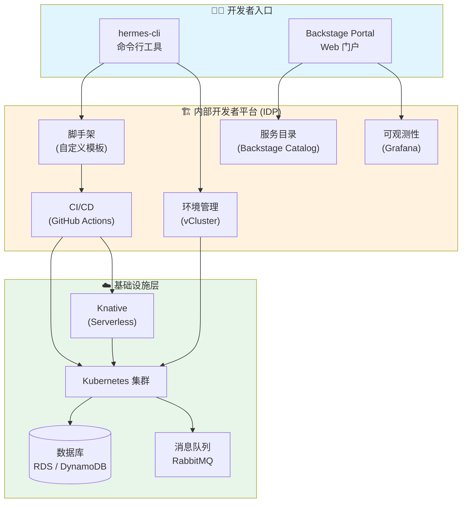

# 第14章 云原生生态概览

> **预计学时**：2 学时  
> **先修依赖**：第13章（CI/CD 流水线）  
> **贯穿案例**：*Hermes Delivery* 快递调度系统

---

## 学习目标

| 层次 | 目标 |
|------|------|
| **知识** | 解释 Serverless 的核心原理与适用场景；区分 FaaS 与容器化 Serverless；描述平台工程与内部开发者平台（IDP）的定位；识别 CNCF Landscape 的层次结构 |
| **能力** | 能够为 *Hermes Delivery* 的业务场景选择合适的 Serverless 方案；能阅读 CNCF Landscape 并筛选适合团队的技术栈 |
| **素养** | 建立"关注业务代码而非基础设施"的云原生思维；理解平台工程中"赋能而非控制"的理念 |

---

## 情境导入

*Hermes Delivery* 的系统上线半年后，快递调度量从日均 5 万单增长到了 20 万单。运维团队的张磊发现一个令人头疼的规律：每逢"双十一"促销日，通知服务会收到海量的短信和推送请求，服务器扩容速度跟不上流量暴涨；而到了凌晨 2 点，80% 的服务器又在"空转"——资源利用率不到 15%。

与此同时，新入职的开发工程师小李在第一天就面临巨大挫折：他需要先学会配置 Kubernetes YAML、了解 Helm Chart、搞懂 Ingress 规则，最后才能写第一行业务代码。"我只是想写一个快递轨迹查询的 API，为什么需要先学这么多基础设施的东西？"小李抱怨道。

技术负责人王工意识到，这些问题指向同一个方向——团队需要将注意力从"基础设施的运维"转移到"业务价值的交付"。这正是**云原生生态**要解决的核心命题。

---

## 14.1 Serverless：从"租服务器"到"租函数"

### 14.1.1 部署模式的演进

回想一下我们在第 7、8 章学到的容器化部署：你需要定义 Dockerfile、编写 Kubernetes YAML、配置副本数、设置资源限制……每一步都在回答"如何运行代码"。而 Serverless 提出了一个激进的问题：**能不能只关心"代码本身"，把"如何运行"完全交给平台？**

用一组类比来理解这个演进过程：

```
物理机时代   →  "我要买一块地，自己盖房子"（采购、布线、空调……）
虚拟机时代   →  "我租一栋楼的某一层"（IaaS，仍需安装操作系统）
容器时代     →  "我租一套精装修公寓"（Docker/K8s，带基础运维）
Serverless  →  "我住酒店，按夜计费"（连房间维护都不用管）
```

Serverless 并非真的"没有服务器"，而是说：**服务器的存在对开发者透明**。开发者只提交代码（或容器镜像），平台负责实例的启动、扩缩容、故障恢复，并**按实际调用量计费**。

### 14.1.2 AWS Lambda：函数即服务（FaaS）

AWS Lambda 是 Serverless 领域最具代表性的 FaaS（Function as a Service，函数即服务）产品。它的核心抽象是：你写一个**函数**，绑定一个**触发器**，剩下的全部交给 AWS。

让我们用 *Hermes Delivery* 的场景来体会。快递状态变更时，系统需要给用户发送通知——这个通知逻辑就是一个典型的 Lambda 场景。

**示例 14-1：用 Go 编写一个快递通知 Lambda 函数**

```go
// hermes-notification/main.go
// 运行环境：AWS Lambda (Go runtime, provided.al2023)
// 最低版本要求：Go ≥ 1.21

package main

import (
    "context"
    "encoding/json"
    "fmt"
    "log"

    "github.com/aws/aws-lambda-go/events"
    "github.com/aws/aws-lambda-go/lambda"
)

// DeliveryEvent 快递状态变更事件
type DeliveryEvent struct {
    OrderID     string `json:"order_id"`
    UserPhone   string `json:"user_phone"`
    Status      string `json:"status"`   // picked/dispatched/delivering/delivered
    Timestamp   int64  `json:"timestamp"`
}

// handleDeliveryNotification 处理快递状态变更
// 当 DynamoDB 中的订单状态变更时，通过 EventBridge 触发此函数
func handleDeliveryNotification(ctx context.Context, event events.SQSEvent) error {
    for _, record := range event.Records {
        var delivery DeliveryEvent
        if err := json.Unmarshal([]byte(record.Body), &delivery); err != nil {
            log.Printf("解析事件失败: %v", err)
            continue
        }

        // 根据状态选择通知模板
        message := buildNotification(delivery)
        
        // 发送短信（此处简化，实际调用 SNS）
        fmt.Printf("[通知] 发送给 %s: %s\n", delivery.UserPhone, message)
        
        // 关键步骤：将通知记录写入日志（后续用于链路追踪，见第10章）
        log.Printf("通知已发送: order=%s, status=%s", delivery.OrderID, delivery.Status)
    }
    return nil
}

// buildNotification 根据快递状态构建通知内容
func buildNotification(e DeliveryEvent) string {
    templates := map[string]string{
        "picked":     "您的快递已揽收，快递员正在赶来～",
        "dispatched": "您的快递已从中转站发出，预计明日到达",
        "delivering": "快递员正在派送中，请注意接听电话",
        "delivered":  "快递已签收，感谢使用 Hermes Delivery！",
    }
    if msg, ok := templates[e.Status]; ok {
        return fmt.Sprintf("[Hermes] %s (订单: %s)", msg, e.OrderID)
    }
    return fmt.Sprintf("[Hermes] 您的订单 %s 状态更新为: %s", e.OrderID, e.Status)
}

func main() {
    lambda.Start(handleDeliveryNotification)
}
```

**代码说明**：这段代码中，开发者**完全没有**配置服务器端口、线程池、负载均衡。Lambda 运行时替你完成了这一切。在 AWS 控制台上，只需要将这个函数订阅到 EventBridge（事件总线）的规则上——当 DynamoDB 中有新的状态变更事件时，Lambda 自动被触发。

**计费方式**：Lambda 按"调用次数 + 执行时长（内存规格 × 运行秒数）"计费。对于凌晨几乎无调用的通知服务，费用趋近于零——这正是 Serverless "按需计费"的核心优势。

### 14.1.3 Knative：Kubernetes 上的 Serverless

Lambda 虽然方便，但它与 AWS 深度绑定。如果你已经将 *Hermes Delivery* 部署在 Kubernetes 上（第 8 章），是否也能享受 Serverless 的弹性？Knative 就是答案。

Knative（读作 "kay-nay-tiv"）是 Google 开源的 Kubernetes 扩展，它将 **Serverless 体验** 引入 **Kubernetes 生态**。核心组件：

| 组件 | 职责 | 类比 |
|------|------|------|
| **Serving** | 管理无状态服务的部署、扩缩容、流量分发 | "K8s 上的 Lambda" |
| **Eventing** | 事件源管理、事件路由和订阅 | "K8s 上的 EventBridge" |

Knative Serving 最引人注目的特性是**缩容到零**（Scale-to-Zero）：当一个服务 30 秒内没有请求时，Knative 会将它缩容到零个 Pod；一旦有新请求到达，它会在**亚秒级**冷启动一个新 Pod。

**示例 14-2：将 Hermes Delivery 的轨迹查询服务部署到 Knative**

```yaml
# hermes-tracking/knative-service.yaml
# 与第 8 章的标准 K8s Deployment 对比，注意这里完全没有 replicas 字段
apiVersion: serving.knative.dev/v1
kind: Service
metadata:
  name: hermes-tracking
  namespace: hermes-delivery
spec:
  template:
    metadata:
      annotations:
        # 设置最大并发请求数（超过此数自动扩容出新实例）
        autoscaling.knative.dev/target: "50"
        # 缩容到零之前的最小保留时间
        autoscaling.knative.dev/scale-down-delay: "60s"
    spec:
      containers:
        - image: hermes-registry/tracking-service:v2.1.0
          env:
            - name: DB_HOST
              valueFrom:
                configMapKeyRef:
                  name: hermes-config
                  key: tracking_db_host
          resources:
            requests:
              cpu: 100m
              memory: 256Mi
            limits:
              cpu: 500m
              memory: 512Mi
```

**与标准 K8s 的关键差异**：

1. **无 replica 定义**：Knative 完全接管了扩缩容决策，你只告诉它"每个 Pod 最多处理多少并发请求"
2. **缩容到零**：凌晨无请求时，此服务占用 0 个 Pod、0 个 CPU 核心
3. **流量驱动**：Knative 自动创建 Route 和 Configuration 对象管理版本

> **扩展阅读**：Knative 还有一个子项目叫 **Knative Functions**，它允许你用 `func create` 一行命令创建函数项目模板，进一步简化开发体验——就像在 K8s 上使用 AWS Lambda 的开发范式。

### 14.1.4 Serverless 的适用边界

并非所有场景都适合 Serverless。以 *Hermes Delivery* 为例：

| 场景 | 是否适用 | 原因 |
|------|:--:|------|
| 快递通知推送（突发流量） | ✅ 适用 | 流量不可预测，无调用时零成本 |
| 实时路径规划（长时计算） | ❌ 不适用 | Lambda 有 15 分钟超时限制 |
| 订单创建 API（稳定流量） | ⚠️ 可选 | 稳定流量下容器方案性价比更高 |

**决策框架**：当你面对一个新的 *Hermes Delivery* 服务时，可以用三个问题快速判断：

1. **流量是否"尖峰+谷底"型？** 如果是（如促销通知），Serverless 优势明显
2. **单次执行是否小于 15 分钟？** 如果超过，FaaS 直接排除；可考虑 Knative（无超时限制）
3. **是否需要 GPU 或特殊硬件？** 如果需要，容器方案更灵活

Serverless 与容器并非二选一的"宗教战争"，而是同一个平台上**互补的工具**。许多成熟团队的做法是：稳态流量用 K8s Deployment 承载，突发流量通过 Knative 弹性处理——两者共享同一个 Kubernetes 集群。这正是云原生生态"多样性"的最好体现。

---

## 14.2 平台工程：让开发者回归编码

### 14.2.1 为什么需要平台工程

回到本章开头小李遇到的困境——新员工需要数天才能写出第一行业务代码。这并不是个别现象。2023年，平台工程（Platform Engineering）正式进入 Gartner 技术成熟度曲线的"期望膨胀期"，背后的驱动力正是**开发者体验危机**。

让我们一起看看 *Hermes Delivery* 团队面临的"认知负载"清单：

```
一个新人要部署一个快递查询 API 到他完成第一步编码前，需要了解：

□ Dockerfile 怎么写                    （第7章）
□ Deployment / Service YAML 怎么写      （第8章）
□ ConfigMap / Secret 管理               （第8章）
□ Ingress / Gateway 路由规则            （第9章）
□ CI/CD 流水线配置                      （第13章）
□ 监控和日志接入                         （第10章）
□ ……（这张清单还在增长）
```

**平台工程的核心主张**：将这些分散的基础设施能力**整合为一个自服务的内部平台**，通过 API、CLI 工具和 Web 门户暴露给开发者。开发者不需要成为 Kubernetes 专家，就可以安全、高效地部署和运维他们的服务。

Daniel Bryant（平台工程领域的思想领袖）提出了一个关键框架：

```
                            ┌──────────────┐
  开发者 ←── 黄金路径 ──→  │  内部平台    │ ←── 平台工程师
  (消费者)     (Golden     │  (IDP)       │     (构建者)
               Path)       └──────┬───────┘
                                  │
                          ┌───────┴────────┐
                          │  基础设施层      │
                          │ (K8s, 数据库,   │
                          │  消息队列, ...)  │
                          └────────────────┘
```

### 14.2.2 平台工程 vs DevOps：不是替代，是演进

一个常见的误解是"平台工程要取代 DevOps"。实际上，两者的关系是这样的：

| 维度 | DevOps | 平台工程 |
|------|--------|---------|
| 目标 | 打破开发与运维的隔阂 | 降低开发者的认知负载 |
| 手段 | 团队协作、CI/CD 自动化 | 构建可复用的内部平台 |
| 适用规模 | 所有团队 | 尤其是 ≥ 25 名开发者 |
| 关键角色 | DevOps 工程师 | 平台工程师 + DevOps 工程师 |

可以这样理解：**DevOps 解决了"怎么协作"的问题，而平台工程解决了"协作起来累不累"的问题**。

### 14.2.3 黄金路径（Golden Path）

平台工程中最重要的设计原则是**黄金路径**——为最常见的任务提供一条"铺满地毯"的默认道路。

以 *Hermes Delivery* 为例，团队为"创建一个新的微服务"设计了这样的黄金路径：

```
开发者只需要执行：
  $ hermes-cli new-service --name courier-assign --template go-grpc

平台自动完成：
  1. 生成项目骨架（Go 模块、Dockerfile、K8s YAML）
  2. 在 Backstage 中注册服务
  3. 创建 Git 仓库并配置 CI/CD 流水线
  4. 申请数据库实例
  5. 配置监控和日志

开发者看到的结果：
  ✓ 服务 courier-assign 已创建
  ✓ 代码仓库：github.com/hermes/courier-assign
  ✓ 数据库：courier_assign_db (只读副本已配置)
  ✓ CI/CD：主分支推送自动触发构建
  → 现在可以开始写业务代码了！
```

注意：黄金路径**不是强制路径**。如果快递路径规划团队有特殊需求（比如需要 GPU 节点），他们完全可以绕开黄金路径——这就是"铺地毯，不修墙"的理念。

**"平台即产品"思维**：平台工程成功的关键在于将内部平台当作一个**产品**来对待，而非一个**项目**。两者的区别在于：

| 维度 | 项目思维 | 产品思维 |
|------|---------|---------|
| 目标 | 按时交付功能 | 持续提升开发者体验 |
| 成功标准 | 功能上线 | NPS（净推荐值）、开发者活跃度 |
| 与用户关系 | 需求方 vs 实施方 | 持续倾听、定期回访 |
| 生命周期 | 有明确的结束日期 | 持续迭代演进 |

*Hermes Delivery* 的平台团队每两周做一次开发者满意度调研，直接决定下一个迭代的优先级——当开发者反映"数据库申请流程太慢"时，自动化数据库申请就排到了最高优先级。这种以开发者体验为中心的迭代方式，正是平台工程的精髓。

---

## 14.3 内部开发者平台（IDP）

### 14.3.1 IDP 是什么

内部开发者平台（Internal Developer Platform，IDP）是平台工程的**落地载体**。它不是一个单一的工具，而是由多个工具组成的**能力层**，位于开发者与基础设施之间。

一个成熟的 IDP 通常包含以下五大能力：

```
┌────────────────────────────────────────────────────────┐
│                 内部开发者平台 (IDP)                      │
├──────────┬──────────┬──────────┬───────────┬────────────┤
│ 服务目录  │ 脚手架    │ 环境管理  │ 可观测性   │ 权限与治理  │
│ (Catalog)│(Scaffold)│  (Env)   │ (Observ.)  │ (Govern.)  │
├──────────┼──────────┼──────────┼───────────┼────────────┤
│ 我的服务  │ 一键创建  │ 开发/测试 │ 日志查询   │ RBAC       │
│ 在哪？   │ 新服务    │ /生产环境 │ 指标大盘   │ 合规检查   │
│ 谁在维护？│ 标准化模板 │ 独立隔离  │ 链路追踪   │ 成本归因   │
│ 依赖关系？│ 内置最佳  │ 按需创建  │ 告警规则   │ 安全基线   │
│          │ 实践      │          │           │            │
└──────────┴──────────┴──────────┴───────────┴────────────┘
│                    基础设施层（第7-9章）                    │
│         Kubernetes · Istio · Databases · Queues          │
└─────────────────────────────────────────────────────────┘
```

### 14.3.2 Backstage：IDP 的事实标准

说到 IDP，就不得不提 **Backstage**——这个由 Spotify 开源并捐赠给 CNCF 的项目，已经成为 IDP 构建的**事实标准**。

Backstage 的核心是 **Software Catalog**（软件目录），它像一个面向开发者的内部"黄页"——在这里你可以找到组织中每一个服务的元数据：它的所有者、API 文档、CI/CD 状态、技术栈、依赖关系。

**示例 14-3：在 Backstage 中注册 Hermes Delivery 的快递通知服务**

```yaml
# catalog-info.yaml（放在服务代码仓库根目录）
# Backstage 通过扫描代码仓库自动发现此文件
apiVersion: backstage.io/v1alpha1
kind: Component
metadata:
  name: hermes-notification
  description: Hermes Delivery 通知服务 —— 处理短信、邮件、App 推送
  annotations:
    github.com/project-slug: hermes-delivery/notification-service
    backstage.io/techdocs-ref: dir:.
  tags:
    - go
    - serverless
    - event-driven
  links:
    - url: https://hermes-docs.internal/notification
      title: API 文档
      icon: docs
spec:
  type: service
  lifecycle: production
  owner: delivery-team
  system: hermes-delivery
  dependsOn:
    - component:hermes-event-bus    # 依赖事件总线
    - resource:dynamodb-orders       # 依赖订单数据库
  providesApis:
    - hermes-notification-api
```

在这个 YAML 文件中，`owner: delivery-team` 使得任何人都能迅速找到通知服务的负责团队；`dependsOn` 字段自动生成了依赖拓扑图——当事件总线需要升级时，平台可以自动通知所有受影响的团队。

### 14.3.3 Hermes Delivery 的 IDP 实践全景

经过一年的建设，*Hermes Delivery* 团队形成了如图 14-1 所示的平台架构。



> **图 14-1 Hermes Delivery IDP 架构全景**：开发者通过 CLI 和 Web 门户与平台交互，平台层整合了服务目录、脚手架、环境管理、CI/CD 和可观测性，底层跑在 Kubernetes + Knative 混合基础设施上。

---

## 14.4 CNCF Landscape 导览

### 14.4.1 CNCF 是什么

CNCF（Cloud Native Computing Foundation，云原生计算基金会）是 Linux 基金会旗下的子基金会，成立于 2015 年。它管理着包括 Kubernetes、Prometheus、Envoy 在内的 **200+ 个云原生开源项目**。

CNCF 每年发布一张著名的 **Cloud Native Landscape**（云原生全景图），按项目成熟度分为三个等级：

| 等级 | 含义 | 代表项目 |
|:--:|------|------|
| 🥇 **Graduated**（毕业） | 成熟稳定，大规模生产使用 | Kubernetes、Prometheus、Envoy、Istio |
| 🥈 **Incubating**（孵化） | 增长期，有一定生产用户 | Backstage、Knative、Argo |
| 🥉 **Sandbox**（沙箱） | 实验阶段，早期创新 | 各类新兴项目 |

### 14.4.2 Landscape 的层次结构

云原生全景图虽然庞大，但它有清晰的层次结构。我们将全景图简化为"五横四纵"来看：

```
五横（层次）：
┌─────────────────────────────────────────────────────────────┐
│ 5. 平台层    │ Backstage · Crossplane · KubeVela              │
├─────────────────────────────────────────────────────────────┤
│ 4. 可观测性   │ Prometheus · Jaeger · Fluentd · Grafana       │
├─────────────────────────────────────────────────────────────┤
│ 3. 运行时层   │ Kubernetes · containerd · CRI-O · Knative     │
├─────────────────────────────────────────────────────────────┤
│ 2. 编排与管理  │ Helm · Argo · Flux · Operator Framework      │
├─────────────────────────────────────────────────────────────┤
│ 1. 应用定义    │ Docker · gRPC · Helm Chart · OpenAPI         │
└─────────────────────────────────────────────────────────────┘

四纵（能力）：
  ① 数据库与存储（Vitess、TiKV、Rook）
  ② 流与消息（Kafka、NATS、Pulsar）
  ③ 服务网格（Istio、Linkerd、Open Service Mesh）
  ④ 安全与合规（Falco、OPA、Notary、Vault）
```

### 14.4.3 教材技术栈在 Landscape 中的位置

本教材涉及的技术栈在 CNCF Landscape 中的对应关系：

| 教材章节 | 涉及技术 | CNCF 等级 | Landscape 位置 |
|---------|---------|:--:|------|
| 第4、6章 | gRPC | — | 应用定义（非 CNCF 但生态核心） |
| 第7章 | containerd | 🥇 Graduated | 运行时层 |
| 第8章 | Kubernetes、Helm | 🥇 Graduated | 运行时层 / 编排与管理 |
| 第9章 | Istio、Envoy | 🥇 Graduated | 服务网格 |
| 第10章 | Prometheus、Jaeger | 🥇 Graduated | 可观测性 |
| 第13章 | Argo / Flux | 🥈 Incubating | CI/CD |
| **第14章** | **Knative、Backstage** | 🥈 Incubating | 运行时层 / 平台层 |

> **实用建议**：在 [landscape.cncf.io](https://landscape.cncf.io) 上，你可以按分类过滤、搜索项目名称、查看项目成熟度和贡献者数量。当你需要为一个技术选型寻找备选方案时，Landscape 是最佳的出发点——但请记住，Graduated 不代表一定适合你，Sandbox 也不代表不能用。**选型永远基于需求，而非等级**。

---

## 14.5 常见误区

> **误区 1：Serverless = 只用函数（FaaS）**
>
> 许多人把 Serverless 等同于 AWS Lambda 这样的 FaaS 产品。实际上，Serverless 是一种**架构理念**，它包括 FaaS（函数即服务）、Serverless 容器（如 AWS Fargate / Knative）、Serverless 数据库（如 Aurora Serverless）。核心判断标准是：**你是否需要管理服务器实例的生命周期？** 如果不需要，它就是 Serverless。

> **误区 2：引入平台工程后，DevOps 团队就该解散了**
>
> 平台工程并不替代 DevOps，而是为 DevOps 实践提供一个**加速器**。平台工程师是 IDP 的构建者，而 DevOps 工程师是IDP的使用者和实践方法的推行者。在一个成熟的组织中，两者是互补关系。

> **误区 3：CNCF Landscape = 技术选型菜单，每个格子都得填上**
>
> CNCF 全景图中的每个分类下可能有十几个项目，但这**不是**要你全部装上的购物清单。Landscape 的本质是一张**地图**，地图不是让你走遍每条路，而是帮你找到最适合的那条。对于大多数团队，Graduated 项目中的精华组合（Kubernetes + Prometheus + Argo + Istio）已经覆盖了 90% 的需求。

> **误区 4：IDP = 给开发者加一个新的审批步骤**
>
> 良好的 IDP 设计是**赋能而非控制**。如果一个平台每次部署都要平台团队手动审批，那不是 IDP，那是**瓶颈**。好的 IDP 通过"黄金路径"引导开发者走向正确实践，同时保留绕过路径的灵活性——就像高速公路旁的辅路，你可以不走，但它随时可用。

---

## 本章小结

### 思维导图

```
第14章 云原生生态概览
│
├── Serverless ── 理念："关注代码，不关注服务器"
│   ├── AWS Lambda ── FaaS 代表，事件驱动，按调用计费
│   └── Knative ── K8s 上的 Serverless，支持缩容到零
│
├── 平台工程 ── 理念："降低开发者的认知负载"
│   ├── 黄金路径（Golden Path）── 给最常见任务铺好默认道路
│   └── 与 DevOps 的关系 ── 互补，非替代
│
├── 内部开发者平台 (IDP) ── 理念："自服务的能力层"
│   ├── Backstage ── CNCF Incubating，事实标准
│   └── 五大能力：服务目录 / 脚手架 / 环境管理 / 可观测性 / 治理
│
└── CNCF Landscape ── 理念："云原生世界的地图"
    ├── 三等级：Graduated / Incubating / Sandbox
    └── 五横四纵结构
```

### 关键术语表

| 术语 | 英文 | 释义 |
|------|------|------|
| 无服务器计算 | Serverless | 服务器对开发者透明的计算模式，按调用计费 |
| 函数即服务 | FaaS (Function as a Service) | Serverless 的子类型，以函数为部署单元 |
| 缩容到零 | Scale-to-Zero | 无请求时将实例数缩减到零，下次请求时冷启动 |
| 平台工程 | Platform Engineering | 构建内部平台以降低开发者认知负载的工程实践 |
| 黄金路径 | Golden Path | 为最常见任务提供的默认标准化流程 |
| 内部开发者平台 | IDP (Internal Developer Platform) | 平台工程的落地载体，整合基础设施能力的自服务层 |
| 云原生计算基金会 | CNCF | 管理 K8s 等 200+ 云原生项目的基金会 |
| 软件目录 | Software Catalog (Backstage) | Backstage 的核心功能，组织内所有服务的元数据中心 |

---

## 练习

### 基础题

1. 用自己的话解释：Serverless 与容器的核心区别是什么？为什么说 Serverless 并非"没有服务器"？
2. AWS Lambda 的计费模型是怎样的？*Hermes Delivery* 的通知服务使用 Lambda 有哪些成本优势？
3. Knative Serving 的"缩容到零"是什么意思？它和标准 Kubernetes Deployment 的扩缩容有什么区别？
4. 什么是"黄金路径"（Golden Path）？它在平台工程中扮演什么角色？
5. CNCF Landscape 的三级成熟度分别是什么？请各举一个代表项目。

### 综合题

1. *Hermes Delivery* 现在有一个"快递员排班优化"服务，它需要 GPU 进行路线计算，且每次计算可能持续 30 分钟以上。请判断 Serverless（Lambda 或 Knative）是否适合此场景，并说明理由。如不适合，建议使用哪种部署方式（参考第 7、8 章）？

2. 假设你是 *Hermes Delivery* 的平台工程师，团队刚决定引入 Backstage 作为 IDP。请设计一个"黄金路径"，描述一个新入职的工程师从零开始创建一个微服务所需的所有步骤（参考 14.2.3 的示例）。至少包含：代码仓库创建、CI/CD 配置、数据库申请、监控接入。

3. 打开 [CNCF Landscape](https://landscape.cncf.io)，在"Service Mesh"分类下找到 Istio 和 Linkerd。比较两者的成熟度等级、GitHub Stars 数量和主要差异，撰写一份 200 字以内的技术选型建议。

### 拓展题

1. **探索**：查询资料了解 **OpenFaaS** 或 **AWS Fargate**，它们分别属于 Serverless 的哪个子类型？与本章介绍的 Lambda / Knative 有何异同？撰写一份简短的对比报告。

2. **思辨**：平台工程强调"降低认知负载"，但也有人认为"过度封装会让开发者失去对底层原理的理解"。你如何看待这种张力？结合你学习第 7、8 章（Docker / Kubernetes）的经历，写一段 300 字左右的思考。
