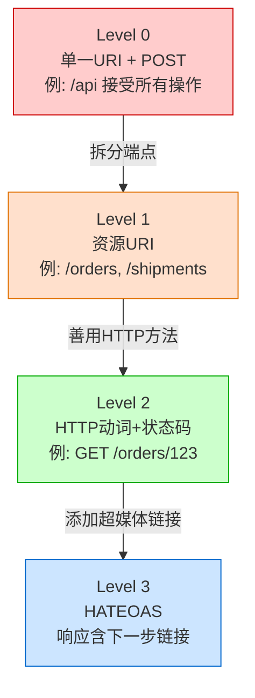
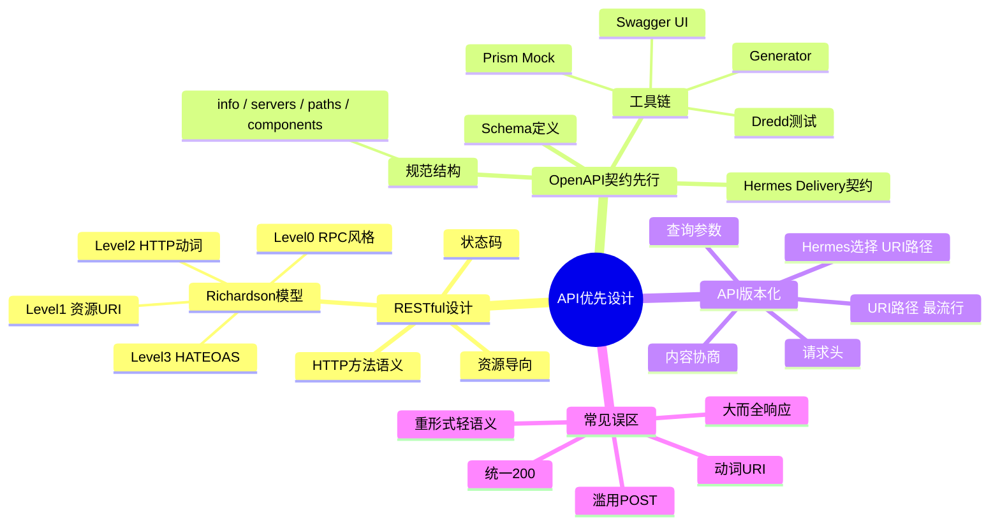

# 第3章 API 优先设计

> **章节信息**：第一篇 · 服务化基础 | 学时：3（理论2 + 实践1）| 前置：第2章「服务化思维与设计原则」

---

## 学习目标

| 层次 | 目标 |
|------|------|
| **知识** | 理解 RESTful 设计的六大原则与 Richardson 成熟度模型；掌握 OpenAPI 3.1 规范的核心结构；比较四种主流 API 版本化策略的适用场景 |
| **能力** | 能使用 OpenAPI 规范独立设计一个微服务的完整 API 契约；能运用成熟度模型评估现有 API 的设计质量 |
| **素养** | 建立"契约先行"的协作意识——在编写一行代码之前，先定义好服务之间的交互协议 |

---

## 3.1 情境导入：Hermes Delivery 的 API 之困

先回顾一下我们在第2章中为 *Hermes Delivery* 快递调度系统划分的四个限界上下文：**订单管理**、**路线规划**、**运单追踪**和**费用结算**。现在，小李的团队准备开始编码了。

周一早上，负责"订单管理"的张工和负责"路线规划"的王工发生了这样的对话：

> **张工**："老王，我的订单服务需要调用你的路线规划，你给我什么接口？"
>
> **王工**："你发一个 POST 到 `/api/v1/route/calc`，body 里传起点和终点坐标就行。"
>
> **张工**："返回什么格式？状态码怎么约定？"
>
> **王工**："呃……正常返回 200，失败的话……有时候 500，有时候 400，取决于是什么错。反正你看 body 里的 `code` 字段吧。"
>
> **张工**："那路线规划的请求体字段名叫什么？`origin` 还是 `from_address`？经纬度用 `lat/lng` 还是 `latitude/longitude`？"
>
> **王工**："我代码里写的是……你等一下我翻翻。"

这种对话在缺乏 API 契约的团队中每天都在发生。王工的接口没有文档、字段命名随心所欲、错误处理不一致——张工要么反复打断王工问字段含义，要么凭猜测集成然后被线上故障打脸。

**这就是本章要解决的核心问题**：在微服务架构中，服务之间通过 API 通信。如果每个 API 都像王工那样"即兴发挥"，系统就会退化为一座巴别塔——每个服务说着不同的"方言"，集成成本呈指数级增长。

API 优先设计（API-First Design）正是解药：**在编写任何实现代码之前，先定义好 API 契约**。本章将从 RESTful 设计原则出发，引入 Richardson 成熟度模型作为评估标尺，然后深入 OpenAPI 规范——业界标准的 API 描述语言——为 Hermes Delivery 设计一套完整的、可自动生成文档和客户端 SDK 的 API 契约。

---

## 3.2 RESTful 设计原则

### 3.2.1 资源导向：把一切建模为资源

REST（Representational State Transfer，表述性状态转移）不是协议，不是标准，而是一种**架构风格**——Roy Fielding 在2000年的博士论文中提出的设计约束集合。它的核心理念出奇地简单：**把服务中的一切建模为"资源"（Resource），通过统一的接口操作这些资源**。

打个比方：文件系统中的一切都是文件——普通文件是文件，目录是文件，设备也是文件。同样的，在 RESTful 系统中，一切都是资源——订单是资源，用户是资源，甚至"查询运单状态"这个动作也可以抽象为资源。

回到 Hermes Delivery。先列出系统中的核心资源：

| 资源 | URI 路径 | 含义 |
|------|----------|------|
| 订单集合 | `/orders` | 所有快递订单 |
| 单个订单 | `/orders/{orderId}` | 某个具体订单 |
| 订单下的运单 | `/orders/{orderId}/shipments` | 一个订单可能有多个运单（拆分运输） |
| 路线方案集合 | `/routes` | 所有已规划的路线 |
| 单个路线方案 | `/routes/{routeId}` | 某条具体路线 |
| 运单集合 | `/shipments` | 所有运单 |
| 单个运单 | `/shipments/{shipmentId}` | 某个具体运单及其追踪状态 |

注意 URI 的命名规则：
- **用名词复数，不用动词**：`/orders` 而非 `/createOrder` 或 `/getOrders`
- **用层级表达归属关系**：`/orders/{orderId}/shipments` 表示"某个订单下的所有运单"
- **用路径参数标识单个资源**：`{orderId}` 是资源的唯一标识

> **常见误区 1**：很多开发者习惯把 URI 设计成动词短语——`/createOrder`、`/updateShipment`、`/deleteRoute`。这违背了 REST 的资源导向原则。正确的做法是：资源路径用名词，操作语义由 HTTP 方法承载。

### 3.2.2 HTTP 方法与语义：CRUD 的标准化表达

RESTful API 将 CRUD（Create, Read, Update, Delete）操作映射到标准的 HTTP 方法：

| HTTP 方法 | 语义 | 幂等性 | 示例（Hermes Delivery） |
|-----------|------|:------:|--------------------------|
| `GET` | 读取资源 | ✅ | `GET /orders/ORD-2026-001` — 获取该订单详情 |
| `POST` | 创建资源 | ❌ | `POST /orders` — 创建新订单 |
| `PUT` | 全量替换 | ✅ | `PUT /orders/ORD-2026-001` — 完整更新订单 |
| `PATCH` | 部分更新 | ❌ | `PATCH /orders/ORD-2026-001` — 只修改订单状态 |
| `DELETE` | 删除资源 | ✅ | `DELETE /orders/ORD-2026-001` — 取消订单 |

**幂等性**（Idempotency）是一个关键概念：多次相同的请求，产生的副作用与一次相同。GET、PUT、DELETE 是幂等的——查询10次与查询1次结果一样；PUT 同样内容10次与1次效果相同。POST 不是幂等的——连续 POST 两次会创建两个订单。

幂等性在分布式系统中至关重要：当网络超时，调用方不知道该请求是否被服务端成功处理。如果是幂等的 GET/PUT/DELETE，重试即可；如果是非幂等的 POST，则需要额外的去重机制（如客户端生成的幂等键）。

> **常见误区 2**：用 POST 做一切——查询用 POST，更新用 POST，删除也用 POST。理由是"简单，不用记那么多方法"。但这样丧失了 HTTP 方法自带的语义，代理、缓存、网关等中间件无法根据方法做优化。而且团队新人理解 API 时需要阅读文档才知道每个 POST 实际做了什么。

### 3.2.3 状态码：让 HTTP 帮你"说话"

RESTful API 应该充分利用 HTTP 状态码来传达操作结果，而不是把所有信息塞进响应体的自定义 `code` 字段：

| 类别 | 典型状态码 | 使用场景 |
|------|-----------|----------|
| **2xx 成功** | `200 OK` | GET/PUT/PATCH 成功 |
| | `201 Created` | POST 创建成功，配合 `Location` 头返回新资源 URI |
| | `204 No Content` | DELETE 成功，无响应体 |
| **3xx 重定向** | `301 Moved Permanently` | 资源 URI 永久变更 |
| **4xx 客户端错误** | `400 Bad Request` | 请求格式错误（JSON 语法错误） |
| | `401 Unauthorized` | 缺少认证凭据 |
| | `403 Forbidden` | 有凭据但权限不足 |
| | `404 Not Found` | 资源不存在 |
| | `409 Conflict` | 资源状态冲突（如重复创建） |
| | `422 Unprocessable Entity` | 参数校验失败（格式正确但语义不对） |
| **5xx 服务端错误** | `500 Internal Server Error` | 未预期的服务器错误 |
| | `503 Service Unavailable` | 服务暂时不可用（熔断/限流） |

> **常见误区 3**：所有响应都返回 `200 OK`，然后在响应体里放一个 `{"code": 0, "message": "success"}` 或 `{"code": -1, "message": "参数错误"}`。这绕过了 HTTP 协议层的语义，让负载均衡器、API 网关、监控系统无法直接根据状态码判断服务状态。

### 3.2.4 Richardson 成熟度模型：评估 API 的 RESTful 程度

Leonard Richardson 提出了一个四级模型，用于评估 API 对 REST 原则的遵循程度。这个模型不追求"每人都要达到 Level 3"，而是提供了一种渐进改进的路线图：

```
Level 0: 单一 URI，单一方法（如 SOAP 式的 /api + POST）
   │
   ▼
Level 1: 资源 URI（多个端点，每个端点代表一种资源）
   │
   ▼
Level 2: HTTP 动词（GET/POST/PUT/DELETE + 正确的状态码）
   │
   ▼
Level 3: HATEOAS（超媒体驱动，响应中包含可执行的链接）
```



让我用 Hermes Delivery 的"获取订单"功能来展示每个级别的差别：

**Level 0** — 一切皆 RPC：

```
POST /api
Body: {"action": "getOrder", "orderId": "ORD-2026-001"}
Response: 200 OK  {"result": {...}}
```

**Level 1** — 有了资源概念：

```
POST /orders/get
Body: {"orderId": "ORD-2026-001"}
Response: 200 OK  {"result": {...}}
```

**Level 2** — 使用 HTTP 方法 + 状态码：

```
GET /orders/ORD-2026-001
Response: 200 OK  {"id": "ORD-2026-001", "status": "IN_TRANSIT", ...}
若不存在: 404 Not Found  {"error": "order not found"}
```

**Level 3** — HATEOAS，响应中包含可操作的链接：

```
GET /orders/ORD-2026-001
Response: 200 OK
{
  "id": "ORD-2026-001",
  "status": "IN_TRANSIT",
  "pickup": {"lat": 39.9042, "lng": 116.4074},
  "delivery": {"lat": 31.2304, "lng": 121.4737},
  "_links": {
    "self":        {"href": "/orders/ORD-2026-001"},
    "cancel":      {"href": "/orders/ORD-2026-001/cancel"},
    "shipments":   {"href": "/orders/ORD-2026-001/shipments"},
    "invoice":     {"href": "/orders/ORD-2026-001/invoice"}
  }
}
```

**实际建议**：行业最佳实践要求在 **Level 2**，这是目前绝大多数公开 API（GitHub、Stripe、Twilio）所达到的级别。HATEOAS 理念优美但实现复杂，在内部微服务中很少采用。本章的 Hermes Delivery API 也将定位在 Level 2，但在关键资源上提供有限的超媒体链接以方便服务发现。

---

## 3.3 OpenAPI 契约先行

### 3.3.1 什么是"契约先行"

传统开发流程中，API 是"副产品"——后端写好代码，然后补一份文档；前端看着（可能已经过时的）文档写调用代码。问题层出不穷：

- 文档与实现不一致，信文档还是信代码？
- 前后端并行开发时，前端只能等后端"先好了叫我"
- API 变更缺乏跟踪，不知道哪个版本改了什么

**契约先行**（Contract First）将流程翻转过来：先由前后端开发者共同（或由架构师主导）编写一份 API 契约——精确描述每个端点的路径、方法、请求体、响应体、状态码、认证方式。这份契约是**唯一的真相源（Single Source of Truth）**。

契约确立后，三条流水线可以并行推进：

```
                    ┌──────────────┐
                    │  OpenAPI     │
                    │  契约文档    │
                    │  (api.yaml)  │
                    └──────┬───────┘
           ┌───────────────┼───────────────┐
           ▼               ▼               ▼
    ┌─────────────┐ ┌─────────────┐ ┌─────────────┐
    │ 后端开发    │ │ 前端开发    │ │ 测试团队    │
    │ 按契约实现  │ │ Mock Server │ │ 写契约测试  │
    │ 保证符合    │ │ 先行开发    │ │ 验证实现    │
    └─────────────┘ └─────────────┘ └─────────────┘
```

### 3.3.2 OpenAPI 规范概述

OpenAPI 规范（前身是 Swagger）是目前最主流的 API 描述语言，已发展到 3.1 版本。它使用 JSON 或 YAML 格式，以结构化方式描述 API 的方方面面。

一个 OpenAPI 文档的核心结构如下：

```yaml
openapi: "3.1.0"                    # ① 规范版本

info:                               # ② API 元信息
  title: Hermes Delivery API
  version: "1.0.0"
  description: 快递调度系统 API

servers:                            # ③ 服务器地址
  - url: https://api.hermes-delivery.com/v1

paths:                              # ④ 端点定义（核心！）
  /orders:
    get:
      summary: 查询订单列表
      # ... 参数、响应等

components:                         # ⑤ 可复用组件
  schemas:                          #    数据模型定义
    Order: { ... }
  securitySchemes:                  #    认证方式
    bearerAuth: { ... }
```

关键模块说明：

| 模块 | 作用 |
|------|------|
| `paths` | 定义每个端点的 HTTP 方法、参数、请求体、所有可能的响应 |
| `components/schemas` | 定义可复用的数据模型（类似编程中的类型定义） |
| `components/parameters` | 可复用的查询参数/路径参数 |
| `components/responses` | 可复用的响应模板（如标准的 404 响应） |
| `components/securitySchemes` | 认证方式定义（Bearer Token、API Key、OAuth2） |
| `security` | 全局或端点的安全要求 |

### 3.3.3 完整示例：Hermes Delivery API 契约

现在，让我们正式为 Hermes Delivery 编写一份 OpenAPI 契约。由于完整规范较长，这里展示核心部分（完整版见配套代码仓库 `hermes-delivery-lab` 的 `chapter-03` 分支）。

**第一步：定义全局结构**

```yaml
openapi: "3.1.0"
info:
  title: Hermes Delivery API
  description: |
    快递调度系统 API —— 贯穿教材《网络软件服务工程》的案例系统。
    涵盖订单管理、路线规划、运单追踪和费用结算四个核心服务。
  version: "1.0.0"
  contact:
    name: 教材编写组
    email: textbook@hermes-delivery.dev

servers:
  - url: http://localhost:8080/api/v1
    description: 本地开发环境

tags:
  - name: Orders
    description: 订单管理
  - name: Routes
    description: 路线规划
  - name: Shipments
    description: 运单追踪
  - name: Billing
    description: 费用结算
```

**第二步：定义可复用的数据模型（Schema）**

在 OpenAPI 中，Schema 使用 JSON Schema 标准来定义数据模型，这相当于为 API 的数据结构建立了"类型系统"：

```yaml
components:
  schemas:
    # --- 地址模型 ---
    Address:
      type: object
      required:
        - name
        - phone
        - address_line
        - city
      properties:
        name:
          type: string
          description: 收件人/寄件人姓名
          example: 张三
        phone:
          type: string
          pattern: '^1[3-9]\d{9}$'
          description: 联系电话
          example: "13800138000"
        address_line:
          type: string
          description: 详细地址
          example: 海淀区中关村南大街5号
        city:
          type: string
          description: 城市
          example: 北京
        latitude:
          type: number
          format: double
          description: 纬度（可选，用于路线规划）
          example: 39.9042
        longitude:
          type: number
          format: double
          description: 经度（可选，用于路线规划）
          example: 116.4074

    # --- 订单模型 ---
    Order:
      type: object
      required:
        - pickup
        - delivery
      properties:
        id:
          type: string
          readOnly: true
          description: 订单唯一标识（服务端生成）
          example: ORD-2026-0001
        status:
          type: string
          enum: [PENDING, ASSIGNED, PICKED_UP, IN_TRANSIT, DELIVERED, CANCELLED]
          readOnly: true
          description: 订单状态
        pickup:
          $ref: '#/components/schemas/Address'
        delivery:
          $ref: '#/components/schemas/Address'
        package_info:
          type: object
          properties:
            weight_kg:
              type: number
              format: float
              description: 包裹重量（千克）
              example: 2.5
            description:
              type: string
              description: 物品描述
              example: 书籍
        created_at:
          type: string
          format: date-time
          readOnly: true
        _links:
          type: object
          readOnly: true
          description: HATEOAS 链接
          properties:
            self:
              type: object
              properties:
                href:
                  type: string
            shipments:
              type: object
              properties:
                href:
                  type: string

    # --- 错误响应模型 ---
    Error:
      type: object
      required:
        - error
      properties:
        error:
          type: object
          required:
            - code
            - message
          properties:
            code:
              type: string
              example: ORDER_NOT_FOUND
            message:
              type: string
              example: 未找到订单 ORD-2026-9999
            details:
              type: array
              items:
                type: object
              description: 字段级错误详情（用于 422）

    # --- 路线模型 ---
    Route:
      type: object
      properties:
        id:
          type: string
          readOnly: true
        origin:
          $ref: '#/components/schemas/Address'
        destination:
          $ref: '#/components/schemas/Address'
        waypoints:
          type: array
          items:
            $ref: '#/components/schemas/Address'
          description: 途经点（可选）
        total_distance_km:
          type: number
          description: 总距离（公里）
        estimated_minutes:
          type: integer
          description: 预估耗时（分钟）

    # --- 运单模型 ---
    Shipment:
      type: object
      properties:
        id:
          type: string
          readOnly: true
        order_id:
          type: string
          description: 关联订单ID
        courier_id:
          type: string
          description: 快递员ID
        status:
          type: string
          enum: [ASSIGNED, PICKED_UP, IN_TRANSIT, DELIVERED, EXCEPTION]
        tracking_events:
          type: array
          readOnly: true
          items:
            type: object
            properties:
              timestamp:
                type: string
                format: date-time
              location:
                type: string
              status:
                type: string
              description:
                type: string
```

**第三步：定义端点**

```yaml
paths:
  # ===== 订单管理 =====
  /orders:
    get:
      tags: [Orders]
      summary: 查询订单列表
      description: 支持按状态筛选和分页
      parameters:
        - name: status
          in: query
          schema:
            type: string
            enum: [PENDING, ASSIGNED, PICKED_UP, IN_TRANSIT, DELIVERED, CANCELLED]
        - name: page
          in: query
          schema:
            type: integer
            default: 1
            minimum: 1
        - name: size
          in: query
          schema:
            type: integer
            default: 20
            minimum: 1
            maximum: 100
      responses:
        '200':
          description: 订单列表
          headers:
            X-Total-Count:
              schema:
                type: integer
              description: 订单总数
          content:
            application/json:
              schema:
                type: array
                items:
                  $ref: '#/components/schemas/Order'

    post:
      tags: [Orders]
      summary: 创建新订单
      requestBody:
        required: true
        content:
          application/json:
            schema:
              $ref: '#/components/schemas/Order'
      responses:
        '201':
          description: 订单创建成功
          headers:
            Location:
              schema:
                type: string
              description: 新订单的 URI
          content:
            application/json:
              schema:
                $ref: '#/components/schemas/Order'
        '422':
          description: 请求参数校验失败
          content:
            application/json:
              schema:
                $ref: '#/components/schemas/Error'

  /orders/{orderId}:
    get:
      tags: [Orders]
      summary: 获取订单详情
      parameters:
        - name: orderId
          in: path
          required: true
          schema:
            type: string
      responses:
        '200':
          description: 订单详情
          content:
            application/json:
              schema:
                $ref: '#/components/schemas/Order'
        '404':
          description: 订单不存在
          content:
            application/json:
              schema:
                $ref: '#/components/schemas/Error'

    patch:
      tags: [Orders]
      summary: 更新订单（部分字段）
      parameters:
        - name: orderId
          in: path
          required: true
          schema:
            type: string
      requestBody:
        content:
          application/json:
            schema:
              type: object
              properties:
                status:
                  type: string
                  enum: [ASSIGNED, CANCELLED]
                delivery:
                  $ref: '#/components/schemas/Address'
      responses:
        '200':
          description: 更新成功
          content:
            application/json:
              schema:
                $ref: '#/components/schemas/Order'
        '409':
          description: 状态冲突（如尝试修改已完成的订单）

  /orders/{orderId}/cancel:
    post:
      tags: [Orders]
      summary: 取消订单
      parameters:
        - name: orderId
          in: path
          required: true
          schema:
            type: string
      responses:
        '200':
          description: 已取消
        '409':
          description: 订单状态不允许取消（如已揽件）

  # ===== 路线规划 =====
  /routes:
    post:
      tags: [Routes]
      summary: 规划路线
      description: 根据起点和终点计算最优路线
      requestBody:
        required: true
        content:
          application/json:
            schema:
              type: object
              required: [origin, destination]
              properties:
                origin:
                  $ref: '#/components/schemas/Address'
                destination:
                  $ref: '#/components/schemas/Address'
                waypoints:
                  type: array
                  items:
                    $ref: '#/components/schemas/Address'
                optimize:
                  type: string
                  enum: [distance, time]
                  default: time
      responses:
        '200':
          description: 路线规划结果
          content:
            application/json:
              schema:
                $ref: '#/components/schemas/Route'

  # ===== 运单追踪 =====
  /shipments:
    get:
      tags: [Shipments]
      summary: 查询运单列表
      parameters:
        - name: order_id
          in: query
          schema:
            type: string
        - name: courier_id
          in: query
          schema:
            type: string
        - name: status
          in: query
          schema:
            type: string
      responses:
        '200':
          description: 运单列表
          content:
            application/json:
              schema:
                type: array
                items:
                  $ref: '#/components/schemas/Shipment'

  /shipments/{shipmentId}:
    get:
      tags: [Shipments]
      summary: 获取运单详情（含追踪事件）
      parameters:
        - name: shipmentId
          in: path
          required: true
          schema:
            type: string
      responses:
        '200':
          description: 运单详情
          content:
            application/json:
              schema:
                $ref: '#/components/schemas/Shipment'

  /shipments/{shipmentId}/events:
    post:
      tags: [Shipments]
      summary: 添加追踪事件
      description: 快递员扫码更新运单状态
      parameters:
        - name: shipmentId
          in: path
          required: true
          schema:
            type: string
      requestBody:
        required: true
        content:
          application/json:
            schema:
              type: object
              required: [status, location]
              properties:
                status:
                  type: string
                  enum: [PICKED_UP, IN_TRANSIT, DELIVERED, EXCEPTION]
                location:
                  type: string
                  description: 当前位置描述
                  example: 北京分拣中心
                description:
                  type: string
                  example: 已离开北京分拣中心，发往上海
      responses:
        '201':
          description: 事件已记录

  # ===== 费用结算 =====
  /billing/invoices:
    get:
      tags: [Billing]
      summary: 查询账单列表
      parameters:
        - name: order_id
          in: query
          schema:
            type: string
      responses:
        '200':
          description: 账单列表

components:
  securitySchemes:
    bearerAuth:
      type: http
      scheme: bearer
      bearerFormat: JWT
      description: 使用 JWT Token 进行认证

security:
  - bearerAuth: []
```

### 3.3.4 从契约到代码：OpenAPI 生态工具链

一份 OpenAPI 契约不只是文档——它是可执行的规范。围绕它有一整套工具链：

| 工具 | 方向 | 作用 |
|------|------|------|
| **Swagger Editor** | 编写 | 在线编辑器，实时预览 API 文档 |
| **Swagger UI** | 呈现 | 将 OpenAPI 文档渲染为交互式 API 文档页面 |
| **Prism** | Mock | 根据 OpenAPI 契约自动启动 Mock Server，前端无需等后端 |
| **OpenAPI Generator** | 代码生成 | 从契约生成 50+ 语言的客户端 SDK 和服务端骨架 |
| **Spectral** | 校验 | 对 OpenAPI 文档进行 Lint 检查，确保符合团队规范 |
| **Dredd** | 测试 | 用契约自动测试实际 API 是否与文档一致 |

一个典型的工作流：

```
1. 编写 openapi.yaml  ──→  2. Spectral 校验  ──→  3. Prism 启动 Mock
                                                          │
    5. 开发完成 ──→  6. Dredd 契约测试  ◀──  4. 前后端并行开发
```

---

## 3.4 API 版本化策略

API 是服务之间的合同。但凡合同就有修订的一天——业务需求变化、字段重命名、认证方式升级……变更不可避免。关键不是"要不要变"，而是"如何变"。

在 Hermes Delivery 的场景中，想象这样一个需求：初期地址字段只记录文本描述（"海淀区中关村南大街5号"），后来路线规划需要经纬度坐标。这是一个**破坏性变更**（Breaking Change）——所有调用方都必须同步升级。

### 3.4.1 四种主流版本化策略

```
┌─────────────────────────────────────────────────────────────────┐
│                    API 版本化策略决策树                            │
│                                                                   │
│  是否破坏性变更？                                                  │
│       │                                                           │
│   ┌───┴───┐                                                       │
│   │ 否    │ 是                                                    │
│   ▼       ▼                                                       │
│  兼容升级  ┌── 策略选择 ──┐                                        │
│  (直接改)  │              │                                        │
│           ▼              ▼                                        │
│    ① URI路径版本    ② 请求头版本                                   │
│   /api/v1/orders   API-Version: 1                                 │
│   /api/v2/orders   API-Version: 2                                 │
│           │              │                                        │
│           ├──────────────┤                                        │
│           │              │                                        │
│           ▼              ▼                                        │
│      ③ 查询参数版本  ④ 内容协商(Accept头)                          │
│   /api/orders?v=1   Accept: application/vnd.hermes.v2+json        │
└─────────────────────────────────────────────────────────────────┘
```

**① URI 路径版本化（最流行）**

```
GET /api/v1/orders/ORD-001
GET /api/v2/orders/ORD-001
```

- ✅ 直观，一眼看出版本；调试友好，可直接在浏览器地址栏切换
- ✅ CDN/反向代理可轻松基于路径做路由
- ❌ URI 不够"纯净"——理论上 URI 应该标识资源，不应包含版本
- **适用**：大多数场景。GitHub、Stripe、Twilio 均采用此策略

**② 请求头版本化**

```
GET /api/orders/ORD-001
Header: API-Version: 2026-01-01
```

- ✅ URI 保持纯净，版本信息在元数据中
- ❌ 调试困难，不能直接在浏览器中测试
- ❌ 代理层缓存可能因忽略自定义头部而导致错误路由
- **适用**：内部微服务间通信，或对 URI 美学有执念的团队

**③ 查询参数版本化**

```
GET /api/orders/ORD-001?version=2
```

- ✅ 实现简单，只需加一个参数
- ❌ "版本"不是查询条件，语义不对；容易被忽略使用默认值导致意外
- **不推荐** 用于生产环境

**④ 内容协商版本化（Accept 头）**

```
GET /api/orders/ORD-001
Accept: application/vnd.hermes.v2+json
```

- ✅ 理论上最符合 REST 学术定义（利用 HTTP 内容协商）
- ❌ 实践中最复杂——客户端库支持差、调试困难、不易理解
- **适用**：对 REST 纯粹性有极致追求的场景（极少见）

### 3.4.2 Hermes Delivery 的版本化选择

权衡利弊后，Hermes Delivery 选择 **URI 路径版本化**。原因如下：

1. **教学友好**：路径版本一目了然，学生容易理解和调试
2. **生态兼容**：所有 HTTP 工具（curl、Postman、浏览器）天然支持
3. **基础设施友好**：API 网关（后续第9章）可以基于路径 `/v1/` `/v2/` 做流量路由

版本号采用主版本号策略：只有当存在破坏性变更时才递增（`v1` → `v2`），兼容变更（如新增可选字段、新增端点）保留在同一版本内。

```yaml
# openapi.yaml 中体现版本化
servers:
  - url: http://localhost:8080/api/v1
    description: 当前稳定版本
  - url: http://localhost:8080/api/v2
    description: 下一版本（开发中）
```

---

## 3.5 常见误区与最佳实践

本章已经穿插了三个常见误区（动词 URI、滥用 POST、统一 200）。这里再补充两个与工程实践相关的关键误区：

> **常见误区 4**：API 设计追求"大而全"——一个端点返回所有可能用到的字段，理由是"万一前端需要呢"。这导致响应体膨胀、数据库查询复杂度增加、网络带宽浪费。实际应该遵循 **"按需返回"** 原则：默认返回核心字段，通过 `?fields=id,status,pickup` 或响应体中的 `_links` 让调用方按需获取详情。GraphQL 的兴起本质上就是对这个问题的回应。

> **常见误区 5**：认为"RESTful 就是 URL 写得好看"。REST 的核心不是 URL 命名规范，而是 **统一接口（Uniform Interface）**——让所有资源通过相同的 HTTP 方法、状态码、媒体类型交互。一个 URL 规范但只使用 POST 的 API，比一个使用全部 HTTP 方法但 URL 稍显混乱的 API 离 REST 更远。

### API 设计检查清单

在提交 API 设计之前，逐项核对：

- [ ] 所有资源路径使用名词复数（`/orders` 而非 `/order`）
- [ ] 创建操作用 POST，并返回 `201 Created` + `Location` 头
- [ ] 幂等的全量更新用 PUT，部分更新用 PATCH
- [ ] 200 OK 不承载错误信息；用 4xx/5xx 系列状态码表达错误语义
- [ ] 分页查询返回 `X-Total-Count` 头或包含分页元数据的响应体
- [ ] 错误响应体结构统一（如 `{"error": {"code": "...", "message": "..."}}`）
- [ ] 敏感数据（密码、Token）不出现在 URL 查询参数中
- [ ] API 版本化策略已明确，并反映在 URI 或请求头中

---

## 本章小结



**关键术语表**：

| 术语 | 英文 | 释义 |
|------|------|------|
| 表述性状态转移 | REST | Roy Fielding 提出的架构风格 |
| 资源 | Resource | REST 中的核心抽象，一切皆资源 |
| 幂等性 | Idempotency | 多次相同请求与一次请求副作用相同 |
| Richardson 成熟度模型 | Richardson Maturity Model | 评估 API RESTful 程度的四级模型 |
| 超媒体即应用状态引擎 | HATEOAS | 响应中包含可执行的下一步链接 |
| 契约先行 | Contract First | 先定义 API 契约，再编写实现代码 |
| OpenAPI 规范 | OpenAPI Specification | 主流的 API 描述语言（原 Swagger） |
| 破坏性变更 | Breaking Change | 需要调用方同步修改的 API 变更 |

**本章核心思想**：API 是微服务之间的语言。一个设计良好的 API 是服务于人类开发者的——清晰、一致、自文档化。OpenAPI 契约让 API 从"后补的文档"变为"先行的设计蓝图"，这是从"写代码"到"做工程"的关键一步。

在下一章中，我们将深入 API 的具体实现——如何使用 REST 和 gRPC 在服务间传递数据，并在代码层面实现本章设计的契约。

---

## 练习

### 基础题（5题）

1. **HTTP 方法匹配**：为以下 Hermes Delivery 的操作选择正确的 HTTP 方法：(a) 查询所有待揽件的订单；(b) 创建一个新订单；(c) 修改订单的收件地址；(d) 取消一个订单；(e) 删除一个已完成的订单归档。

2. **状态码选择**：下列场景应该返回什么 HTTP 状态码？(a) 查询不存在的订单 `ORD-9999`；(b) 创建订单成功；(c) 请求体 JSON 格式错误；(d) 快递员试图取消一个已揽件的运单；(e) 路线规划服务暂时不可用。

3. **Richardson 模型判断**：判断以下 API 调用属于哪个成熟度级别：
   ```
   POST /api  Body: {"method": "getOrder", "params": {"id": "123"}}
   GET  /orders/123  Response: 200 OK {"name": "..."}
   GET  /orders/123  Response: 200 OK {"name": "...", "_links": {"cancel": "/orders/123/cancel"}}
   ```

4. **OpenAPI 结构填空**：在 OpenAPI 文档中，端点的路径和方法定义在 `_______` 字段中，可复用的数据模型定义在 `_______` 字段中。

5. **版本化判断**：以下哪些是破坏性变更？(a) 新增一个可选查询参数 `?sort=desc`；(b) 将响应字段 `phone` 重命名为 `phone_number`；(c) 新增一个端点 `GET /orders/{id}/history`；(d) 将 `POST /orders` 的必填字段从 3 个增加到 4 个。

### 综合题（3题）

6. **设计 API**：为 Hermes Delivery 的"费用结算"服务设计 RESTful API，至少包含：查询某订单的费用明细、生成账单、标记账单已支付。写出完整的 URI 和方法设计，并说明理由。

7. **重构 API**：下面是某开发者设计的"运单追踪"API，请指出至少 5 处不符合 RESTful 设计原则的地方并给出修正方案：
   ```
   POST /api/getShipment          Body: {"shipmentId": "SHP-001"}
   POST /api/updateShipmentStatus Body: {"shipmentId": "SHP-001", "status": "delivered"}
   POST /api/addTrackingEvent     Body: {"shipmentId": "SHP-001", "event": "..."}
   ```
   所有接口统一返回 `200 OK {"code": 0, "data": {...}}`。

8. **契约评审**：假设你是 Hermes Delivery 的架构师。团队提交了以下的 OpenAPI 片段用于订单创建端点。请评审并指出问题：
   ```yaml
   /order:
     post:
       responses:
         '200':
           description: OK
           content:
             application/json:
               schema:
                 type: object
                 properties:
                   result:
                     type: string
                   error:
                     type: string
   ```

### 拓展题（2题）

9. **HATEOAS 设计**：为 `GET /orders/{orderId}` 的响应设计 HATEOAS 链接。考虑订单的不同状态（PENDING、IN_TRANSIT、DELIVERED），每种状态下可执行的操作不同——状态机驱动的超媒体链接。

10. **API 版本迁移计划**：Hermes Delivery 的 v1 API 中，`Order` 的 `pickup` 字段是字符串；v2 需要改为结构化的 `Address` 对象。设计一个 v1 → v2 的平滑迁移方案，包含过渡期策略、废弃通知机制、最终下线时间表。

---

## 实验

### 实验 3-1：编写你的第一个 OpenAPI 契约

**目标**：使用 OpenAPI 3.1 规范为 Hermes Delivery 的"订单管理"服务编写完整的 API 契约文档。

**环境准备**：
```bash
# 拉取实验代码
git clone https://github.com/hermes-delivery-lab.git
cd hermes-delivery-lab
git checkout chapter-03
```

**任务**：

1. **安装工具**：安装 Swagger Editor（或使用在线版 [editor.swagger.io](https://editor.swagger.io)）
2. **编写契约**：在 `api/orders.yaml` 中补全订单管理 API 的完整定义，至少包含：
   - 创建订单（含参数校验）
   - 查询订单（含分页和状态筛选）
   - 获取订单详情
   - 更新订单状态（PATCH）
   - 取消订单
3. **验证**：使用 Spectral 对 `orders.yaml` 进行 lint 检查
   ```bash
   npx @stoplight/spectral-cli lint api/orders.yaml
   ```
4. **可视化**：启动 Swagger UI 查看生成的交互式文档
   ```bash
   docker run -p 8081:8080 -v $(pwd)/api:/api swaggerapi/swagger-ui
   ```
   打开 `http://localhost:8081` 查看结果
5. **启动 Mock Server**：使用 Prism 启动 Mock Server，用 curl 测试
   ```bash
   npx @stoplight/prism-cli mock api/orders.yaml
   ```

**验收标准**：
- Spectral lint 检查零错误
- Swagger UI 可正常渲染文档
- Mock Server 可正常响应请求（返回符合 Schema 的假数据）
- `POST /orders` 返回 `201 Created`，`GET /orders/{id}` 在 ID 不存在时返回 404

**提交**：将完整的 `orders.yaml` 提交到实验仓库的 `chapter-03-solution` 分支。
