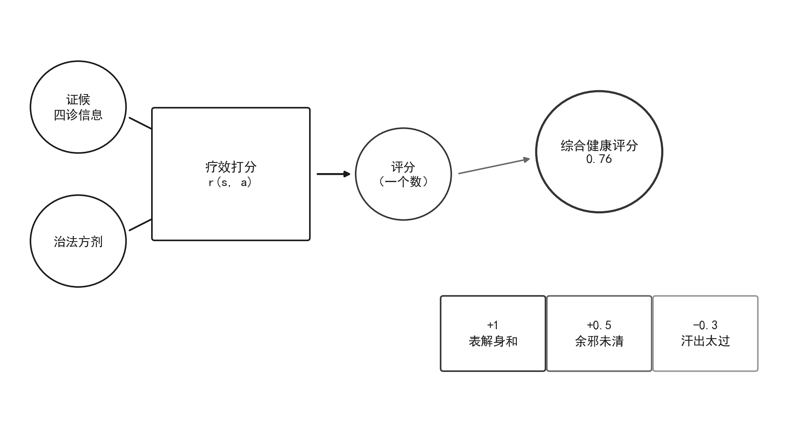

## 7.1 奖励函数：健康全要素的反馈

### 7.1.1 奖励函数：概念与内涵

奖励函数（reward function）是强化学习中"评分"的正式化表达：把智能体在状态 s 执行动作 a 后获得的结果折算成一个数值 r(s,a)。通俗地说，它就是给每个健康结果打分的一把尺子，回答一个基本问题——刚才这一步做得好不好？好得几分？差又差多少？第 1.5 节已说明：奖励是环境对动作的即时反馈，正数鼓励、负数惩罚、零表示中性，强化学习的目标正是让长期累积的奖励尽可能大。但"尽可能大"有一个前提：尺子的刻度必须量对东西。健康语境下，奖励刻度应当覆盖健康全要素——不仅量症状是否缓解，还要量体质是否改善、情志是否舒展、社会功能是否恢复、与环境的协调是否良好。如果只量症状不量体质，医师就会被引导去"压症状"而忽视病根；如果只量眼前不量远期，就会被引导去"求速效"而伤根本。所以本书把奖励函数提升为幸福表达的通道：你奖励什么，平台就引导学习朝什么方向走；尺子量错了，再精确的算法也只会把错误放大。例如只奖励退热快，系统就会偏好大剂量发汗，热虽退而津液伤；只奖励食欲恢复，系统就可能忽略情志问题。健康全要素的提法，正与中医"形与神俱，乃尽终其天年"的整体生命观相合——打分尺子量的是一个人的全部，而不是某一片断。

奖励的符号与量值都携带行为学含义。正奖励鼓励相应处理，负奖励提醒规避风险，绝对值大小表达好坏强度。第 1 章网格世界即是范例：越界 r = −1，进入禁区 r = −1，到达目标 r = +1，其余情况 r = 0——转移表回答"走到哪"，奖励表回答"值多少"，两者成对出现。临床语境完全同构：一次诊疗把病情转移到新状态，同时收到症状缓解、证候转化、随访疗效等多重奖励信号；医患信任与患者依从同样是奖励，信任是诊疗长期有效的社会基础，一次失当处理破坏信任的代价，远大于一张漂亮的化验单。中医强调"中病即止""衰其大半而止"，讲究的是分寸而非把指标推向极值。以感冒随访为例：表解身和、诸症悉除，奖励 +1；余邪未清、微有咳嗽，奖励 +0.5；汗出太过、气短乏力，奖励 −0.3。同样的发汗动作，分寸不同则价值迥异，这正是"微似有汗"的数学表达。可见健康全要素的奖励不是把好事简单相加，而要像辨证一样分清主次、明辨虚实、权衡标本，让每一分奖励都对应真实的健康收益。更进一步，奖励还应区分即刻反馈与远期反馈：急性症状的缓解是即时奖励，体质的改善、证候的转化则是慢变量，二者在时间尺度上的差别，正是第 1.6 节折扣回报与第 4 章价值函数要处理的问题。读者可以先记住一个判断标准：凡是打不出分、说不清为什么的健康收益，都值得再想一层——是量错了刻度，还是根本不该由机器来量。

### 7.1.2 奖励函数：方法与实现

奖励函数的设计在工程上称为奖励工程（reward engineering），分三步。第一步，把期望的健康结果逐条翻译成数值：疗效证据等级可映射为奖励，A 级证据 = 1.0、B 级 = 0.7、C 级 = 0.4；症状缓解程度、随访转归、依从性与信任度，都设计为相应加分项。第二步，解决奖励稀疏：若奖励只在疗程结束时出现一次，中间每一步的好坏无从判断，就需要奖励塑形（reward shaping）——为"方向正确"的中间行为设置渐进小奖励，如症状每减轻一档就给一次正反馈，让学习步步有回音。第三步，警惕奖励漏洞：只奖励点击量，推荐系统就会推博眼球的无关内容；只奖励复诊率，医者就可能诱导无谓复诊而透支信任。记住工程箴言：你奖励什么，就得到什么。奖励表每一格都是对行为的一次投票，动手设计前先问：我想要的行为到底是什么？在平台上，证据等级映射是最直接的落地方式；把疗效随访差值替换进奖励表，观察策略如何变化，是最直观体会"奖励引导行为"的入门实验。初学者最容易犯的错，是把奖励表当成一劳永逸：上线后从不复审。实际上奖励表与证候一样会过时——疾病谱在变、指南在更新、患者群体在变化，奖励表应当像方剂随证加减一样定期修订；每一次修订都要记录理由，让每一次改分都有据可查。把奖励工程理解为一项持续维护的工作，而不是一次性的翻译任务，平台才能长期不跑偏。

用一个失眠诊疗的例子（教学示例数据），完整走一遍奖励函数的设计流程。目标清单：入睡时间缩短、睡眠时长增加、日间精力恢复、焦虑减轻、西药减量顺利、患者满意且信任。量化方案：每项按 0 至 1 打分，症状缓解 0.4、日间功能 0.2、情志舒展 0.2、信任依从 0.2，合计为一次随访的奖励，长期随访再加远期转归项。组合方式：加权求和，权重由医者、患者与管理者共同商定——权重是价值观的表达，偏疗效还是偏体验，会塑造出不同的诊疗风格。设计完成后必须反向检验：把数值代入可能的诊疗轨迹，看它把行为引向哪里——会不会诱导过度检查？会不会诱导提前停药？这种正向翻译、反向检验的双向思维，是奖励工程的核心技能。还要注意：这里设计的都是单步奖励，单步分高不等于全程好，把一次次奖励串成对一个完整诊疗过程的评价，是回报与价值函数（第 1.6 节、第 4 章）的任务。数字核算：一次随访中症状缓解 0.8、日间功能 0.7、情志舒展 0.6、信任依从 0.9，总奖励 = 0.4×0.8 + 0.2×0.7 + 0.2×0.6 + 0.2×0.9 = 0.32 + 0.14 + 0.12 + 0.18 = 0.76（见图 7-1）；若把"重镇安神、速效为先"的权重独占 0.8（教学设定示例：此处作反事实演示，实际设计时各项权重之和仍须归一为 1，见 7.3.2），同一结果的总分便偏向短期指标，长期调理无人喝彩——权重之差，即策略之差。这个算例还说明一个实操要点：加权总分只是参考，临床决策最终仍要回到四诊合参——如果某次随访四维分数都高，但患者脉象弦紧不减，系统应把脉象转归列为硬指标复核，而不是盲从总分。分数辅助决策，辨证仍是主体。

**图7-1 奖励函数设计示意：给健康结果打分的一把尺子**

图注：①对接正文：正文 7.1.1 把疗效打分定义为“给健康结果打分的一把尺子”，7.1.2 以失眠诊疗随访完成加权算例。②线的注释：加权横条的长度=权重×得分（该项对综合健康评分的贡献）；刻度卡 +1/+0.5/-0.3 为随访三分数（正文 7.1.1）。③符号的注释：疗效打分以证候/四诊信息为输入、以治法方剂为举措，输出一个健康结果评分。④指针图段：指向“综合健康评分 0.76”框——0.4×0.8+0.2×0.7+0.2×0.6+0.2×0.9=0.32+0.14+0.12+0.18=0.76，与正文实算一致；尺子量错了，再精确的算法也只会把错误放大。e. 阅读引导：先看左侧“证候/四诊信息与治法方剂输入奖励函数、输出健康结果评分”的打分主线，再看刻度卡 +1/+0.5/−0.3 三档随访分数，最后回到加权算式 0.76 对照符号含义：奖励表每一格都是对一次诊疗行为的态度投票。

### 7.1.3 奖励函数：小结与衔接

本节要点回顾：奖励函数 r(s,a) 是环境对动作的即时评分，是给每个健康结果打分的一把尺子；符号与量值表达好坏与强度，转移与奖励成对构成环境反馈；健康全要素的奖励应覆盖症状、体质、情志、社会功能与环境协调，不盯单一指标；奖励工程含目标翻译、稀疏处理、漏洞审查三步，核心是正向翻译、反向检验。中医语境中，疗效反馈是奖励的直接来源，医患信任是奖励的社会维度，二者共同引导策略朝"既治好病、又赢得信任"演化。记住一条铁律：算法学到的行为质量，上限由奖励设计决定——设计错了，再好的算法也白费。把奖励函数理解为幸福的表达，意味着设计奖励表的人，实质是在替系统定义什么是好的健康状态，每一分奖励的选择都是对"何谓幸福"的一次回答。临床检验：同一首方剂，若奖励只算症状积分，医师会倾向加重药力换取短期分数；若同时计入脉象转归与患者自评，医师就会兼顾攻邪与扶正。平台实践中，奖励表评审应像处方点评一样定期进行，由医者、患者与管理者共同参与。理解了这一层，再读第 1.5 节的网格世界奖励表，就会看懂：同样三行数字背后，站着设计者对"何谓健康"的不同回答——奖励表怎么定，生命就被怎么理解；把奖励表看作幸福的表达，就是把这张表当成对生命价值的一份宣言。下一段将把七节串联成一条完整的认知链，读者可以带着这张路线图检验自己的理解：每读完一节，是否都能回答"这一节解决了上一节的什么问题、又为下一节埋下什么伏笔"。

从本节引出本章的中心问题：这把打分尺子怎么造，才能引导出幸福的健康行为？如果只追求奖励最大化，会不会反把人引向极端？这正是本章八节依次回答的认知链：7.2 节确立第一原则——适度而非最优化；7.3 节展开适度的四个维度——生理、心理、社会、环境四个潜能最适度；7.4 节讨论多目标与约束，把多维平衡变成可计算的问题；7.5 节从奖励黑客与指标异化的教训反证极端化的危害；7.6 节引入正则化与信息熵，给出落实适度的数学工具；7.7 节把个人幸福放进系统科学的大视野；7.8 节收束于六者和谐——幸福医院、和谐社会与人类命运共同体。每一节都以前一节的问题为起点，又为后一节埋下伏笔。读完本章，读者将明白：强化学习的目标句"最大化长期回报"需要被重新理解——真正要最大化的不是某个极端值，而是整体潜能在不同尺度上的伸缩与绽放。下一节的问题就摆在这里：如果把"最大化长期回报"照字面执行，健康会走向哪里？带着这个问题翻开 7.2 节，读者将经历一次从"最优"到"适度"的观念翻转。这种翻转并非否定最优化的价值：在适度区间之内，最优化仍然是寻找最佳策略的有力工具；本书反对的只是把某一指标推向极端的最优化。简言之，最优化是方法，适度是目标——方法服务于目标，二者并不冲突。记住这一句话，读者在后续章节再遇到各种算法时，就不会迷失在数学细节里。
