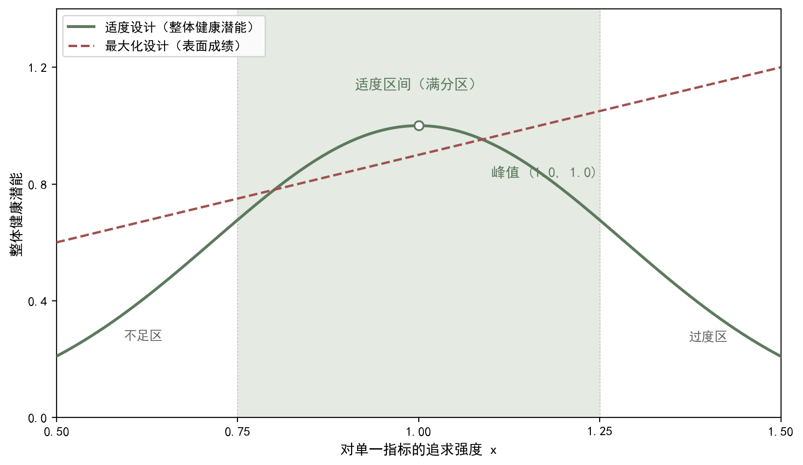

## 7.2 奖励设计原则：适度而非最优化

### 7.2.1 奖励设计原则：概念与内涵

强化学习的教科书目标句是"最大化长期累积奖励"，第 5 章的最优状态价值、贝尔曼最优方程都围绕"最优"二字展开。本书却提出一个看似矛盾、实则更贴近健康的命题：奖励设计的灵魂不是最优化，而是适度。最优化（optimization）追求把某个指标推向极值；适度（moderation）追求把状态维持在恰到好处的中和区间。中医对此有最古老的表达：《素问·生气通天论》说"阴平阳秘，精神乃治"，阴阳双方不是一方压倒另一方，而是势均力敌的平衡；《中庸》讲"致中和，天地位焉，万物育焉"，"中"即不偏不倚、无过不及。过与不及同病，临床上处处可见：汗法以"遍身漐漐微似有汗"为佳，大汗淋漓反伤阳耗气；补法以虚则补之为度，滥补反壅滞生热；攻下"衰其大半而止"，过用则正气随泻而脱。中医治病的分寸感，正是适度哲学的临床原型。举一个反例：若把降糖目标设为"血糖越低越好"，追求极值的处方必然频繁诱发低血糖——低血糖的即时危险远大于高血糖的长期隐患，这正是过犹不及的现代版本。《伤寒论》用桂枝汤后"啜热稀粥一升余，以助药力"，强调给机体留出自行调和的余地，而不是把药力推到极致。把这段中医分寸史翻译成奖励设计语言：最优策略不是取最大值的点，而是落在最适区间内的策略族；凡是把奖励函数设计成单调递增、永不封顶的，都是在鼓励系统效仿"大汗淋漓"式的极端。这是本章反复出现的第一条红线。

为什么最优化有害？因为单一的最大化会破坏尺度伸缩的整体潜能。生物学中的耐受定律早已说明：每种生物对温度、湿度等生态因子都有一个最适区间，在区间内生长最好，低于或高于区间都受抑制——不是越高越好，而是恰到好处最好。人体指标同样如此：血压、血糖、睡眠时长都只有最适区间而没有极值偏好；一味追求越低越好或越多越好，必然牺牲其他维度。尺度伸缩（scale extension）指同一生命在不同尺度上展开的能力——个人、家庭、医院、社会，微观与宏观互相成就；极端化恰恰斩断这种伸缩：为把某项指标推到极值，系统把全部资源压向一处，其他维度被掏空，整体潜能反而坍缩。奖励函数若按最大化设计，就像鞭子驱赶系统奔向极值；若按适度设计，则像缰绳把系统稳在最适区间。耐受定律在人体上处处可见：体温高于 37℃ 是发热，低于 35℃ 是失温，二者都是病理；睡眠低于 6 小时或超过 9 小时，长期风险都高于中间区间。极端化破坏整体潜能，表现为拆东墙补西墙：为把运动量冲上去，关节提前报废；为把血压压下来，脑供血不足。这不是猜测，而是每一项"指标冲顶"工程反复上演的结局。因此，设计奖励的第一问不是"如何让指标更高"，而是"这个指标的极值方向真的通向健康吗"。血糖、血压、步数、睡眠，每一项都回答"否"——它们的最适区间都在中间。记住这个判断，就守住了适度原则的入口。

### 7.2.2 奖励设计原则：方法与实现

把"适度而非最优化"落成可操作的设计原则，可概括为四条。其一，目标对齐：奖励必须反映真实目标，而不是方便测量的代理指标——量睡眠质量，不要量躺床时长；量功能恢复，不要只量化验数字。其二，适度区间：为每个指标设定最适区间，区间内给满分，超出区间奖励递减乃至封顶，让系统没有动力冲向极值。其三，多信号平衡：不把权重压倒性地放在单一信号上，宁可每项都够得着，也不让一项吃独食。其四，可解释：每项奖励都能向患者、家属和管理者说清楚为什么这样打分，奖励是共识的产物而不是黑箱的指令。数学上，适度区间可写成：对指标 x，奖励函数 r(x) 在区间 [x1, x2] 内取最大值 1，两侧按距离平滑衰减；区间之外函数不再随 x 单调上升，系统便失去冲极值的动力（见图 7-2）——这把尺子的刻度本身就在表达"适可而止"。以收缩压为例，最适区间可取 90 至 120 毫米汞柱，过低或过高都按距离扣分，系统便不会为了更低而把血压推向危险。可解释性同样可操作：每项奖励附一句为什么，如"睡眠 7 小时得分最高，是因为流行病学研究显示 7 小时左右全因死亡率最低"——能解释的奖励才经得起患者与家属的追问，也经得起规者与法者的审查。四条原则的次序也有讲究：目标对齐是前提，区间与平衡是结构，可解释是保障——前提错了，后面越精巧越危险；结构与保障缺失，前提再对也会在执行中走样。读者设计任何奖励表，都应从头到尾走一遍这四问。

用运动处方体会这些原则。步数奖励设计为：每日 6000 至 10000 步给满分 1.0；3000 至 6000 步按比例递减；超过 15000 步奖励反而回落——对中老年人而言，过大运动量可能损伤膝关节，越多越好在此是害人的直觉。饮食奖励不按蛋白质摄入量单一指标，而按主食、蛋白、蔬菜、饮水的平衡程度打分，偏食者奖励递减；情志奖励不以永远乐观为目标，而把情绪自我觉察、适度表达设为最适区间。设计完成后做反向检验：这套步数奖励会鼓励一位膝关节退变的老人每天咬牙走一万步吗？会——除非把关节疼痛报告设为扣分项；会引导追求肌肉围度的青年走向极端训练吗？可能——除非把过度训练综合征风险写进约束。平台场景同理：把信息有用、行为可落实、患者满意放在最适区间内综合评分，而不是把点击率推到最大，推荐系统才真正服务于健康。每一次调整权重与区间，都要回到"这条奖励会把行为引向哪里"的追问。适度，才是长期可持续的最优。这套设计还有一个隐藏收益：可解释的奖励表天然利于医患沟通——患者看到"步数过万反而减分"，会理解医师不是限制他运动，而是保护他的膝关节；管理者看到"点击率不进奖励表"，会理解平台不靠流量取胜。奖励表写清楚了，很多误会就提前化解了。下节把同样的思路从单一指标推广到四个维度，读者将看到四把尺子如何各安其位。

**图7-2 适度而非最优化曲线：过度追求单目标，整体健康先升后降**

图注：①对接正文：正文 7.2.1 确立“适度而非最优化”，7.2.2 给出收缩压与步数的临床刻度。②线的注释：绿色实线为整体健康潜能（钟形），先升后降；红色虚线为按“越高越好”思路设计的表面成绩，单调上升（报表一路走高）。③符号的注释：横轴 x 为对单一指标的追求强度，纵轴为整体健康潜能（综合健康水平）；绿色阴影 [0.75, 1.25] 为适度区间（满分区），两侧为衰减区。④指针图段：指向钟形顶点右侧的回落段——进入适度区间达到顶峰，继续冲顶则整体下降（拆东墙补西墙：步数>15000 伤膝、血糖过低致低血糖）；不是越高越好，而是恰到好处最好（阴平阳秘，精神乃治）。e. 阅读引导：先看绿色钟形实线与红色单调虚线两条曲线的走向差异，再看适度区间 [0.75,1.25] 满分区与顶点右侧的回落段，最后对照横纵轴符号含义：进入适度区间即达顶峰，继续冲顶则整体下降——不是越高越好，而是恰到好处最好。

### 7.2.3 奖励设计原则：小结与衔接

本节要点回顾：奖励设计的第一原则是适度而非最优化；最优化破坏尺度伸缩的整体潜能，适度把系统稳在最适区间；中医的阴平阳秘、致中和是适度哲学的古老表达，耐受定律给出科学佐证；实现适度有目标对齐、适度区间、多信号平衡、可解释四条原则，并用封顶或衰减的奖励函数落实。需要强调：适度不是保守，更不是差不多就行；适度是主动把系统约束在最能发挥整体潜能的区间，是一种比冲极值更高级的优化观。对学习强化学习的读者来说，这是一次重要的观念翻转：第 5、6 章的最优性工具仍然有效，但必须服务于适度目标——最优策略是在约束与最适区间内做到最好，而不是把某个数字推向无穷。观念翻转的落点是重新定义最优：最优策略不是把回报推向无穷的策略，而是在可行域与最适区间之内做到最好的策略——多约束的可行域、多目标的权重、正则化与熵的缰绳，共同构成新的最优定义。理解了这一点，读者再看后续任何算法，都会先问：它在优化什么？最适区间画在哪里？缰绳松紧如何？问出这些问题，才算真正读懂算法。值得再说一层：适度与最优不是替代关系而是层级关系——最优化在适度给定的框架内工作，适度在更上层决定框架本身。这就好比辨证在先、用药在后：先定"该往哪个方向调"，再求"这个方向内怎么调得最好"。把层级分清楚，观念翻转才算完成。

适度原则回答了怎么打分，但还没回答往哪里适度：最适区间到底画在哪些维度上？健康不是单一指标，而是多维存在。下一节展开本章的核心概念——四个最适度：生理、心理、社会、环境四个潜能最适度，共同构成健康全要素的目标框架；四个维度各有最适区间，又相互牵连、彼此制约。从奖励函数的角度看，四个最适度意味着奖励不是一把尺子，而是四把尺子的合奏；如何把四把尺子合成一个可计算、可学习的评分系统，正是 7.3、7.4 两节的任务。进入下一节前，读者可以先用本节原则自问：我为自己设计的健康奖励表，各项指标的最适区间在哪里？有没有哪一项被无意识设成了越大越好？具体做法：写下自己一周的健康行为清单，逐项问——运动量的最适区间在哪里？饮食是不是被单一指标（如蛋白质克数）绑架？睡眠是不是被"越少越高效"的错误信念扭曲？把每个指标的最适区间画出来，再对照实际行为，多数人会发现自己正被某种越大越好或越快越好的直觉悄悄驱赶。带着这些困惑进入 7.3 节，四个最适度就不再是抽象概念，而是一面照见自己健康观的镜子。还要预告一个与本节相关的视角：健康不是一次测评的静态结果，而是长期动态过程——今天的适度区间与十年后不同，与病程不同阶段也不同。因此，奖励表、权重与区间都必须定期复审，这将在 7.3、7.4 两节以"随证治之"的形式具体展开。读者带着"动态适度"的预期进入下一节，会更容易接受四维框架的灵活性。
