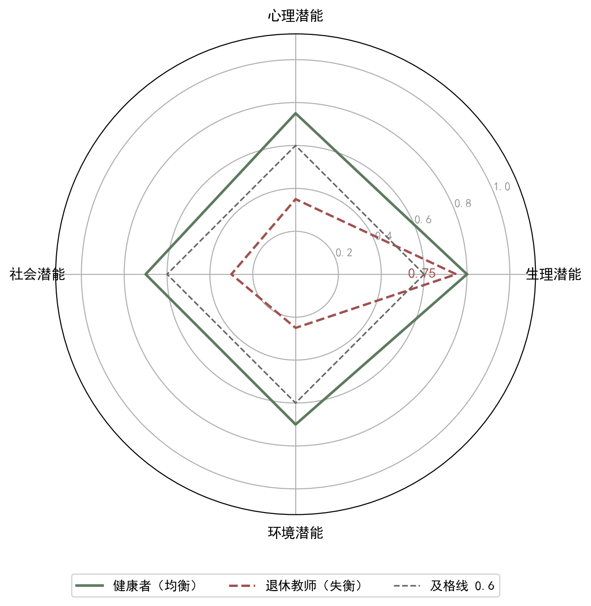

## 7.3 四个最适度：生理、心理、社会、环境

### 7.3.1 四个最适度：概念与内涵

本章的核心概念是四个最适度（four potential optimality：physiological / psychological / social / environmental）：生理潜能最适度、心理潜能最适度、社会潜能最适度、环境潜能最适度。生理潜能指形体的健康能力——脏腑气血的运行、运动耐量、睡眠与食欲的节律；心理潜能指情志与认知的舒展——情绪的自我调节、注意与记忆、对自我的接纳；社会潜能指人际与角色的健康——家庭关系的温暖、职业功能的胜任、助人与受助的能力；环境潜能指人与自然的协调——对气候节律的顺应、居处环境的适宜、生活方式与生态的良性互动。这个四维框架与世界卫生组织关于健康的定义若合符节——健康不只是没有疾病，而是身体、心理、社会适应均处于完好状态；也与中医形神合一、天人相应的整体观相通：形者生理，神者心理，人伦者社会，天地者环境，四者一体不可分割。四个维度互相牵连：长期失眠拖垮心理，心理压力加重躯体症状，久病之人疏离社会，社会孤立又反噬健康——牵一发而动全身。用一个健康画像体会四维：一位退休教师，血压血糖平稳（生理），但丧偶后情绪低落、睡眠浅（心理），子女在外、社交萎缩（社会），冬季畏寒、居室阴冷（环境）——四维中只有生理在及格线上，整体健康却明显失衡（见图 7-3）。只治失眠而不问孤寂，只调情绪而不管居室，都是只见一维的疗法；全要素的奖励设计必须四维齐观，才谈得上整体调节。

四个维度的关键词都是最适度而非最大化——即最适度而非最优化（最大化）：最优化指向单点极值，最适度守护区间平衡。生理上不是越强壮越好：过度训练伤膝，滥补反生湿热，以妄为常透支生命；心理上不是越积极越好：适度的忧患是生存的警觉，过度的亢奋同样耗神，《素问》讲"恬惔虚无，真气从之"，贵在从容而非亢进；社会上不是地位越高越好：角色负荷过重、人情透支，同样损伤健康；环境上更不是改造越多越好：人应顺四时、适寒暑，与天地相参，而不是无度索取自然。四个最适度之间存在此消彼长的张力：追求生理指标的极致，可能牺牲心理安宁；承担过多社会责任，可能挤压生理恢复。因此，四个最适度不是四座各自独立的极值峰，而是一个相互制约、需要动态平衡的整体结构。用强化学习的语言说，健康的目标不是单一标量，而是一个四维目标向量 F = (f生, f心, f社, f环)，每个分量都有最适区间；最优策略是让整个向量落在四维的和合区间里，而不是把某一维推向顶端。四维牵连的经典证据在《金匮要略》："见肝之病，知肝传脾，当先实脾"——肝（情志与气机）与脾（运化与形体）的传变，正是心理维度波及生理维度的中医模型；而怒伤肝、思伤脾、恐伤肾则说明情志不是孤立的内心事件，而是牵动脏腑的系统扰动。目标向量 F 的记号提醒我们：健康评价是四维的，任何把 F 压成单数的做法，都是对健康的简化，也是奖励设计最大的风险来源。

**图7-3 四个最适度雷达图：生理、心理、社会、环境——均衡与失衡对比**

图注：①对接正文：正文 7.3.1 提出四维目标向量 F 与退休教师健康画像。②线的注释：绿色多边形为健康者（均衡，四维均在及格线上）；红色多边形为退休教师（失衡）；灰色虚线为及格线 0.6。③符号的注释：F=(f生, f心, f社, f环) 为四维目标向量，各分量取值 0~1，越高越接近该维度最适。④指针图段：指向红色多边形“生理 0.75”顶点——四维中只有生理一维在及格线上，整体明显失衡；只治失眠不问孤寂、只调情绪不管居室，都是只见一维的疗法。e. 阅读引导：先看红色与绿色两个多边形的整体形状对比（失衡 vs 均衡），再看红色多边形“生理 0.75”这一唯一过线顶点，最后对照及格线 0.6 与四维向量 F 的符号含义：只治失眠不问孤寂、只调情绪不管居室，都是只见一维的疗法。

### 7.3.2 四个最适度：方法与实现

把四个最适度写进奖励函数，方法是分维打分、加权合成——四个最适度从理念到算法，中间只隔一张奖励表。第一步，为每个维度定义最适区间和打分函数：生理维度如睡眠 6 至 8 小时、每周中等强度运动 150 分钟左右；心理维度如焦虑自评量表得分处于正常带、情绪觉察能力良好；社会维度如家庭关系融洽、工作角色胜任、有稳定的互助网络；环境维度如作息顺应昼夜节律、居处通风采光适宜、与自然有规律接触。打分各有所据：睡眠与食欲来自问诊，情绪来自情志望诊与量表，家庭与社会功能来自随访，居处来自起居询问——四维分数不是空想，而是四诊的延伸。第二步，用权重把四维合成一个总奖励：R = w1·f生 + w2·f心 + w3·f社 + w4·f环，权重和为 1，体现设计者对四维重要性的判断。第三步，针对不同病证调整权重：急性疼痛期生理权重上调，恢复期心理与社会权重上升，慢性病长期管理则四维权重趋于均衡——权重随证候与病程动态调整，与中医随证治之的精神一致，正是因人、因时、因地制宜的算法化。做一个加权合成的数字例子（教学示例数据）：设四维打分分别为 0.9、0.6、0.5、0.7，若权重取 (0.4, 0.3, 0.2, 0.1)，总奖励 = 0.4×0.9 + 0.3×0.6 + 0.2×0.5 + 0.1×0.7 = 0.71；若患者正处于心理危机期，把权重调为 (0.2, 0.5, 0.2, 0.1)，同样四维分数下总奖励变为 0.2×0.9 + 0.5×0.6 + 0.2×0.5 + 0.1×0.7 = 0.65——同一患者，同一时刻，权重变化直接改变当前最该处理哪一维的结论，这就是权重即价值观的可计算版本。

以一位围绝经期失眠的女性患者为例。生理维度：睡眠 6 至 8 小时、潮热次数减少为最适；心理维度：焦虑自评从重度降至轻度以下、能自我接纳为最适；社会维度：恢复家务与工作的胜任感、与家人沟通顺畅为最适；环境维度：作息规律、卧室安静凉爽、日间有户外活动为最适。四维奖励合成后，治疗策略自然走向安神与调肝脾并重、心理疏导与家庭支持并举、起居调摄与环境改善齐进，而不是一味重镇安神——后者只能刷高生理维度的短期分，却压垮心理与社会维度。实现时注意三点：一是数据来源不同，量表、随访、家属报告、可穿戴设备各司其职——睡眠时长靠手环记录，焦虑程度靠量表评估，家庭关系靠家属访谈，起居环境靠问诊询问，缺任何一类，该维度就只能靠猜，最适区间判断必然失真；二是维度间冲突要协商处理，如患者想加大运动量快速减重（生理），但膝痛明显（环境与生理冲突），正确做法不是哪边赢，而是调整约束——在膝痛可承受的区间内渐进增加负荷，并把疼痛报告设为扣分项，让系统学会在安全边界内减重，这正引向下节的多目标方法；三是四维评分要留给医师与患者人本判断的余地，分数是辅助而不是命令——这是"适度"在实践中的最后一道保障。

### 7.3.3 四个最适度：小结与衔接

本节要点回顾：健康由生理、心理、社会、环境四个潜能最适度构成，每个维度都有最适区间而非极值偏好；四维相互牵连、动态平衡，共同构成健康全要素的目标框架；实现方法是分维打分、加权合成，权重随病证与病程动态调整；临床要点是四维数据来源多样、冲突需要协商、人本判断不可让渡。四个最适度把 7.2 节的适度原则从怎么打分落实为往哪里适度——最适区间画在四个维度上，健康才完整；只画一个维度，就是只见树木不见森林。还要记住：四个最适度不是静态的处方，而是随生命进程伸缩的标尺——少年与老年、急性期与恢复期，最适区间都在移动；奖励函数因此需要定期复审与更新，这与后文"策略需要持续学习"的思想完全一致，也与中医因人因时因地制宜的辨证精髓一脉相承。最适区间随生命进程移动，例子俯拾皆是：青少年的睡眠最适区间是 8 至 10 小时，老年人则常为 6 至 7 小时；急性期患者需要卧床静养，恢复期患者需要循序渐进的活动；春季宜升发、冬季宜收藏，同一个人的运动最适区间也随季节伸缩。因此，奖励表的复审不是形式，而是医疗质量的日常：每一次随证调整，都是一次最适区间的重画；每一次疗效评估，都是一次四维分数的新写。读者若把静态奖励表当成一次定终身，就违背了本章最核心的动态观——适度是过程，不是终点。

四个最适度同时存在，立即带来一个计算问题：四个目标怎么同时满足？健康是多目标问题，而不是单目标问题的简单叠加。把四维最适度写进优化语言，问题就变得具体：四个目标函数的最优解通常互不相同——让睡眠最快的方案未必让情绪最好，让情绪最好的方案未必让社会功能恢复最快；健康不可能靠分别最大化每一维来实现，只能靠在权衡中共同逼近各自的适度区间。下一节讨论多目标与约束：把四维目标写成可计算的优化形式，用权重表达取舍，用帕累托最优刻画"没有最好只有权衡"，用约束划定"无论如何不可越过的红线"——安全红线、耐受红线、伦理红线。帕累托最优将给出严格回答：健康的合理方案不是唯一点，而是一个权衡前沿；约束则把前沿限定在红线之内。从奖励设计角度看，7.4 节是在 7.3 节四维框架之上架设的计算桥梁：四把尺子如何合成一把会权衡的尺子，又如何在红线的约束下不越雷池。理解它们，就理解了为什么强化学习在健康领域不是寻找极值点的机器，而是守护平衡区间的艺术——算法给出的是区间内的从容，而不是悬崖边的惊险。进入 7.4 节前，读者可以先做一个对照练习：把四维目标与本节提到的红线（安全、耐受、伦理）分别列成两栏，再试着给每个维度写下权重——你会发现，权重之争背后其实是价值观之争；而把价值观之争摆到桌面上来谈，正是下一节方法的起点。
