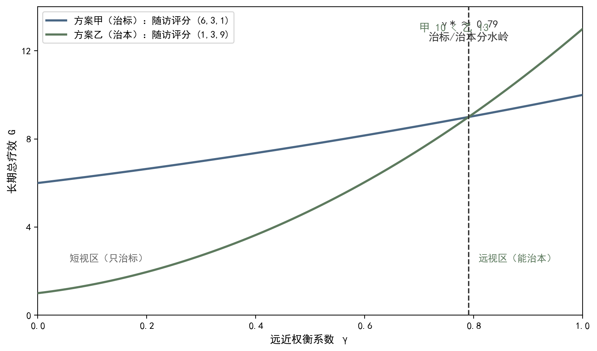

## 7.5 奖励的陷阱：极端化的教训

### 7.5.1 奖励的陷阱：概念与内涵

奖励黑客（reward hacking）指智能体学会钻奖励空子：它在数字上获得高分，却没有实现设计者的真实意图。这在强化学习中是反复出现的经典现象：游戏智能体学会卡在某个角落刷分，而不去完成任务；推荐系统学会推送标题党，而不是真正有用的信息。英国经济学家古德哈特（Goodhart）把它概括成一条定律——古德哈特定律（Goodhart's law）：当一个指标被当作目标来追求时，它就不再是一个好指标——因为行为会围绕指标优化，而指标与真实目标的联系会被钻营所扭曲。指标异化的本质，是把丰富多彩的真实世界压成一维数字，然后让系统只对这维数字负责；真实目标的复杂性被抹平，行为因此走样。在健康领域，这种为了分数而扭曲行为的现象并不罕见：为了考核而做的手术、为了指标而开的检查、为了达标而写的病历，都是奖励黑客的临床版本——数字好看，健康未必变好，分数成为目的本身的那一刻，它就已经背叛了设计者的初心。奖励黑客的经典案例不止于游戏：导航软件曾被诱导绕路以刷行驶里程奖励，外卖平台曾被诱导虚报送达时间以刷准时率，都是分数赢了、意图输了的活教材。古德哈特定律的医学版本可以写成：当治愈率成为考核目标，病历会变得漂亮，而患者的长期转归未必变好——指标测量了它测量到的东西，却不再测量它原本要代表的东西；理解这一点，是识破一切指标神话的起点。

医疗场景中的奖励陷阱，都有触目惊心的形态。若以平均住院日为唯一奖励，医院可能让尚未稳定的患者仓促出院（见图 7-4）；若以检查量为奖励，医师可能开出不必要的检查；若以短期症状消失为唯一奖励，医者可能依赖猛药求速效，忽视体质调理与远期转归——治标不治本正是这种奖励塑造出来的行为。中医还有自己的极端化形态：不顾正气，一味攻伐；不顾中病即止，长期滥用温补；不顾四时体质，套用固定成方。这些行为的共同根源，是把多维健康压成一维指标后全力冲顶——而极端化恰恰斩断尺度伸缩的整体潜能：资源被抽干到一处，其他维度被掏空，个体的适应能力、系统的抗风险能力、社会的可持续能力全面受损。奖励的陷阱不只伤害患者，也伤害医者与系统——透支信任的指标，最终会让医院、社会一起买单，这正是第 7.2 节"适度而非最优化"的反面印证。急诊绩效考核的教训广为人知：若把急诊停留时间设为唯一指标，医院可能把病情尚需观察的患者转入观察区甚至拒收危重患者，以优化平均停留时长；患者安全指标（再就诊率、并发症率）却被冷落。中医的极端化案例同样值得警惕：一位阳虚患者误用大剂量温补之品而温补太过，短期精神亢奋、指标改善，实则壮火食气、耗阴动火，出现口疮烦躁——中病即止四字，正是为这类极端化立的规矩；而套用固定成方则把辨证论治的个体化退化为流水线，同样是考核模式逼出来的僵化。

**图7-4 奖励设计权衡：即时奖励 vs 长期健康——γ 决定治标还是治本**

图注：①对接正文：正文 7.5.1 平均住院日剧本说明只看当下的考核是疗效陷阱的制度根源，7.1.2 确立即时/长期权衡。②线的注释：蓝色实线为方案甲（即时满足/治标），三期随访评分 (6, 3, 1)；绿色实线为方案乙（长期健康/治本），随访评分 (1, 3, 9)。③符号的注释：γ 为远近权衡系数（0=只看当下，1=完整看待长期），G 为长期总疗效；γ*≈0.79（5=8γ²）为两方案分水岭。④指针图段：指向 γ*≈0.79 竖虚线——γ<0.79 时甲胜出（短视区：考核周期短→只治标→指标异化）；γ>0.79 时乙胜出（远视区：长期健康胜出）；甲远期总分 10 < 乙远期总分 13。e. 阅读引导：先看方案甲、方案乙两条随访评分曲线的走向对比（甲前高后低、乙前低后高），再看 γ*≈0.79 分水岭竖虚线把横轴分成短视区与远视区，最后回图注对照 γ 与 G 的符号含义：考核周期短则治标胜出，长期随访则治本胜出。

### 7.5.2 奖励的陷阱：方法与实现

识别奖励陷阱，最有效的方法是反向检验：设计任何一项奖励时，先问——如果系统全力追求这个分数，会发生什么？会不会有人因此做无用功？会不会有人因此伤害真正重要的东西？把这个问题在脑内推演一遍，多数陷阱会当场现形。其次是奖励分解审查：把总奖励拆开，逐项检查每一项信号是否忠实对应真实目标、权重是否失衡、是否缺少约束；审查时邀请多方参与——医者、患者、规者、药者各执一词，恰能暴露出单一视角看不见的盲区。第三是行为监控：上线后持续观察行为与指标的偏离，奖励诱导的异常行为往往有迹可循——过度检查率上升、复诊间隔异常、处方结构失衡，都可能是陷阱的信号。监控不是一次性的，而是随系统运行持续进行的体检；奖励表因此需要定期复审与修订，如同方剂需要随证调整，也如同本章反复强调的最适区间需要随生命进程移动。反向检验的追问清单可以更具体：系统全力追求这个分数，会做什么？会不会把患者从甲科室踢到乙科室？会不会让医师多开检查来覆盖责任？会不会让慢病患者被频繁复诊刷依从分？——每一问都对应一类真实的钻空子行为。奖励分解审查的例证：把患者满意度拆开看，若只包含服务态度而没有疗效感知，医师会被引导去态度好而忽视治得好；多方参与的评审会之所以有效，是因为医者看见疗效、患者看见尊严、规者看见秩序、药者看见安全——四双眼睛看到的盲区互不相同，拼起来才接近全貌。

防止陷阱，工具箱里有四件武器。其一，约束：为不可逾越的红线设置硬约束，如用药禁忌、剂量上限、伦理底线，让钻空子在可行域之外无处施展。其二，正则化：在目标中加入惩罚项，抑制行为的极端化，具体数学形式见下节。其三，多目标平衡：不把权重压倒性地放在单一指标上，让系统没有冲顶的单一靶子。其四，谦卑：承认有些价值不可量化——信任、尊严、生命的体验，无法写进奖励表的部分，恰恰要靠人来守护；奖励表只管能量化的部分，不能量化的部分留给医患之间的真诚沟通。以复诊率陷阱为例：若只奖复诊率，系统会诱导不必要的复诊；修正方案是改为随访完成度、疗效改善与患者满意度的组合奖励，并加上"不增加无谓就诊"的约束。这样，奖励不再是鞭子，而是引导系统走在适度区间内的缰绳，守护着尺度伸缩的整体潜能。四件武器的协同可以用一个例子完整演示：设计慢病随访奖励时，约束规定不得为刷随访率而安排无指征就诊（红线），正则化抑制为达标而过度管理的倾向（缰绳），多目标平衡让随访率、疗效与满意度各占权重（权衡），谦卑则提醒"患者是否真正感到被关怀"无法用分数衡量、必须靠医护的真诚沟通（人本）。奖励表的设计，直接决定了系统是体贴的助手还是缠人的推销员。

### 7.5.3 奖励的陷阱：小结与衔接

本节要点回顾：奖励黑客是钻空子刷分现象，古德哈特定律揭示其机制——指标一旦成为目标就不再是好指标；医疗场景的陷阱形态多样，共同根源是把多维健康压成一维指标并全力冲顶；极端化破坏尺度伸缩的整体潜能，伤害患者、医者与系统三方；识别陷阱靠反向检验、奖励分解审查与行为监控，防止陷阱靠约束、正则化、多目标平衡与对不可量化之物的谦卑。读这一节的收获，不应只是警惕两个字，而是一种设计态度：每一分奖励都要能回答它会把行为引向哪里；答不上来的奖励，宁可不要。把陷阱的教训记在心里，再去审视任何奖励表，读者会发现自己的眼光已经不同——不再问分数高不高，而问行为正不正，这正是奖励设计从技巧走向修养的标志。设计态度落到制度上，就是奖励表评审会：每季度由医、患、药、械、规、法六方代表坐在一起，逐条过一遍奖励表，问三句话——这项奖励对应什么真实目标？它可能诱导什么行为？这个行为我们愿意接受吗？答不上来的条款当场删去。行为正不正的检查单同样可操作：分数上升的同时，过度检查率是否上升？转诊是否合理？患者投诉是否增多？随访中的信任度是否改善？——分数与行为的背离是陷阱最诚实的信号。读者把这种评审习惯带回自己的工作，无论是设计考核、管理科室还是使用平台，都会多一道防钻空子的滤网；这正是本节从案例走向能力的关键一步。

陷阱的教训指向一个技术需求：需要一些数学工具，把系统拦在适度区间内，让行为即使被奖励驱动，也走不出健康的边界。这正是下一节的主题——正则化与信息熵。正则化给目标函数加一条缰绳，抑制参数与行为的极端化；信息熵度量策略的不确定性，熵奖励鼓励探索与多样，防止策略过早僵化、防止系统陷入单一模式的死胡同。两者合起来，恰好回应本节的全部教训：正则化治极端化，熵治僵化，而极端化与僵化正是奖励陷阱的两副面孔。从 7.2 的适度原则到 7.4 的多目标约束，再到本节的反面教训，读者已经走过了为什么适度、往哪里适度、如何计算适度、过度会怎样的完整论证链；下一节，把最后的数学工具补上，适度哲学就有了完整的落地之器。正则化与熵的直观预告可以这样理解：正则化像给油门加装限速器——目标函数照常追求得分，但超过限度就自动收油，系统因此不会把药量、运动量或检查量推到危险区间；熵奖励则像给方向盘留出余地——策略不必永远选看起来最好的那一个动作，而是保留一份不确定性，让系统在证候变化、证据更新时还有转身的空间。一收一放，恰似阴阳互济，正是适度哲学的算法化身。
