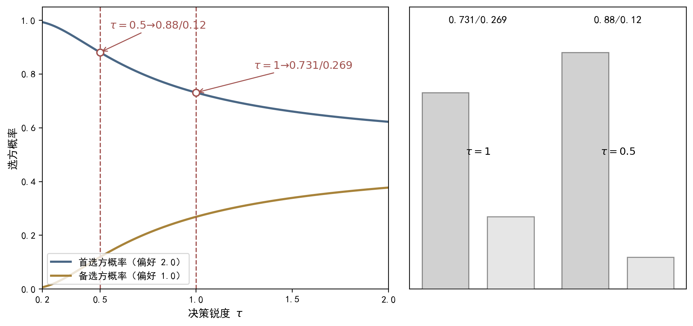

## 9.1 参数化策略：从表格到连续决策

### 9.1.1 参数化策略：概念与内涵

本书第2章把策略（policy）定义为给定状态下选择动作的概率分布：π(a|s) 表示在状态 s 下采取动作 a 的概率，且对一切状态有 Σ_a π(a|s)=1。到目前为止，我们都用表格（table）表示策略——把 π 写成一个 |S|×|A| 的矩阵，第 (s,a) 个条目就是 π(a|s)，条目之间彼此独立、互不影响。表格表示直接、精确，配合贝尔曼方程与贪婪提取十分自然：动态规划里的策略改进，就是把某个状态的动作改成价值最大的那一个，等价于改动表格里的一个条目。然而表格策略有三个内在局限。第一，条目数随状态数线性增长，状态达到十万、百万量级时表格便无法存储——第8章的价值函数方法正是为此而生，同样的批评也适用于策略表。第二，表格无法泛化：从未访问过的状态在表里没有条目，策略对它的选择只能靠随机猜测，已学到的相邻状态知识完全派不上用场。第三，表格假定动作空间离散可枚举，而现实中大量任务的动作为连续量——机器人的关节力矩、车辆的转向角、方剂的剂量，对连续动作根本无法逐格列出概率。三个局限环环相扣：存储压力随状态规模增长，泛化缺失随状态稀疏加剧，动作离散则限制了任务类型——凡此种种都指向同一个结论：表格的表意能力已经到了天花板。这正是本章把策略从表格升级为函数的起点。

参数化策略（parameterized policy）就是把决策规则写成一个带参数（parameter）的函数 π(a|s,θ)，其中 θ∈R^m 是参数向量。通俗地说，它就像一台带旋钮的决策机器：给定状态 s，函数输出一个动作概率分布；转动旋钮（改变 θ），行为模式就随之调整——动作概率不是直接存储的，而是由参数计算出来的。检索方式随之改变：表格策略是"查表"，函数策略是"计算"——把 s 输入函数，得到分布 π(·|s,θ)。更新方式也变了：表格策略"直接改条目"，函数策略只能"调参数 θ"；因为相邻状态共享同一组参数，改一个参数会影响所有共享该参数的状态——这正是泛化能力的来源：未访问状态的特征同样会被输入函数，得到合理的概率输出。最常用的参数化策略是 softmax 策略（softmax policy）：先为每个动作定义一个偏好分数（preference score）h(s,a,θ)，再通过 softmax 函数把偏好转化为概率，即 π(a|s,θ)=exp(h(s,a,θ))/Σ_{a'}exp(h(s,a',θ))，最常用的线性偏好是 h(s,a,θ)=θ^T φ(s,a)，其中 φ(s,a) 是"状态-动作对"的特征向量。softmax 的直观含义是：偏好分数越高的动作被选中的概率越大，但不是唯一确定——这正是策略"随机性"的数学来源。在中医语境里，同一证候可以有多张候选方剂，偏好分数的高低就是辨证论治中"孰轻孰重"的数量化：风寒表实证虽以麻黄汤为主，医者仍给华盖散、荆防败毒散留下概率，这便是"同病异治"在概率语言中的精确表达。

### 9.1.2 参数化策略：方法与实现

用一个具体数值例子感受 softmax 策略。考虑两动作任务，状态-动作对的特征取 φ(s,a1)=(1,0)、φ(s,a2)=(0,1)，参数 θ=(θ1,θ2) 分别对应两个动作的偏好基值。若当前 θ1=2.0、θ2=1.0，则偏好 h(a1)=2.0、h(a2)=1.0，softmax 给出 π(a1|s)=e^2/(e^2+e^1)≈0.731、π(a2|s)≈0.269。也就是说，偏好只差 1，选中概率就从对半变成约 73%——softmax 放大了偏好差异，却没有把概率变成 0 或 1，保留了探索（exploration）的可能性。换成表格策略，同样的信息只能表达为"要么选 a1、要么选 a2"的二值分布，无法表达"更倾向但非确定"的精细度。从这个例子还能看到参数化策略的工程优势：改偏好就是改行为，改参数就是改偏好，三者一一对应，调试与解释都极为直观。所谓探索，就是保留试错的空间——正如医者面对疑似的风寒表实证，主选辛温解表之余仍给辛凉解表留一点概率，万一辨证有偏，行动仍有回旋余地。温度旋钮 τ 对分布形态的连续调节——τ 越大分布越均匀（探索强），τ 越小越集中在高偏好动作（利用强）——见图 9-1（τ 的完整讨论见 9.5.2 节）。这里再引入一个贯穿全章的关键记号——对数梯度（log-gradient）：对 softmax 策略它有简洁的闭合形式，∇θ ln π(a|s,θ)=φ(s,a)−E_{A∼π(·|s,θ)}[φ(s,A)]，即"实际选择动作的特征减去按策略加权平均的特征"。这个公式是策略梯度更新式落地为代码的桥梁：只需一次前向计算分布，就能同时得到概率与梯度，9.2 节将给出它的严格推导。

**图9-1 softmax 策略示意：温度 τ 对动作概率分布的影响**

图注：对接正文 9.1.2 与 9.5.2（偏好放大曲线的两个数值例）。图中两条线：蓝线为首选方概率（偏好 2.0）、金线为备选方概率（偏好 1.0），为选方概率随决策锐度 τ 的变化曲线；τ 为决策锐度参数，红虚线为正文标注点位置。指针图段：聚焦 τ∈[0.2,2.0] 的试新→守成过渡段——τ=1 时首选方≈0.731、备选方≈0.269（正文 9.1.2），锐度减半 τ=0.5 后首选方≈0.88、备选方≈0.12（正文 9.5.2）；偏好放大拉开了概率差距，却没有把选择变成非此即彼——保留的灵活性不是瑕疵，而是开方风格的一部分，也是中医“同病异治”的概率表达。e. 阅读引导：先看蓝线（首选方）与金线（备选方）随决策锐度 τ 变化的分离趋势，再看 τ=1 时 0.731/0.269 与 τ=0.5 时 0.88/0.12 两处标注点的数值变化，最后回图注对照 τ 的符号含义：偏好放大拉开概率差距却不把选择变成非此即彼，是同病异治的概率表达。

对于连续动作空间，表格与 softmax 都无法直接使用——动作集不可枚举，无法逐格列出概率。此时的标准选择是正态分布策略，也称高斯策略（Gaussian policy）：π(a|s,θ)=N(a; μ(s,θ), σ²)，即动作 a 服从以 μ(s,θ) 为均值、σ² 为方差的正态分布；均值由函数给出，最常见的形式是线性均值 μ(s,θ)=θ^T φ(s)，方差 σ² 可以固定，也可以作为参数的一部分参与学习。高斯策略输出的是一个"带不确定性的连续值"，通俗地说，就是每次先在均值附近随机"抖一下"再输出动作：均值决定最可能采取的动作，方差决定随机性的大小——方差大意味着探索范围广、动作抖动大；方差小意味着行为接近确定性输出。它的对数梯度同样简洁：∇θ ln π(a|s,θ)=(a−μ(s,θ))/σ²·∇θ μ(s,θ)，当 μ=θ^T φ(s) 时即为 (a−μ)/σ²·φ(s)。直觉是：若采样到的动作 a 大于均值 μ——"这个方向的表现可能更好"——梯度方向把均值向上推；反之向下推。在中医场景中，方剂的剂量、针刺的深度、疗程的长短都是连续动作，正是高斯策略的用武之地：剂量不是"轻、中、重"三档，而是可以连续调节的量，均值给出最适剂量，方差给出调节的把握——方差大表示"还没拿准"，该多试几个剂量；方差小表示"已经拿稳"，按均值执行即可。方差若设为零，策略就退化为确定性输出——连续策略的随机性不是瑕疵，而是与离散 softmax 完全同构的探索机制。9.6 节将系统展开。

### 9.1.3 参数化策略：小结与衔接

把表格策略与参数化策略并排比较，可以提炼出三大根本差异。第一，最优策略的定义不同：表格策略追求"使每个状态的价值都最大"（逐点最优，策略改进定理保证逐状态改善）；函数策略由于参数共享，无法保证每个状态同时最优，只能追求某个全局标量指标 J(θ) 最大——这是全局最优意义上的折中。第二，更新方式不同：表格策略直接改写条目，更新是"局部、精确"的；函数策略只能修改参数 θ，更新是"全局、模糊"的——改动一个参数影响所有共享该参数的状态，这正是泛化的来源，也是偏差的来源。第三，动作概率的检索方式不同：表格是"查表"，函数是"计算"。这三大差异不是琐碎的工程细节，而是决定后续所有算法形态的根本前提：既然只能优化标量 J(θ)，"如何定义 J(θ)"与"如何求 ∇θJ(θ)"就成了核心问题。三大差异也意味着，参数化策略的"最优"是全局折中意义上的最优：不再有"每个状态都最好"的奢望，只有"整体指标最高"的现实追求——这恰恰更接近临床决策的真实处境：没有放之四海皆准的方剂，只有对整体疗效最优的权衡。值得注意的是，表格策略可以看成参数化策略的极端特例：若每个状态用 one-hot 特征编码，参数恰好就是各状态的动作概率，softmax 策略退化为逐状态独立的分布参数——这说明"从表格到函数"不是抛弃旧框架，而是旧框架的自然推广。

目标函数 J(θ) 有两种常见定义。本章采用平均回报形式（average reward per step）以保证理论叙述的简洁：设 dπ(s) 为策略 π 下的状态平稳分布（stationary distribution），则 J(θ)=Σ_s dπ(s)Σ_a π(a|s,θ) r(s,a)，即长期平均单步奖励；另一种常见定义是带折扣的起始状态价值 J(θ)=E_{S0∼ρ}[vπ(S0)]，两种定义在数学结构上等价，策略梯度定理的结论都成立。本书选择平均回报形式，是因为它在推导中能让分布漂移项干净地消去，这一点在 9.2 节会看到。关键在于：J(θ) 对 θ 的依赖是双重的——既通过 π(a|s,θ) 显式依赖，又通过状态分布 dπ 隐式依赖（策略变了，访问分布也会变）。打个比方：一位医者调整了接诊风格，不仅开方变了，连挂他号的病人构成也会悄悄改变——这就是"策略改变分布"的临床写照。直接对 J(θ) 求导时，含 ∇θdπ(s) 的"分布梯度项"无法用模型无关的方式处理，这正是策略梯度定理要解决的核心困难。至此本章的准备完成：策略已从表格升级为函数，优化目标已从逐状态最优转为标量 J(θ)。下一个问题是：这类方法比价值方法究竟好在哪里、梯度到底怎么算？9.2 节回答"改进的方向在哪里"，9.3 节回答"如何一步步试错地走过去"，而方向走多稳、试哪些方向，则由 9.4、9.5 两节回答。如果说价值方法回答的是“现在值多少”，策略梯度方法回答的则是“下一步怎么改”——两种问题视角不同，答案的形态也不同，这正是本章与第8章的分工。
