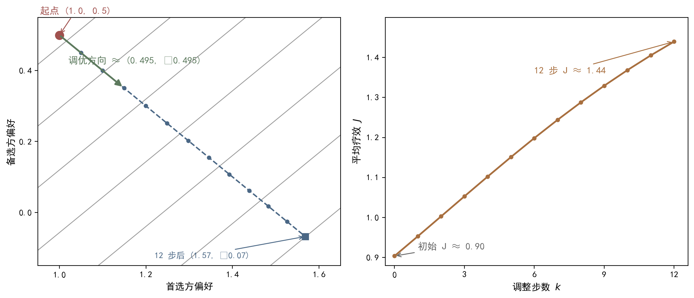

## 9.2 策略梯度定理：改进的方向

### 9.2.1 策略梯度定理：概念与内涵

上一节我们把策略写成了参数化函数，把目标写成了标量 J(θ)，但"如何优化"还悬而未决。直观的想法是梯度上升：沿着 J(θ) 上升最快的方向调整参数。策略梯度（policy gradient），通俗地说，就是沿着改进的方向一步步试探着走——每一步只朝"让平均回报升得最快"的方向挪一点，走一步看一步，而不是一步跳到终点。这好比名医从不指望一副药到病除，而是每诊一调：观效后微调方药，让疗效逐诊爬坡。问题在于：J(θ) 的表达式里既有状态分布又有期望，没有环境模型根本算不出来，梯度从何谈起？先把记号固定下来。本章采用平均回报设定：设 r̄(θ)=lim_{T→∞}(1/T)Σ_{t=0}^{T−1} r_{t+1} 为长期平均单步奖励，dπ(s) 为状态平稳分布，满足平稳方程 dπ(s')=Σ_s dπ(s)pπ(s'|s)，其中 pπ(s'|s)=Σ_a π(a|s)p(s'|s,a)。定义目标函数 J(θ)=r̄(θ)=Σ_s dπ(s)rπ(s)，其中 rπ(s)=Σ_a π(a|s,θ)r(s,a) 是状态 s 下的期望单步奖励。这套记号与第4章的贝尔曼框架一一对应，只是把绝对奖励换成了长期平均水平——临床对应的是"长期平均疗效"：偶有一诊失手不要紧，重要的是疗程结束时的总体转归。读者不妨把梯度上升想成登山：看不清全貌时，最稳妥的办法是每步都朝“脚边最陡的方向”迈，而不是凭感觉朝某个远方目标直冲——策略梯度做的就是这种“脚下最陡”的局部改进。有了方向，再定步幅——步幅（学习率）多大，就是 9.3 节以后各节反复斟酌的事了。

现在考察 ∇θJ(θ) 的结构。J(θ) 对 θ 的依赖是双重的：其一，rπ(s)=Σ_a π(a|s,θ)r(s,a) 显式依赖策略参数；其二，dπ(s) 隐式依赖策略参数——参数改变后，马尔可夫链的转移结构改变，平稳分布随之漂移。直接求导得到三项分解：∇θJ(θ)=Σ_s [∇θdπ(s)] rπ(s)+Σ_s dπ(s)Σ_a [∇θπ(a|s,θ)] r(s,a)+Σ_s dπ(s)Σ_a π(a|s,θ)[∇θr(s,a)]。第三项中 r(s,a) 是环境的固有奖励，与 θ 无关，恒为零；第二项是我们想要的"策略直接效应"；第一项是"分布漂移效应"，含 ∇θdπ(s)，看似需要模型才能处理。直觉上，分布漂移效应度量的是"因为策略改了，我访问各状态的频率变了"这一长期影响——好比医者专攻疑难杂症后，诊室病人构成随之改变，常见病样本减少、疑难病样本增多。为刻画相对优劣，还需要引入相对动作价值（relative action value）qπ(s,a)=E[Σ_{k=0}^{∞}(r_{t+k+1}−r̄(θ)) | s_t=s,a_t=a]，即从状态-动作对出发、未来各步奖励相对平均水平的折减总和；相对状态价值 vπ(s)=Σ_a π(a|s)qπ(s,a)。注意 qπ 与 vπ 都是"相对量"：奖励减去平均水平 r̄ 之后，价值函数有界，贝尔曼方程照常成立。接下来的关键问题是：分布漂移项能否消去或转化为可处理的形式？这正是策略梯度定理的用武之地。三项来源中，只有第二项直接告诉我们“动作偏好该往哪调”，其余两项要么恒为零、要么难以处理——把三者的关系理清，正是下一小节推导的骨架。读者只需记住结论：分布漂移这一项最终会被定理消去，不必手工建模。

### 9.2.2 策略梯度定理：方法与实现

推导的第一步是对数导数技巧（log-derivative trick），也称似然比技巧（likelihood ratio trick）：对任意可微策略，∇θπ(a|s,θ)=π(a|s,θ)·∇θ ln π(a|s,θ)。这个恒等式只是链式法则的改写——d/dx ln f(x)=f'(x)/f(x)，乘回 f(x) 即得——但它意义重大：它把"概率的梯度"改写为"概率×对数概率梯度"，使得对动作求和可以被解读为对动作取期望。例如 Σ_a [∇θπ(a|s,θ)]·x(s,a)=E_{A∼π(·|s,θ)}[∇θ ln π(A|s,θ)·x(s,A)]。一旦写成期望形式，就可以用采样来估计——这是整个策略梯度方法能够无模型化的根源：临床数据本来就是一例一例"采"出来的，期望形式正好对接病案样本。第二步，把三项分解中的第二项用对数导数技巧改写：Σ_s dπ(s)Σ_a [∇θπ(a|s,θ)] r(s,a)=E_{S∼dπ,A∼π}[∇θ ln π(A|S,θ)·r(S,A)]。注意这里 r(s,a) 可以换成 r(s,a)−r̄(θ)（差一个与动作无关的常数，被期望吸收），而 qπ(s,a)=r(s,a)−r̄(θ)+Σ_{s'}p(s'|s,a)vπ(s')——把"单步奖励"升级为"动作价值"，等价于把梯度的期望从"只看一步"延长为"看整个未来"：评价一次处方，不只看当下反应，还要看其后一段时间的转归。对数导数技巧把“难算的概率梯度”换成了“好采样的期望梯度”，是策略梯度方法一切无模型实现的起点：有了它，我们不需要知道证候转移的完整概率表，只需要一次次真实处方的样本。剩下的分布漂移项如何处理，是第三步的任务。顺带一提，临床评价同样遵循“看全程”的原则：一次处方的成败，要看疗程结束时的总体转归，而非单次症状波动——期望形式的“全程视角”与临床直觉完全一致。

第三步处理分布漂移项。可以证明一个关键恒等式：对任意策略 π，有 Σ_s [∇θdπ(s)]·vπ(s)=0。证明思路：对平稳方程两边关于 θ 求导，得到 ∇θdπ(s')=Σ_s [∇θdπ(s)]pπ(s'|s)+Σ_s dπ(s)Σ_a [∇θπ(a|s)]p(s'|s,a)；两边乘以 vπ(s') 并对 s' 求和，利用贝尔曼方程与平稳分布的性质，同类项相消，最终 ∇θdπ 完全消失。直觉是深刻的：平均回报对平稳分布的扰动在一阶意义下不敏感——长期平均收益本质上与"从哪里开始访问"无关，策略对状态分布的长程影响被相对价值的自洽性所抵消。综合三步，得到本章最重要的结论——策略梯度定理（Policy Gradient Theorem）：设策略 π(·|·,θ) 可微，则 ∇θJ(θ)=Σ_s dπ(s)Σ_a ∇θπ(a|s,θ)qπ(s,a)=E_{S∼dπ,A∼π}[∇θ ln π(A|S,θ)·qπ(S,A)]。数值验证：两状态两动作任务，s1 下 a1→s1、a2→s2，s2 任意回 s1，奖励 r(s1,a1)=2、r(s1,a2)=0、r(s2,·)=0；策略 softmax（θ=(1.0,0.5) 两状态共用），π(a1)≈0.62、π(a2)≈0.38。解平稳方程得 dπ(s1)≈0.726、dπ(s2)≈0.274。代入定理（qπ 口径）得 ∇θ1≈0.495、∇θ2≈−0.495——梯度方向"提 a1 偏好、压 a2 偏好"，与奖励结构吻合。> **口径脚注**：∇θ≈(0.495,−0.495) 为 qπ 解析口径下的初始方向近似；图 9-2 的 12 步轨迹按"每步调整幅度 0.1"绘制（θ₁:1.0→1.57、θ₂:0.5→−0.07），方向随 θ 变化逐级微调，为示意性轨迹——初始梯度与步进终点均为近似口径，互不构成精算约束。沿着该梯度方向迭代参数 θ，平均回报 J(θ)=r̄(θ) 单调上升，参数空间的上升轨迹与目标函数曲线见图 9-2。定理的三步证明环环相扣：对数导数把梯度写成期望，相对动作价值把单步升级为全程，分布漂移项在平稳方程的自洽中消失——三处配合，才换来一个只需样本即可估计的方向。这个方向虽然只是“局部的、一阶的”提示，却足以让参数沿着它一步步爬升，最终到达平均回报的局部峰值。这也解释了为何梯度上升的学习曲线总是“平缓爬坡”而非“一步登顶”。

**图9-2 策略梯度上升轨迹：参数空间迭代与目标函数上升**

图注：对接正文 9.2.2（两证候两治法任务，偏好调优的数值验证）。左图：等高线为平均疗效 J，蓝点虚线为开方偏好沿调优方向的调整轨迹（起点红点 (1.0,0.5)，12 步到 (1.57,−0.07)），绿色箭头为初始调优方向 (0.495,−0.495)——“抬首选方偏好、压备选方偏好”；右图：橙色折线为平均疗效 J 随调整步数 k 单调上升（每次调整幅度 0.1，初始 J≈0.90）。符号：偏好放大参数、各证候就诊占比 dπ（s1≈0.726、s2≈0.274）。指针图段：聚焦前 12 步上升轨迹——每一步只朝“让平均疗效升得最快”的方向挪一点，而不是一步跳到终点：开方风格的调整就是沿着改善方向一步步试探着走。e. 阅读引导：先看左图等高线上蓝色轨迹沿绿色箭头逐小步攀升、右图平均疗效 J 随步数 k 单调上升的整体走向，再看起点 (1.0,0.5) 到 12 步后 (1.57,−0.07) 的数值变化，最后回图注对照调优方向的含义：开方风格的调整是沿着改善方向一步步试探着走。

### 9.2.3 策略梯度定理：小结与衔接

策略梯度定理的意义可以从三个层面理解。第一，无模型性：定理右侧是期望形式，其中出现的量——状态分布 dπ、动作分布 π、动作价值 qπ——全部可以通过与环境的交互观测到或估计到，不需要状态转移概率 p(s'|s,a) 或奖励函数 r(s,a) 的解析形式；这与第6章 TD 无模型估计价值的思路一脉相承，但对象从"价值"升级为"目标函数的梯度"。临床上的对应是：我们不需要知道"证候—方剂—转归"的完整概率表，只要积累足够多的真实病案，就能逐步估计出该往哪个方向改进辨证用方。第二，可采样性：期望可以用单条轨迹的样本近似，∇θJ(θ)≈∇θ ln π(at|st,θ)·qπ(st,at)，样本越多估计越准，这正是第8章随机梯度下降（SGD）所要求的无偏梯度估计。第三，结构简单性：定理把"优化一个含状态分布的复杂目标"化约为"优化一个可采样的期望"，使策略优化在算法层面变成纯粹的梯度上升——这是一个近乎奇妙的简化。定理的结论是"改进的方向"：梯度方向指明了参数朝哪个方向移动，平均回报才会上升。但方向只是起点，接下来要回答三个工程问题：梯度用什么来估计（9.3 节）、估计的方差如何压低（9.4 节）、样本从哪里来（9.5 节）。方向上再多说一句：策略梯度给出的不是一步到位的跳变，而是每个参数上“微小但正确”的推动——成千上万次这样的推动累积起来，才成就了策略的成熟。

还要注意定理应用时的两个细节。其一，期望中的状态 S 服从 dπ——与 θ 相关，实践中用同策略（on-policy）轨迹近似：生成轨迹的策略就是被优化的策略。其二，qπ(s,a) 是理想化的真值，算法中必须用估计值替代——用蒙特卡洛回报 G_t 替代得到 REINFORCE（9.3 节），用 TD 估计替代得到行动者-评价者（Actor-Critic，第10章）。这两个替代分别对应"无偏但高方差"与"有偏但低方差"两种取舍，是理解后续所有策略类算法的钥匙——REINFORCE 走前者，行动者-评价者走后者，两条路线将在第10章汇合为完整的策略优化框架。回到本节标题"改进的方向"：策略梯度定理给出的是方向——一个可计算、可采样、无模型的方向；至于沿着这个方向能走多远、走多稳，取决于学习率、基线、探索策略等实现细节，这正是本章接下来四节的内容。值得注意的是，定理本身不限定策略的具体形式：无论是 softmax 还是高斯策略，只要可微，梯度公式同样成立——这正是 9.6 节连续动作能够直接套用本章框架的原因。可以说，定理把"怎么变好"这个模糊的问题，翻译成了"沿哪个梯度走"这个精确的问题；把幸福的探索，从愿望变成了可计算的方向。最后一个提醒：无论用哪种估计替代 qπ，定理的骨架都不变——变化的只是方差与偏差的配比，这正是后续章节反复出现的主题。
