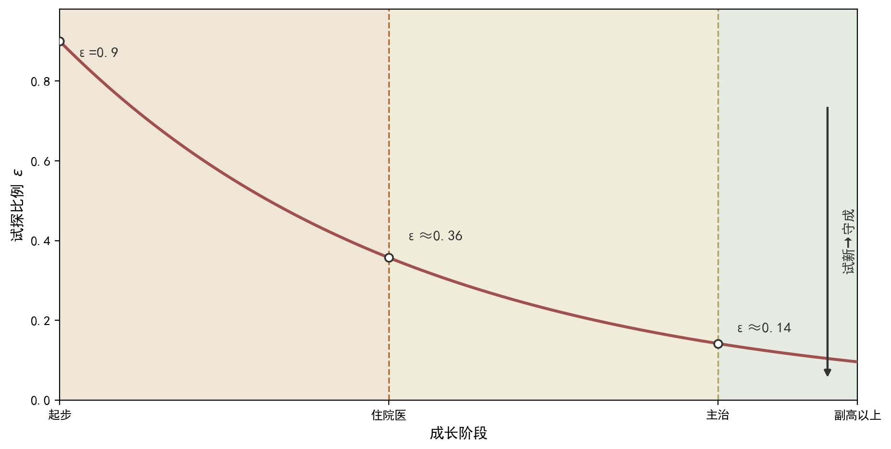

## 9.5 探索与利用：潜能的最适度发展

### 9.5.1 探索与利用：概念与内涵

强化学习从头到尾都面对一对矛盾：探索（exploration）与利用（exploitation）。探索，通俗地说，就是尝试未知的可能——下馆子点一道没吃过的新菜；利用，就是用好已知的好选择——点那道吃过十次从不踩雷的老字号。只利用不探索，会被困在已知的局部最优里，永远不知道还有更好的选择；只探索不利用，学到的东西派不上用场，成长无从谈起。这对矛盾在策略梯度框架中有着精确的表达：策略本身是概率分布，动作的选择天然带有随机性，随机性的大小就是探索的强度——softmax 策略的温度参数、高斯策略的方差、熵正则化的权重，都是调节探索强度的旋钮。临床上，探索就是尝试新治法：在把握不足的证候上试一张未曾用过的方、一种新配伍、一个新剂量；利用就是沿用经过验证的成熟方案。更深刻的结论是：有些任务的最优策略本身就是随机的。石头剪刀布是经典例子：如果对手会统计你的出法并针对性应对，"永远出石头"的确定性策略会被针对，期望胜率归零；而三种手势各 1/3 的均匀随机策略，是唯一无法被利用的最优策略——随机性在这里不是噪声，而是策略的一部分。中医"同病异治"在概率语言中同样是这个道理：多张候选方剂各有胜算，确定性垄断反而脆弱。

把探索与潜能发展联系起来，是本节标题"潜能的最适度发展"的含义。人的潜能不是已知的清单，而是一个需要试探才知道的分布：不试，就不知道自己擅长什么、适合什么。在强化学习的语言里，探索就是对未知动作的采样——每一次尝试都是一次信息投资：即使这次回报不高，样本本身也在缩小不确定性，为未来的利用提供依据。多臂老虎机（multi-armed bandit）刻画了这种权衡的数学本质：面前有若干台老虎机（选项），每台的中奖率未知，先探索各臂收集信息、后专注最优臂获取收益，关键问题是最优的探索量是多少。答案取决于状态空间的大小、奖励的噪声与剩余的时间预算：状态空间越大、噪声越大、时间越充裕，探索就越多——这个"越多"不是无限多，而是在信息收益与试错成本之间取平衡，信息收益递减之处，就是探索应当收敛之时。因此探索率不是越大越好，也不是越小越好——过度探索浪费样本，过度利用困于局部，两者的平衡点就是最适度（optimality）。这个"适度"而非"最大"的思想，与中医"中正平和"、执两用中的思维一脉相承：治病求本而不偏执一端，探索求适度而不冒进，也将在 9.7 节系统科学定位中再次展开——在那里它将升级为场景生存最适度与环境共荣最适度。

### 9.5.2 探索与利用：方法与实现

探索与利用的平衡有三种标准实现。第一种是 ε-贪婪（ε-greedy）：以大概率选择当前最优动作，以 ε 的小概率随机选择任意动作——简单直接，代价是随机选择时完全抛弃已有信息。第二种是 softmax 温度调节：π(a|s)=exp(h(s,a)/τ)/Σ_{a'}exp(h(s,a')/τ)，温度参数 τ 控制分布的尖锐程度——τ 越大分布越均匀（探索强），τ 越小越集中在最优动作（利用强），τ 从大到小的过程称为温度退火（annealing）。数值上，若两个动作偏好分别为 2.0 与 1.0，τ=1 时概率约为 0.73 与 0.27；τ=0.5 时约为 0.88 与 0.12——温度减半，探索明显收缩：偏好还是那对偏好，选择却从"七三开"收紧到接近"九一开"，探索的空间被压缩了。第三种是熵正则化（entropy regularization）：在目标函数中加入策略熵的奖励项，鼓励策略保持一定随机性——熵是分布不确定性的度量，熵越大分布越均匀，把熵纳入目标就是在奖励函数里给探索定价，防止策略过早"锁定"一个动作。三种方法本质相同：把探索强度变成一个可调、可衰减的参数，让学习初期多探索、后期多利用。衰减的速度本身也是超参数：衰减太慢，后期仍在大幅探索、浪费样本；衰减太快，初期没有充分试错、过早锁定——理想的衰减曲线应当与环境的不确定性相匹配：证候分布越复杂，探索衰减就该越缓。三种方法还可组合使用：实践中常以 ε-贪婪起步、辅以熵正则保底，再配温度退火收尾，各取所长。

探索策略必须随成长阶段动态调整，这正是潜能最适度发展在职业成长中的形态。对医者而言：住院医阶段状态空间小、经验不足，宜在低风险虚拟病例上保持高探索率——大胆尝试不同辨证与方剂组合，快速扩大"证候—方剂—转归"的样本覆盖，此时探索是信息投资，试错成本由虚拟环境承担；主治以上阶段状态空间已较完整，应逐步提高利用比例，把成熟经验提炼为可复用策略，仅在证据不足的新场景保留探索。形式上，这对应于探索率 ε 或温度 τ 的衰减曲线：初期高、中期缓降、后期低位（衰减形态与三阶段标注见图 9-3）。临床安全的红线是：真实诊疗中探索必须受约束——新方、新法的试探应发生在虚拟病例、模拟病案或平台的低风险场景中，真实患者面前以利用为主，这正是"把探索放在安全环境里"的工程实现。从潜能发展的视角看，成长曲线正是"小状态空间随机试错→大状态空间精细利用"的转变：年轻时广撒网（探索），年长时深耕耘（利用），而最适度的探索量随经验积累而下降——这是探索与利用权衡在人生尺度上的体现，也是 9.7 节"探索与系统演进"的伏笔。还要注意，最适度不是个体独自决定的：同侪的探索成果会改变自己的最优策略——别人已经试过的路，自己不必再从头试起，这正是系统知识共享的价值。

**图9-3 探索与利用权衡：探索率 ε 随成长阶段衰减**

图注：对接正文 9.5.1 与 9.5.2（试新与守成的权衡、试探比例衰减曲线）。红色曲线为试探比例随成长阶段衰减的教学示意曲线；三条背景色带与虚线为阶段分界（橙=住院医 0-33、黄=主治 33-66、绿=副高以上 66-80）。符号 ε 为试探比例，ε 越大试新越强、越小守成越强。指针图段：聚焦试新→守成过渡段——住院医阶段试探比例高、在低风险虚拟病例上大胆试错（试新是信息投资，试错成本由虚拟环境承担）；主治阶段缓降、把成熟经验提炼为可复用的开方风格；副高以上低位、仅在证据不足的新场景试新。信息收益递减之处，就是试新应当收手之时；真实诊疗中试新必须受约束：新方、新法的试探应发生在虚拟病例、模拟病案或平台的低风险场景中，真实患者面前以守成为主。e. 阅读引导：先看红色试探比例曲线随成长阶段总体下行的衰减主线，再看住院医 0-33 高位、主治 33-66 缓降、副高以上 66-80 低位三个阶段分界处的数值高低，最后回图注对照 ε 的符号含义：信息收益递减之处，就是试新应当收手之时。

### 9.5.3 探索与利用：小结与衔接

本节要点回顾：探索与利用是强化学习的核心矛盾，探索是信息投资而非浪费，利用是把已知经验兑现为收益；最优策略可能本质随机，策略的分布形态天然承载探索；三种实现——ε-贪婪、softmax 温度、熵正则化——本质都是把探索强度变成可调、可衰减的参数；探索率的最适度随状态空间、噪声与时间预算变化，随成长阶段动态调整。要特别记住一个纪律：探索的代价必须可控——在真实高风险场景中降低探索率，把探索集中到低风险环境，这是医疗场景应用强化学习的底线。理解探索与利用，就理解了策略梯度方法"试错中成长"的动力机制：REINFORCE 靠策略分布的内在随机性产生样本，样本回报决定梯度方向，梯度更新又改变分布——探索为学习提供原料，利用使原料转化为收益，二者在同一个更新循环中互相成就——这也是为什么说，探索与利用不是先后两个阶段，而是同一个学习过程中始终并存的两股力量：分布采样带来探索，梯度更新兑现利用，温度衰减只是两者比重的渐进调节，而非一方取代另一方。在中医临床学习中，这种平衡同样可见：读经典、跟名师是"利用"已知的辨证规律，面对疑难杂症尝试新思路就是"探索"——两者共同构成临床能力成长的完整路径。

从探索回到方法本身，还有一个悬而未决的缺口：前几节的策略都建立在离散动作假设上——softmax 需要对每个动作计算偏好，表格更是要求动作可枚举。但现实中的大量决策是连续的：方剂的剂量可以在一个区间内任意取值，针刺的深度、疗程的长短、康复训练的强度都不是"几个选项"而是"一条连续的线"。离散化处理（把连续量切成档位）面临两难：切得粗，精度不足；切得细，计算量剧增且相邻档位的学习彼此割裂。连续动作需要一种全新的策略表示——正态分布策略（高斯策略），它用均值和方差两个参数就描述了整条连续线上的动作分布，方差同时承载探索强度。9.6 节将给出它的数学形式、梯度推导与实现要点，补上策略梯度家族在连续决策上的最后一块拼图。届时，从离散到连续、从表格到函数、从利用到探索，本章的策略工具箱将完整成型。再回顾本节标题中的"潜能最适度发展"：探索为潜能发现边界，利用让潜能兑现价值，最适度确保两者都不越界——过度探索的人终其一生都在"试"，过度利用的人终其一生都在"守"，只有找到平衡点的人，潜能才得到最充分的发展；而这个平衡点并非一成不变，它随经验积累与场景变化而移动，需要持续校准。
