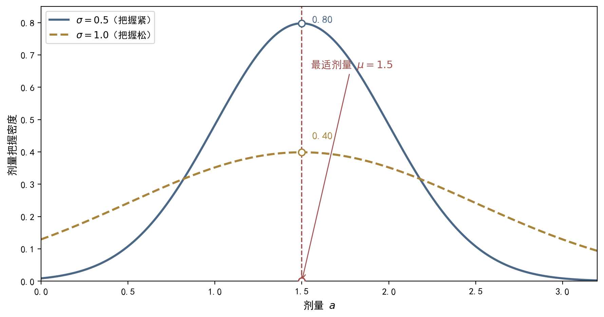

## 9.6 连续动作与正态分布策略

### 9.6.1 连续动作与正态分布策略：概念与内涵

连续动作空间是现实世界最常见的决策形态，也是价值方法最不擅长的地方。价值方法的动作选择依赖枚举：表格 Q 学习需要比较所有动作的价值取最大值，DQN 需要对每个动作计算一次网络输出；动作空间一旦是连续区间（如转向角在 [−1,1] 内取值），枚举要么不可能，要么离散化后陷入"切粗精度不足、切细计算剧增"的两难。策略方法绕开了枚举：策略输出的是概率分布，动作只以"采样"的方式出现。对连续动作的标准选择是正态分布策略，也称高斯策略（Gaussian policy）：π(a|s,θ)=N(a; μ(s,θ), σ²)，即动作 a 服从以 μ(s,θ) 为均值、σ² 为方差的正态分布，最常见的是线性均值 μ(s,θ)=θ^T φ(s)。通俗地说，这个策略每次先在均值附近随机"抖一下"，再输出动作：均值决定最可能采取的动作，方差决定抖动（随机性）的大小。在中医场景中，方剂的剂量、针刺的深度、疗程的长短、康复训练的强度，都是可以用正态分布描述的连续动作——处方不是"轻、中、重"三档，而是一条可以连续调节的剂量线。均值与方差如何共同决定动作分布，其直观形态见图 9-4。顺带说明记号：μ 与 σ 都随状态而变——同一张方剂，面对寒证与热证，最适剂量与把握程度都不同，这正是“均值与方差都是状态的函数”这句话的临床含义。

**图9-4 正态分布策略示意：连续动作，均值附近随机抖动**

图注：对接正文 9.6.1 与 9.6.2（连续调节与剂量把握曲线）。两条钟形曲线同均值 μ=1.5：蓝线 σ=0.5（把握紧：剂量围绕最适值波动小，正文 9.6.2 取值）、金线 σ=1.0（把握松：剂量波动大、保留试新空间，对照示意）；红色虚线为最适剂量位置。符号：μ 为最适剂量（最可能采纳的剂量）、σ² 为波动幅度（决定剂量随机性与试新强度）。指针图段：聚焦最适剂量附近的分布主体（横轴 0-3.2）——每次处方先在最适剂量附近随机“抖一下”再定剂量；中医场景中方剂剂量、针刺深度、疗程长短、康复训练强度都是连续调节量：μ 给出最适剂量，σ 给出调节的把握。e. 阅读引导：先看两条同均值钟形曲线的整体形状（蓝线高瘦、金线矮胖），再看峰顶 μ=1.5 最适剂量处两曲线的宽度差异，最后回图注对照 μ 与 σ² 的符号含义：μ 给出最适剂量，σ 给出调节的把握。

方差 σ² 在连续策略中扮演双重角色。一方面它决定输出的随机性：方差大，动作抖动大，行为接近随机；方差小，行为接近确定性输出。另一方面，方差就是探索强度：方差大意味着探索范围广，方差小意味着探索收缩——这与 9.5 节探索与利用的框架完全对应，连续策略的探索不再需要 ε 或温度，直接由方差承载。方差可以固定（作为超参数），也可以作为参数的一部分参与学习，实现自适应探索：策略在不确定的区域自动增大方差、在确定后收缩方差。学习方差的直观含义是：当实际采样的偏差超过方差预期时，说明当前探索范围不够覆盖真实情况，就增大方差；反之收缩——好比医者对某证候把握不足时，剂量试探的范围自然放宽，把握充足后则收紧到最适剂量附近。还要注意一个统一视角：离散的 softmax 策略与连续的高斯策略，本质是同一件事——"带参数的分布+对数梯度"。策略梯度定理对两者同样成立，REINFORCE 的更新骨架完全通用，区别只在对数梯度的具体表达式：softmax 是特征减期望特征，高斯是残差除以方差乘特征。这个统一视角说明，策略梯度框架天然不区分动作空间的形态——离散与连续，只是同一台决策机器的两种旋钮。

### 9.6.2 连续动作与正态分布策略：方法与实现

高斯策略的对数梯度推导只需链式法则。对数密度 ln π(a|s,θ)=−(a−μ)²/(2σ²)−(1/2)ln(2πσ²)，对 θ 求梯度得 ∇θ ln π(a|s,θ)=((a−μ(s,θ))/σ²)·∇θ μ(s,θ)；当 μ=θ^T φ(s) 时，即 ∇θ ln π=(a−μ)/σ²·φ(s)。直觉非常直接：若采样动作 a 高于当前均值 μ——"这个方向的表现可能更好"——梯度为正，把均值向上推；若低于均值，把均值向下推；推动幅度与偏差 (a−μ) 成正比、与方差 σ² 成反比——方差越大，单次采样的信号越不可信，更新越保守。临床上对应：一次剂量试探偏离最适剂量越远，越要小步调整；而对剂量把握越足（方差小），单次反馈就越值得信。于是高斯策略的 REINFORCE 更新式为 θ←θ+α·G_t·[(a_t−μ(s_t))/σ²]·φ(s_t)，与离散情形只差一个"残差系数"，实现同样只需几行代码。若方差也参与学习（参数 θ_σ），类似推导给出第二个分量：∂/∂θ_σ ln π=(a−μ)²/(2σ⁴)−1/(2σ²)，即"实际偏差超过方差期望时增大方差、反之减小"——策略由此获得自适应探索能力：不确定的区域方差自动变大，确定后方差收缩。需要提醒：均值与方差的学习应当同步进行，方差更新过快会让残差信号失真，实践中常用较小的学习率处理方差参数。残差系数的出现也解释了为何高斯策略特别适合医疗剂量场景：更新幅度天然与“偏离最适值的距离”成正比——偏离越远，下一次调整的步子越大；接近最适值时，步子自动变小，不会在最优剂量附近来回震荡。这也是临床“小步调方”经验的算法化表达。

用一个数值演算展示连续策略的更新节奏。设单特征线性均值 μ=θ·φ(s)，φ(s)=1，当前 θ=1.5、σ=0.5；采样得到动作 a=1.8，回报 G=2.0。残差 (a−μ)/σ²=(1.8−1.5)/0.25=1.2，更新量 α·2.0·1.2·1=2.4α——正回报且动作高于均值，θ 向上推；若下一次采样 a=1.2（低于均值），残差为 −1.2，同样的正回报会把 θ 向下拉——均值在正负反馈中向"高回报动作的方向"漂移：剂量试验中，偏高的剂量效果好，均值就上移；偏低的剂量效果好，均值就下移，最终收敛到高回报的剂量区间。工程上还要警惕两个极端：σ² 设得过小，策略退化为近乎确定性，探索不足，梯度估计只能覆盖很窄的动作区域，容易陷入局部最优；σ² 过大，动作噪声淹没信号，更新量被 1/σ² 压得过小，学习近乎停滞。实践中常用熵正则（9.5 节）在目标中加入策略熵奖励项，防止方差塌缩——连续策略的熵正比于 ln σ，把熵纳入目标就是在奖励函数里给"保持探索"定价；温度与熵的选择，本质上都是回答同一个问题：这一阶段还该保留多少不确定性？另一个前沿方向是确定性策略梯度（Deterministic Policy Gradient, DPG）：直接输出确定性动作 a=μ(s,θ) 而非分布，用链式法则更新，规避高方差的对数梯度，是 SAC、DDPG 等现代算法的另一条血脉，本章不作展开；但在中医临床这类需要可解释行为的场景中，带分布的随机策略仍是首选——给患者一个剂量区间和把握程度，比给一个孤零零的数字更符合临床沟通习惯。

### 9.6.3 连续动作与正态分布策略：小结与衔接

本节要点回顾：连续动作是现实决策的常态，价值方法的枚举在连续空间失效，离散化两难无法根除；正态分布策略 π(a|s,θ)=N(a;μ(s,θ),σ²) 用均值与方差两个参数描述整条连续线上的动作分布，均值决定最可能动作，方差承载随机性与探索强度；对数梯度 ∇θ ln π=(a−μ)/σ²·φ(s) 只需链式法则，REINFORCE 更新式与离散情形统一；方差可学习，实现自适应探索；σ 过小或过大都会损害学习，熵正则是防塌缩的常用手段。还有一个值得体会的细节：均值与方差的更新是分工的——均值负责"学什么动作好"，方差负责"还有多少不确定性"；当方差自动收缩时，策略实际上在说"这个区域我已经确定了"，这正是自适应探索的完整闭环——临床对应是"把握"二字：均值给出最适剂量，方差就是把握程度的数值化，把握大了自然少试探。在实现层面，高斯策略与 softmax 策略共用同一个 REINFORCE 骨架，工程迁移成本极低。至此，本章的策略工具箱完整成型：softmax 策略覆盖离散动作，高斯策略覆盖连续动作，策略梯度定理给出统一的方向，REINFORCE 给出统一的试错更新，基线压低方差，探索策略管理样本来源——从 9.1 节"从表格到连续决策"的承诺，到本节全部兑现——连续动作不再是策略方法的禁区，而成为它最擅长的领地：动作空间越大、越连续，策略方法的相对优势越明显。

从单个智能体回到更大的图景：本章所有方法都在描述一个学习者的成长——用参数化策略表示行为习惯，用策略梯度指明改进方向，用试错积累经验，用基线稳定步伐，用探索发现可能。但学习者从来不是孤立的：他生活在科室、医院、社会构成的层层系统中，他的每一次探索都在为系统贡献信息，系统的规则与资源又反过来塑造他的探索空间——这正是"场景"的含义：场景既提供探索的机会，也划定探索的边界。策略梯度框架里有一个意味深长的对应：个体层面的探索（尝试新动作）与系统层面的演进（知识库的扩张、规范的修订）是同一件事的两面——系统科学正是研究这种"局部决策如何涌现整体行为"的学问：一个医者多试一种新治法，系统就多一份疗效样本；一百个医者各自探索，系统的知识库就以百倍的速度演进——个体探索的涓涓细流，汇聚成系统演进的长河。9.7 节将把镜头拉远，用系统科学的语言回答三个问题：个体如何在系统中定位自己（个人定位）？如何在特定场景中生存得最适度（场景生存最适度）？如何与环境共同演进、避免竭泽而渔（环境共荣最适度）？这是本章从算法走向意义的一节——也是从"我如何成长"走向"我们如何共同成长"的一节。
